<h1>CorrectNote Manual</h1>
<p class="muted">Version 1.20.0</p>
<p class="lang-switch"><a href="README.md">日本語</a></p>
<p class="store-badge"><a href="https://apps.microsoft.com/detail/9NJZGX71LHTZ?referrer=appbadge&amp;mode=direct"></a> <a href="https://github.com/highbridge742/CorrectNote/releases/latest/download/CorrectNote.exe">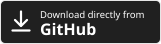</a></p>


<a name="intro"></a>
<section>
<h2>What is CorrectNote?</h2>
<p class="intro-copy">
A notepad for editing text efficiently.<br>
It understands context and fixes typos automatically.<br>
It also lets you<br>
open an input box to take notes even while you are working in another window, and<br>
perform basic operations such as copying nearby text, selecting several lines and moving the cursor<br>
twice as fast as usual.
</p>
<figure class="guide-shot intro-animation"><a href="assets/readme_manual/manual-001.gif">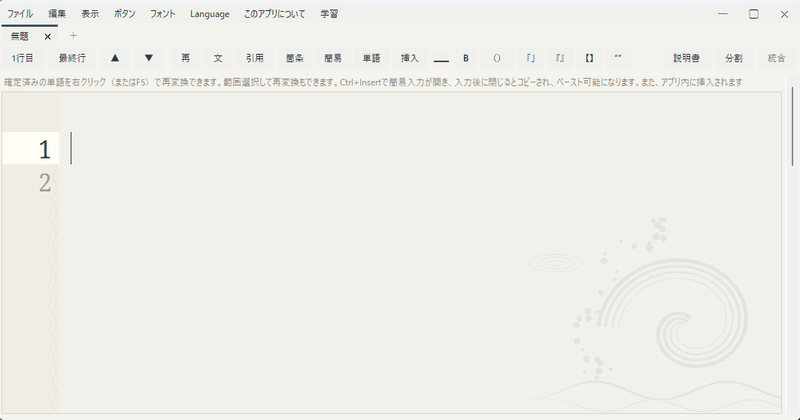</a></figure>
<hr style="border:0;border-top:1px solid var(--rule);margin:18px 0 22px;">

<div class="grid2">
<div class="card">
<h3><span class="dot"></span>Works completely offline</h3>
<p style="margin-bottom:0">
It uses no network connection and no AI. No API and no account are needed.<BR>
What you type never leaves your PC; everything runs locally.
</p>
</div>
</div>
</section>

<a name="picture-index"></a>
<nav class="picture-index" aria-labelledby="contents-heading">
<a name="contents-heading"></a>
<h2>Contents</h2>
<p>Click to jump.</p>
<div class="toc-columns">
<ol class="toc-column">
<li><a href="#screen">The screen</a></li>
<li><a href="#predict">Predictions ― suggesting what comes next</a></li>
<li><a href="#choose">Reconversion ― choosing again from candidates</a><ul><li><a href="#guide-reinput">Re-input conversion ― fix the reading of a confirmed word and convert again (for Japanese input)</a></li></ul></li>
<li><a href="#quick">Quick Input window</a><ul><li><a href="#guide-quick">Draft in Quick Input, close with Esc, and paste into the original field automatically</a></li></ul></li>
<li><a href="#quick-selected-text">Bringing selected text into Quick Input</a></li>
<li><a href="#pick">Picking up words to quote</a><ul><li><a href="#guide-quote">Place the cursor, then click or drag in the text to quote</a></li></ul></li>
<li><a href="#bracket">Wrapping in brackets</a><ul><li><a href="#guide-bracket">Wrap a selection with the button or F2</a></li></ul></li>
<li><a href="#listmode">Bullet lists and character types of a selection</a><ul><li><a href="#guide-list">Click or drag text to list it one item per line</a></li></ul></li>
<li><a href="#wordbook">Word book</a><ul><li><a href="#guide-wordbook">Register text and paste it with a click</a></li></ul></li>
<li><a href="#bulk-insert">Bulk insert</a><ul><li><a href="#guide-bulk">Insert the same text at a set position on several lines</a></li></ul></li>
<li><a href="#lineselect">Selecting whole lines</a></li>
<li><a href="#dragscroll">Scrolling by dragging the margin</a><ul><li><a href="#guide-right-scroll">Scroll by dragging with the right button held</a></li></ul></li>
<li><a href="#overview">Overview ― right double-click</a><ul><li><a href="#guide-overview">Press the right button twice and move while holding the second press</a></li></ul></li>
</ol>
<ol class="toc-column" start="14">
<li><a href="#edit">Basic editing</a><ul><li><a href="#guide-autosave">Close without saving and continue next time</a></li></ul></li>
<li><a href="#wheel-tabs">Switching tabs with the wheel</a><ul><li><a href="#guide-tabs">Switch to another tab with the wheel</a></li></ul></li>
<li><a href="#search-replace">Find and replace</a><ul><li><a href="#guide-search-return">Search with Ctrl+F and go back to where you were</a></li></ul></li>
<li><a href="#goto">Ctrl+G ― go to a line or find text</a></li>
<li><a href="#bookmarks">Bookmarks</a><ul><li><a href="#guide-bookmarks">Add with a double-click on the line number and move with the buttons or Alt+Up/Down</a></li></ul></li>
<li><a href="#keyboard-layout">Keyboard layout and shape</a></li>
<li><a href="#undo-redo">Undo/Redo display</a></li>
<li><a href="#ruler-rows">Marking lines with rulers</a></li>
<li><a href="#toolbar-settings">Showing and reordering buttons</a></li>
<li><a href="#display">Display settings</a><ul><li><a href="#guide-whitespace">Show whitespace marks from the View menu</a></li><li><a href="#guide-typing-pointer">The pointer hides while you type</a></li></ul></li>
<li><a href="#appearance">Appearance ― colors and decorations</a></li>
<li><a href="#ctrl-navigation">Moving the cursor with Ctrl</a><ul><li><a href="#guide-cursor">Ctrl+Left/Right moves the cursor in a way suited to Japanese</a></li><li><a href="#guide-cursor-vertical">Ctrl+Up/Down moves between blocks of text</a></li></ul></li>
<li><a href="#edit-shortcuts">Editing shortcuts</a><ul><li><a href="#guide-capslock">Delete characters with CapsLock</a></li><li><a href="#guide-copy">Copy with F1</a></li><li><a href="#guide-enter">Enter with F3</a></li><li><a href="#guide-paste">Paste with F4</a></li></ul></li>
<li><a href="#shortcuts">Shortcut list</a></li>
<li><a href="#credits">License and sources</a></li>
</ol>
</div>
</nav>

<a name="screen"></a>
<section>
<hr class="section-rule">
<h2>The screen</h2>
<p class="sec-intro">There are two screen layouts.<br>
You can switch at any time with the <b>Side by side</b> and <b>Combine</b> buttons.</p>
<figure class="guide-shot"><a href="assets/readme_manual/manual-098.png">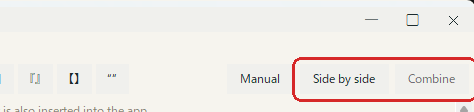</a><br>
<figcaption>Switch the layout with the buttons at the top right of the window.</figcaption></figure>


<hr class="section-rule">

<h3><span class="dot"></span>Side-by-side layout</h3>
<p>When you type in the left pane, typos and unnatural spots are detected automatically and the corrected text is shown on the right.</p>
<div class="mock">
<div class="bar"><div class="dots"><span></span><span></span><span></span></div>CorrectNote</div>
<div class="body">
<div class="pane">
<div class="ptitle">Memo (input)</div>
文字入力を<mark class="s">性格</mark>に反映する
</div>
<div class="pane">
<div class="ptitle">Corrected result</div>
文字入力を<b>正確</b>に反映する
</div>
</div>
</div>

<hr class="section-rule">

<h3><span class="dot"></span>Combined layout</h3>
<p>
A layout that merges the input pane and the correction pane into one, so you can use more of the screen.<BR>
Typos are corrected automatically and replace what you typed.
</p>
<div class="mock">
<div class="bar"><div class="dots"><span></span><span></span><span></span></div>CorrectNote ― Combine</div>
<div class="body">
<div class="pane" style="flex:1">
<div class="ptitle">Memo</div>
文字入力を<mark class="s">性格</mark>に反映する
</div>
</div>
</div>


<hr class="section-rule">

<h3><span class="dot"></span>What the colors mean</h3>
<div class="swatch-row">
<span class="swatch"><i style="background:#f8cdc1;border-color:#e9c9c3"></i>Has correction candidates</span>
<span class="swatch"><i style="background:#e6cbf3"></i>Unnatural string</span>
<span class="swatch"><i style="background:#e9eff1"></i>Word under the mouse (you can choose again)</span>
<span class="swatch"><i style="background:#ffe9a8"></i>Search match</span>
</div>
<figure class="guide-shot"><a href="assets/readme_manual/manual-092.png">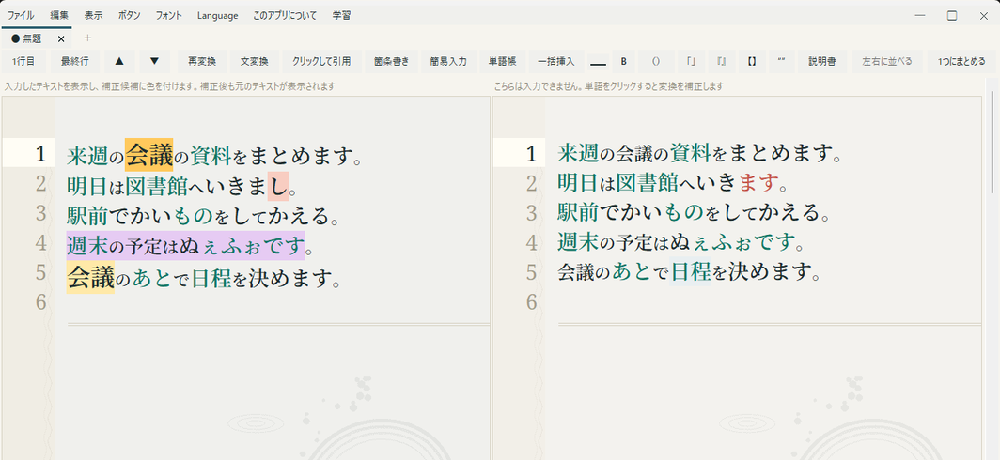</a></figure>

<p>The brown vertical line next to a line number marks a line that is still being analyzed.
When the analysis finishes, the correction is applied and the line disappears.</p>
<figure class="guide-shot"><a href="assets/readme_manual/manual-093.png">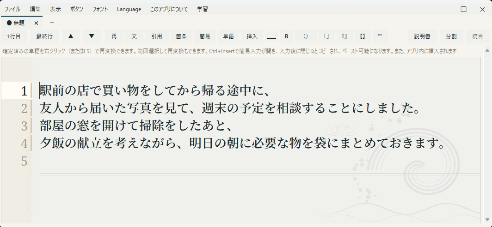</a></figure>
<figure class="guide-shot"><a href="assets/readme_manual/manual-094.png">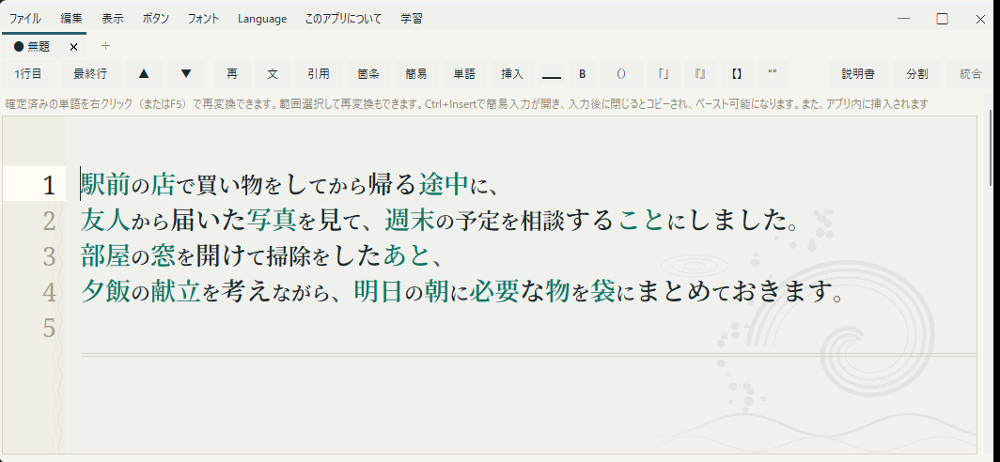</a><figcaption>After the analysis, conjunctions and particles are shown slightly smaller.</figcaption></figure>

</section>

<a name="predict"></a>
<section>
<hr class="section-rule">
<h2>Predictions ― suggesting what comes next</h2>
<p>
When there is no text to the right of the cursor, predictions for what may follow are shown.<BR>
Click one to insert it, or<BR>
press <span class="kbd">F5</span> to select from the candidates.
</p>
<figure class="guide-shot"><a href="assets/readme_manual/manual-095.gif">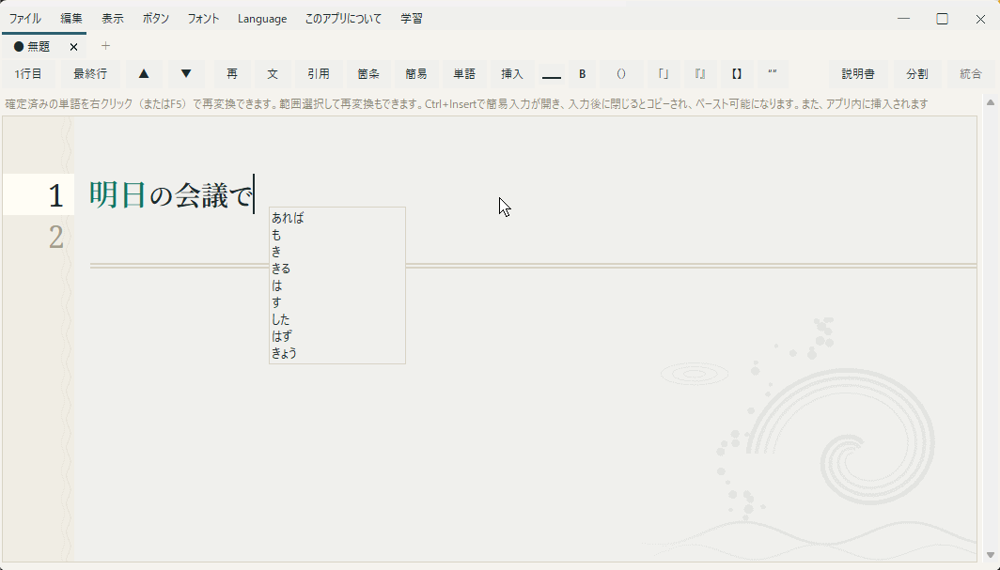</a></figure>
<p>
At the start of a line it suggests heading marks such as 「・ ※ ◆ ■」,<BR>
and at the end of a sentence it suggests 「？ ！ … ⇒」 or closing brackets.<BR>
You can register your own characters for the line-start and sentence-end candidates in the options.
</p>
<figure class="guide-shot"><a href="assets/readme_manual/manual-096.gif">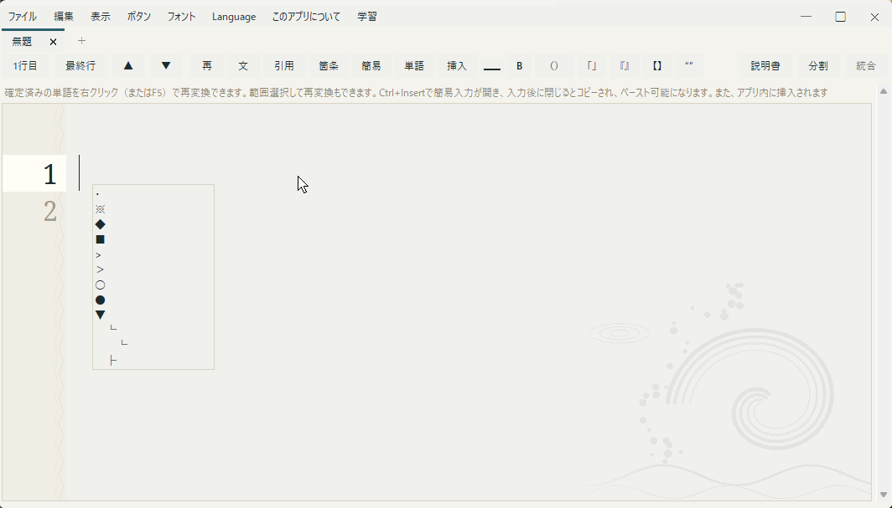</a></figure>
<p>
Press <span class="kbd">F5</span> again and the selection moves back to the left and reconversion starts.
</p>
<p class="guide-back"><a href="#picture-index">Back to contents</a></p>
</section>

<a name="choose"></a>
<section>
<hr class="section-rule">
<h2>Reconversion ― choosing again from candidates</h2>
<p class="sec-intro">You can reconvert words that are already confirmed.</p>

<figure class="guide-shot"><a href="assets/readme_manual/manual-003.gif">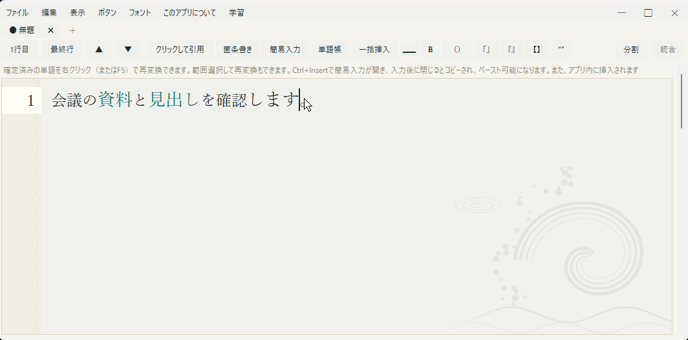</a></figure>

<p>
Press <span class="kbd">F5</span> to select the word at the cursor and open its conversion candidates.<BR>
Each press of <span class="kbd">F5</span> moves the target one word to the left. At the start of a line, the selection goes back to the end of the previous line.
</p>

<h3><span class="dot"></span>Changing the target with Left/Right</h3>
<p>
Use <span class="kbd">←</span><span class="kbd">→</span> to <b>move the target word back and forth</b>.<BR>
Use <span class="kbd">↑</span><span class="kbd">↓</span> to choose a candidate and Enter or Space to confirm.
</p>

<h3><span class="dot"></span>Choosing a range</h3>
<p>
<b>Drag to select a range first</b>, then right-click to look for candidates for that range.
</p>

<h3><span class="dot"></span>Choosing by hovering</h3>
<p>
Rest the mouse on a word for a moment and its candidate list appears.<BR>
Choose with <span class="kbd">↑</span><span class="kbd">↓</span> or a click. If you just start typing, the list closes and your input begins at the cursor.<BR>
It does not appear where a single word cannot be identified, or over a URL.<BR>
You can turn it on or off with “Show candidates on mouse hover” in the Edit menu (on by default).<BR>
Turn on “Show hover candidates only near the text cursor” (off by default) to show them only within 10 lines above or below the line with the text cursor.
</p>

<h3><span class="dot"></span>From the candidate list to re-input conversion</h3>
<p>
While the candidate list is open, press <span class="kbd">Space</span> (or press <span class="kbd">Ctrl</span> twice quickly) before choosing with the arrow keys, and<BR>
<a href="#guide-reinput">re-input conversion</a> starts.
</p>

<p class="guide-back"><a href="#picture-index">Back to contents</a></p>


<a name="guide-reinput"></a>
<article class="picture-guide">
<h3>Re-input conversion ― fix the reading of a confirmed word and convert again (for Japanese input)</h3>
<p>Turn the selection back into hiragana, edit it with the keyboard, and convert it again.</p>
<figure class="guide-shot"><a href="assets/readme_manual/manual-004.gif">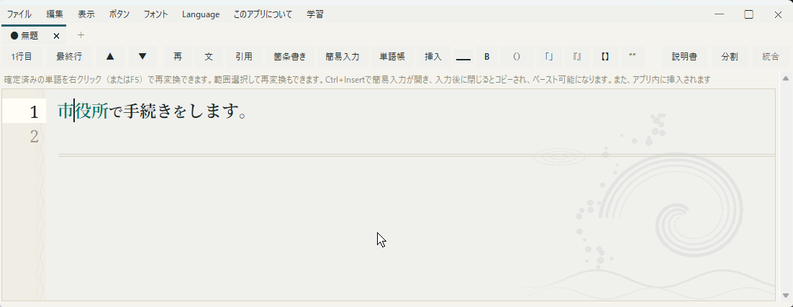</a></figure>

<p>You can also start re-input conversion without F5: just select a range and press Space.</p>
<p class="guide-note">Moving the cursor outside the range ends re-input conversion.<br>If you did not change anything, the original text comes back; if you did, it is converted and finished.</p>
<p class="guide-back"><a href="#picture-index">Back to contents</a></p></article>
</section>

<a name="quick"></a>
<section>
<hr class="section-rule">
<h2>Quick Input window</h2>
<p class="sec-intro">A small window for writing a draft right away, even while you are using another app.<BR>
Quick Input is shown in front of other windows.</p>

<figure class="guide-shot"><a href="assets/readme_manual/manual-005.gif">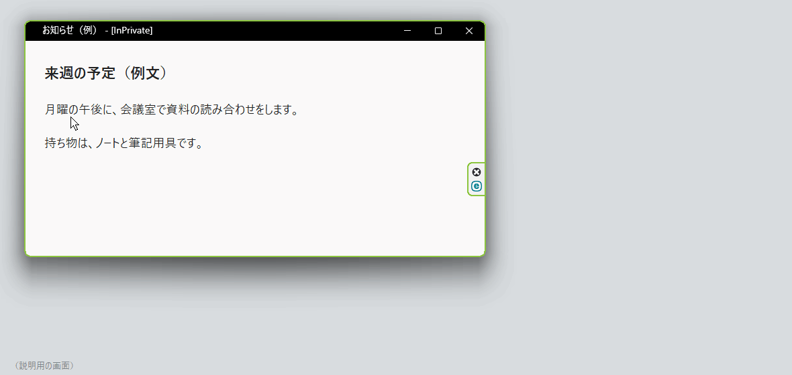</a></figure>

<a name="guide-quick"></a>
<article class="picture-guide">
<h3>Draft in Quick Input, close with Esc, and paste into the original field automatically</h3>
<p>Close the Quick Input window with Esc.<BR>
When it closes, its content is pasted into the input field of the window you were using before you opened it.</p>

<h3><span class="dot"></span>Handy for</h3>
<ul>
<li><b>Jotting down ideas right away.</b> Write whatever comes to mind while you work in Quick Input, and close it with <span class="kbd">Esc</span> to keep it in your memo.</li>
<li><b>Polishing a message before sending it on Slack and the like.</b> In Quick Input, <span class="kbd">Enter</span> adds a line break, so you can write a multi-line draft without worrying about sending it. When you close it with Esc, by default the draft is pasted automatically into the original message field.</li>
</ul>

</article>
</section>

<a name="quick-selected-text"></a>
<section>
<hr class="section-rule">
<h2>Bringing text into Quick Input</h2>
<p>If you select a range and then open Quick Input, the text is copied into the Quick Input window.<BR>
Text shown in a browser can be brought in too.</p>
<figure class="guide-shot"><a href="assets/readme_manual/manual-006.gif">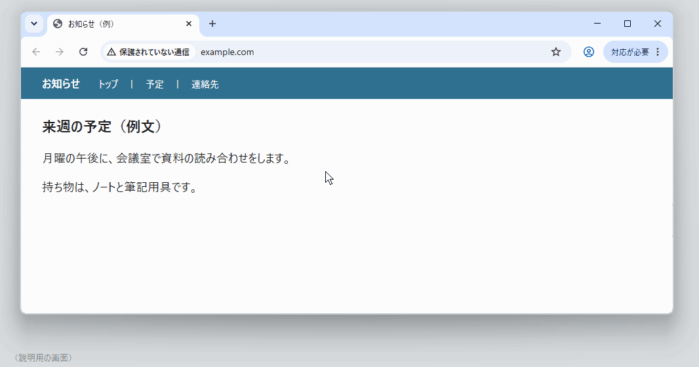</a></figure>

<p>Text from tables such as Excel cells is brought in with tabs between columns and line breaks between rows.</p>

<p class="guide-back"><a href="#picture-index">Back to contents</a></p>
</section>


<a name="pick"></a>
<section>
<hr class="section-rule">
<h2>Picking up words to quote</h2>
<p class="sec-intro">Copies a nearby word to the cursor position.</p>

<figure class="guide-shot"><a href="assets/readme_manual/manual-008.gif"></a></figure>

<a name="guide-quote"></a>
<article class="picture-guide">
Press <b>F1</b> with nothing selected to start quote mode.<BR>
Then click a word or drag over a range: it is copied to the cursor position and quote mode ends.<BR>

<h3><span class="dot"></span>Quoting by line number</h3>
<p>In quote mode, type a line number and press <span class="kbd">Enter</span> to insert the text of that line.<BR>
<b>-1</b> copies the previous line and <b>+1</b> the next line.</p>

<h3><span class="dot"></span>Calculating a formula</h3>
<p>In quote mode, type a formula and press <span class="kbd">Enter</span> to show the result in the correction pane.</p>

<p class="guide-back"><a href="#picture-index">Back to contents</a></p></article>
</section>


<a name="bracket"></a>
<section>
<hr class="section-rule">
<h2>Wrapping in brackets</h2>
<p>You can wrap text in brackets with the toolbar buttons or <B>F2</B>.</p>
<figure class="guide-shot"><a href="assets/readme_manual/manual-009.gif">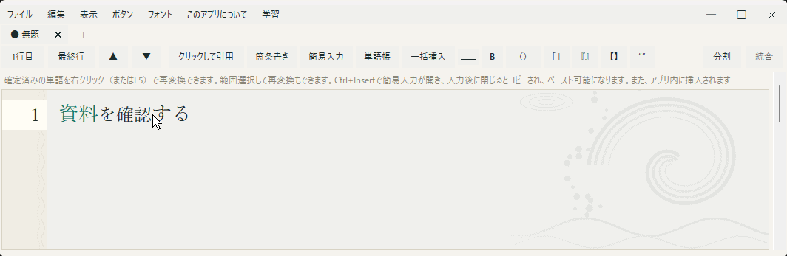</a></figure>

<a name="guide-bracket"></a>
<article class="picture-guide">

<p>With a range selected, the selected text is wrapped in brackets.<BR>
With nothing selected, brackets are inserted at the cursor.</p>
<p>Pressing <span class="kbd">F2</span> repeatedly changes the bracket type in the order （） → 「」 → 『』 → 【】 → “”.<BR>
<span class="kbd">Esc</span> removes the brackets.</p>

<table class="keys">
<tr><th>Button</th><th>Bracket type</th></tr>
<tr><td class="k">（）</td><td>Parentheses</td></tr>
<tr><td class="k">「」</td><td>Japanese corner brackets</td></tr>
<tr><td class="k">『』</td><td>Double corner brackets</td></tr>
<tr><td class="k">【】</td><td>Lenticular brackets</td></tr>
<tr><td class="k">“”</td><td>Double quotation marks</td></tr>
</table>

<p class="guide-back"><a href="#picture-index">Back to contents</a></p></article>
</section>


<a name="listmode"></a>
<section>
<hr class="section-rule">
<h2>Bullet lists</h2><a name="guide-list"></a>
<article class="picture-guide">

<p>Lists items one per line in the order you select them.</p>
<figure class="guide-shot"><a href="assets/readme_manual/manual-010.gif">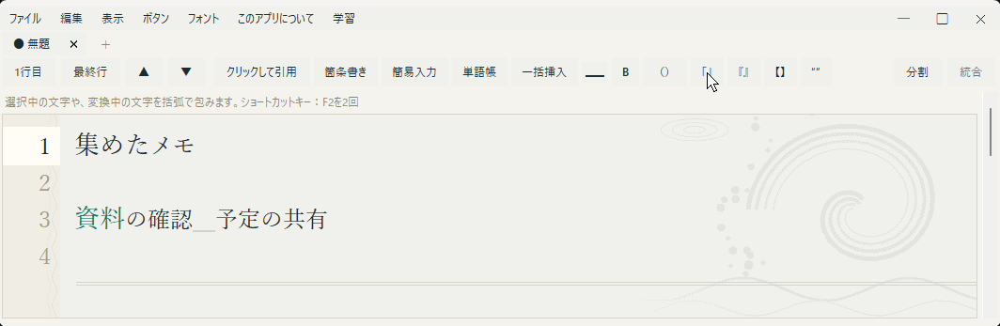</a></figure>


<p>Press <b>Bullet list</b> in the toolbar to start bullet-list mode.<BR>
Click a word in the text or drag over a range, and it is copied below the cursor line.<BR>
Bullet-list mode stays on after copying, so the next range you select is copied to the line below again.<BR>
<span class="kbd">Esc</span> ends bullet-list mode.</p>


<h3><span class="dot"></span>Tidying up text sent from Quick Input</h3>
<p>After closing Quick Input and sending its text to the memo, press <b>Bullet list</b> while the background color is still shown,<BR>
and the colored parts are listed one per line.</p>

<p class="guide-back"><a href="#picture-index">Back to contents</a></p></article>


<hr class="section-rule">

<h3><span class="dot"></span>Changing the character type of a selection (for Japanese input)</h3>
<p>Convert the selection to hiragana with <span class="kbd">F6</span>, katakana with <span class="kbd">F7</span>, and half-width with <span class="kbd">F8</span>.<BR>
<span class="kbd">F9</span> converts it to the alphanumeric keys of the JIS kana layout.</p>

<figure class="guide-shot"><a href="assets/readme_manual/manual-013.gif">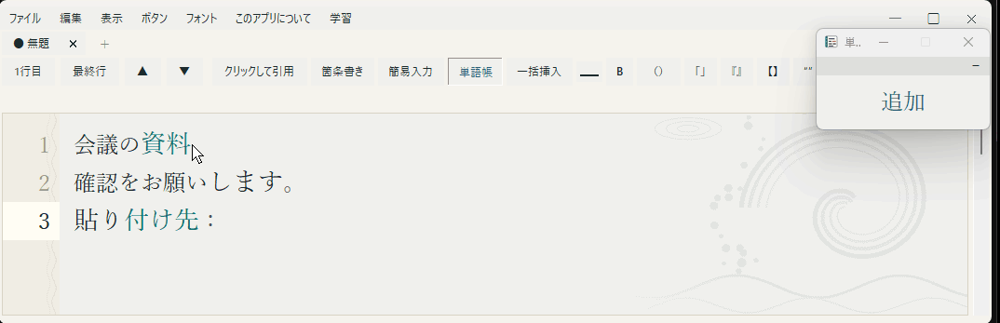</a><figcaption>Confirmed text also turns into hiragana with F6.</figcaption></figure>

<p class="guide-back"><a href="#picture-index">Back to contents</a></p>
</section>


<a name="wordbook"></a>
<section>
<hr class="section-rule">
<h2>Word book</h2>
<p class="sec-intro">Register words you use often and paste them with a click.<BR>
You can also paste them into other apps or a browser.</p>

<figure class="guide-shot"><a href="assets/readme_manual/manual-016.gif">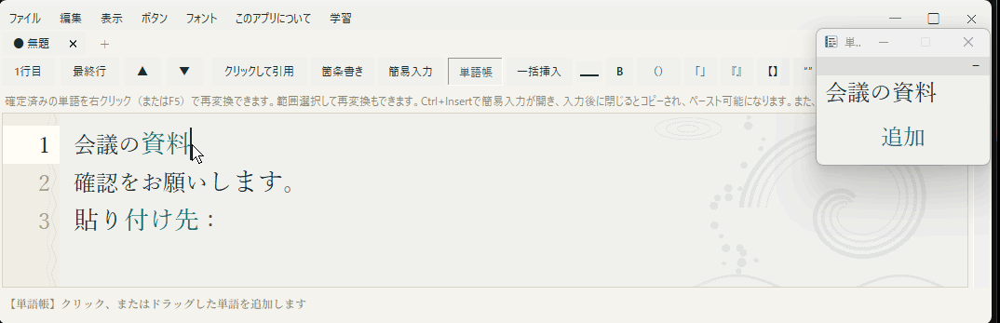</a><figcaption>Click a word in the word book and it is inserted at the cursor.<BR>
</figcaption></figure>

<h3><span class="dot"></span>Registering</h3>
<p>Press <b>Add</b> in the word book, then click a word in the text or drag over a range to register it.</p>

<figure class="guide-shot"><a href="assets/readme_manual/manual-099.png">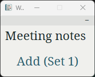</a></figure>

<p><span class="kbd">Ctrl+Alt+Insert</span> or <span class="kbd">Ctrl+Alt+Shift+-</span> opens and closes the word book even while you are using another app.</p>

<p>Press and hold a word and move it up or down to reorder.<BR>
To delete a word, right-click it and choose “Delete”.</p>
<figure class="guide-shot"><a href="assets/readme_manual/manual-014.png">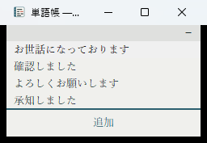</a></figure>

<a name="guide-wordbook"></a>
<article class="picture-guide">

<p class="guide-back"><a href="#picture-index">Back to contents</a></p></article>
</section>

<a name="bulk-insert"></a>
<section>
<hr class="section-rule">
<h2>Bulk insert</h2>
<a name="guide-bulk"></a>
<article class="picture-guide">
<h3>Insert the same text at a set position on several lines</h3>
<p>Inserts the same text at the same position on each selected line at once.</p>
<p>Select a range and press <b>Bulk insert</b>.<BR>
Choose “From start” or “From end”, set the position, and type the text to insert.<BR>

<figure class="guide-shot"><a href="assets/readme_manual/manual-022.png"></a><figcaption>A vertical line shows the insert position.</figcaption></figure>

<figure class="guide-shot"><a href="assets/readme_manual/manual-023.png">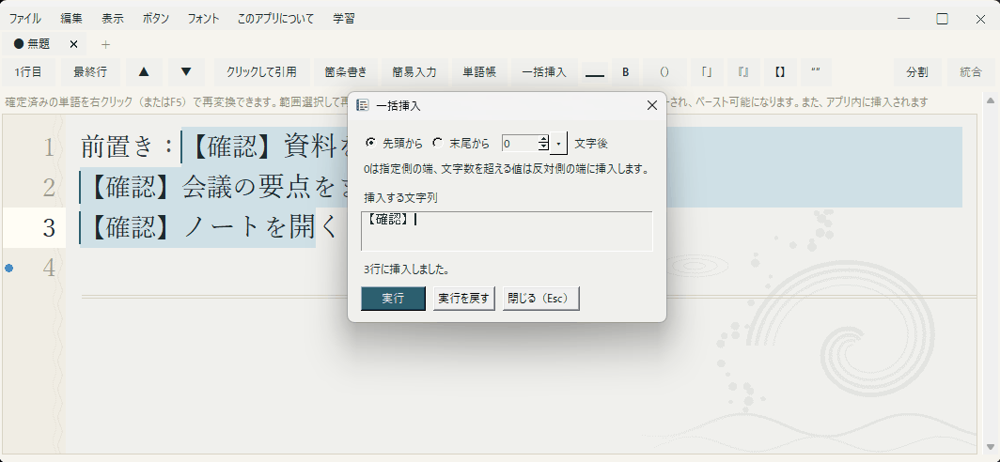</a><figcaption>「【確認】」 has been inserted on each line.</figcaption></figure>
<p><b>Undo run</b> cancels the last bulk insert. <span class="kbd">Esc</span> closes the window.</p>
<p class="guide-back"><a href="#picture-index">Back to contents</a></p></article>
</section>

<a name="lineselect"></a>
<section>
<hr class="section-rule">
<h2>Selecting whole lines</h2>

<p>Blank lines at the top and bottom edges of a selection are left out automatically.</p>
<figure class="guide-shot"><a href="assets/readme_manual/manual-027.gif"></a><figcaption>On release, only the lines with text are selected.</figcaption></figure>

<p>Click a line number to select that line.<BR>
Drag up or down to select several lines.</p>
<figure class="guide-shot"><a href="assets/readme_manual/manual-026.gif">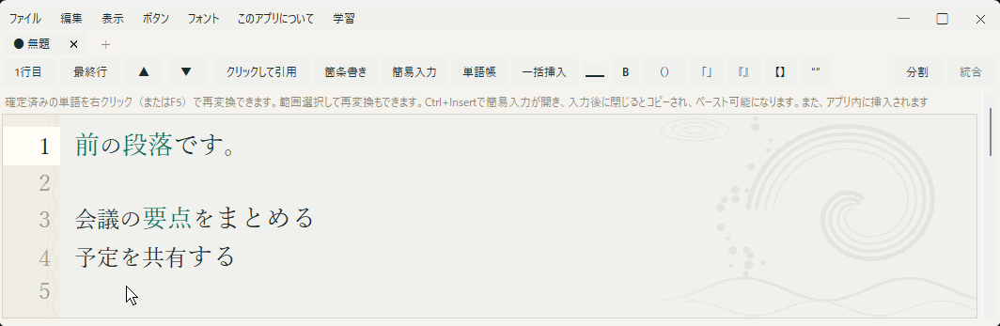</a></figure>


<h3><span class="dot"></span>Selecting with the keyboard</h3>
<p><b>Shift+Space</b> selects the line with the cursor.<BR>
Press it again to copy.<BR>

<figure class="guide-shot"><a href="assets/readme_manual/manual-028.gif">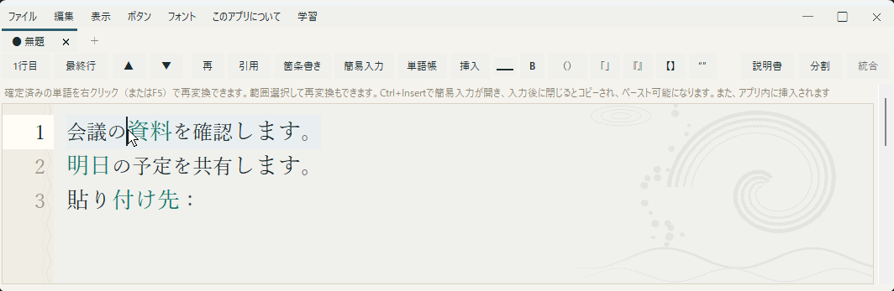</a></figure>

<h3><span class="dot"></span>Scrolling from the line-number menu</h3>
<p>Right-click a line number and choose <b>Scroll so this line is at the top</b> to bring that line to the top of the screen.<BR>
The same menu can also put it in the middle.</p>
<figure class="guide-shot"><a href="assets/readme_manual/manual-029.gif">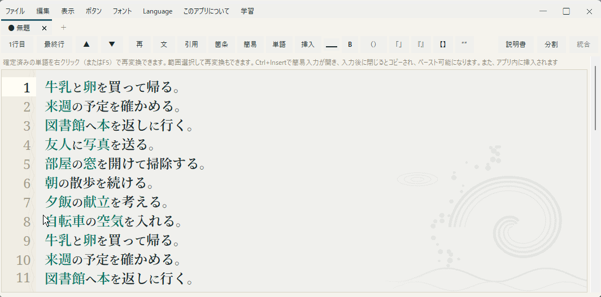</a><figcaption>Line 9 comes to the top of the screen.</figcaption></figure>
</section>

<a name="dragscroll"></a>
<section>
<hr class="section-rule">
<h2>Scrolling by dragging the margin</h2>
<p class="sec-intro">Hold the right button on an empty margin and move up or down to scroll the screen.<BR>
On a touch screen, you can scroll by swiping with one finger.</p>
<a name="guide-right-scroll"></a>
<article class="picture-guide">
<h3>Scroll by dragging with the right button held</h3>
<figure class="guide-shot"><a href="assets/readme_manual/manual-090.gif">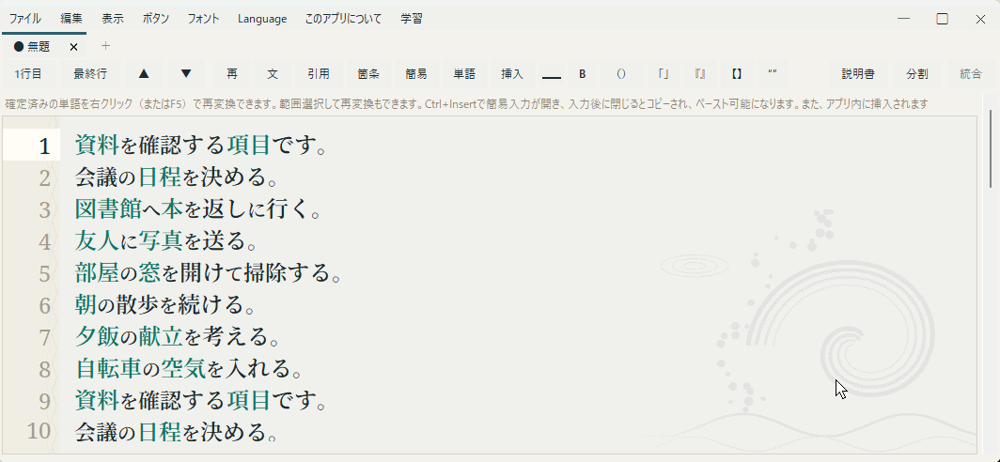</a></figure>
<p class="guide-back"><a href="#picture-index">Back to contents</a></p></article>
</section>

<a name="overview"></a>
<section>
<hr class="section-rule">
<h2>Overview ― right double-click</h2>
<p class="sec-intro">Jump straight to the place you want in a long memo.</p>
<p>Double-click the right button and keep holding the second press: the text shrinks so you can see a wide range.<BR>
Move up or down while holding to scroll, and release to return to normal size.</p>
<a name="guide-overview"></a>
<article class="picture-guide">
<h3>Press the right button twice and move while holding the second press</h3>
<figure class="guide-shot"><a href="assets/readme_manual/manual-033.gif">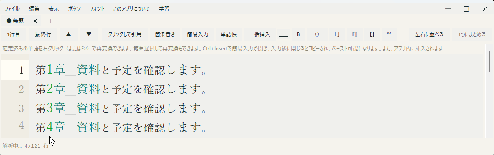</a><figcaption>Move while holding; release to return to normal size.</figcaption></figure>
<figure class="guide-shot"><a href="assets/readme_manual/manual-035.png">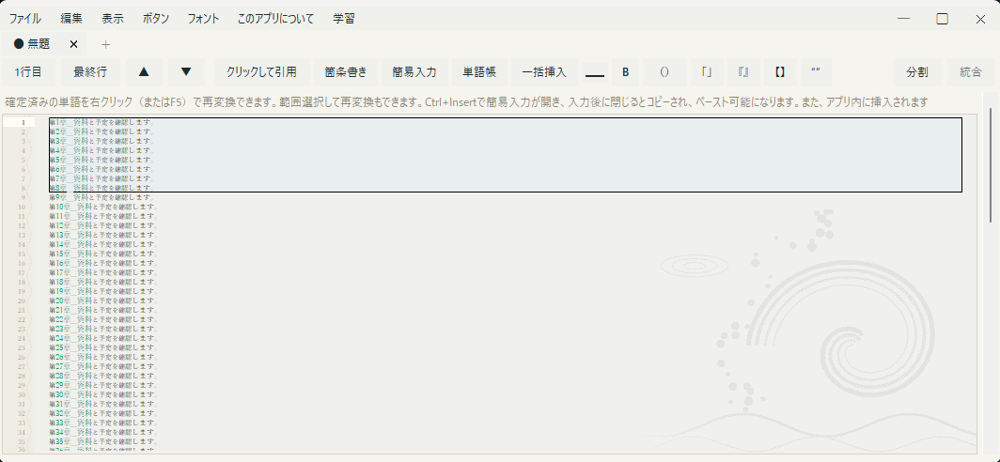</a></figure>
<p class="guide-back"><a href="#picture-index">Back to contents</a></p></article>
</section>

<a name="edit"></a>
<section>
<hr class="section-rule">
<h2>Basic editing</h2>

<h3><span class="dot"></span>Opening several memos in tabs</h3>
<p>The + button opens a new tab. Drag tabs to reorder them.</p>
<table class="keys">
<tr><th>Key</th><th>Action</th></tr>
<tr><td class="k"><span class="combo"><span class="kbd">Ctrl</span>+<span class="kbd">Tab</span></span> /
<span class="combo"><span class="kbd">Ctrl</span>+<span class="kbd">PageDown</span></span></td><td>Next tab</td></tr>
<tr><td class="k"><span class="combo"><span class="kbd">Ctrl</span>+<span class="kbd">Shift</span>+<span class="kbd">Tab</span></span> /
<span class="combo"><span class="kbd">Ctrl</span>+<span class="kbd">PageUp</span></span></td><td>Previous tab</td></tr>
<tr><td class="k"><span class="combo"><span class="kbd">Ctrl</span>+<span class="kbd">T</span></span></td><td>Open a new tab</td></tr>
<tr><td class="k"><span class="combo"><span class="kbd">Ctrl</span>+<span class="kbd">W</span></span></td><td>Close the current tab</td></tr>
</table>
<p>Right-click a tab to choose <b>Move to first tab</b> or <b>Show in a separate window</b>.</p>
<figure class="guide-shot"><a href="assets/readme_manual/manual-038.png">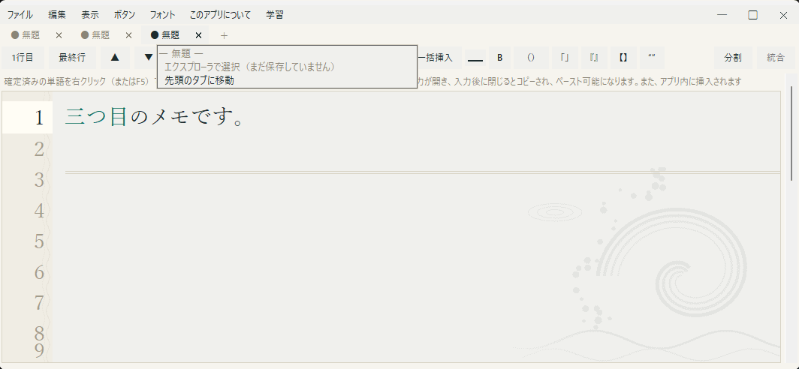</a><figcaption>The menu shown when you right-click a tab.</figcaption></figure>

<hr class="section-rule">

<a name="guide-autosave"></a>
<h3><span class="dot"></span>Auto-save</h3>
<p>What you write is saved automatically for each tab.<BR>
Even if you close without saving, you can continue where you left off next time.</p>

<hr class="section-rule">

<h3><span class="dot"></span>Backups</h3>
<p>A backup of each changed tab is made once a day, and up to five are kept per tab.<BR>
Right-click a tab to see its list of backups; choose one to view its contents.<BR>
You can also make one on the spot with <b>File → Create a backup manually</b>.</p>

<hr class="section-rule">

<h3><span class="dot"></span>Showing the copied range</h3>
<p>The copied range is outlined with a white frame and its text is shown larger.</p>

<hr class="section-rule">

<h3><span class="dot"></span>Encoding and line endings</h3>
<p>Files are saved with the encoding (UTF-8, Shift_JIS, UTF-16) and line endings they were opened with.<BR>
You can change this with <b>File → Encoding of this tab</b>.</p>
</section>

<a name="wheel-tabs"></a>
<section>
<hr class="section-rule">
<h2>Switching tabs with the wheel</h2>
<p>Turning the wheel over the tabs moves to the next tab: down moves right and up moves left.<BR>
Over the text, turn the wheel while holding the right button.</p>
<a name="guide-tabs"></a>
<article class="picture-guide">
<h3>Switch to another tab with the wheel</h3>
<figure class="guide-shot"><a href="assets/readme_manual/manual-039.gif">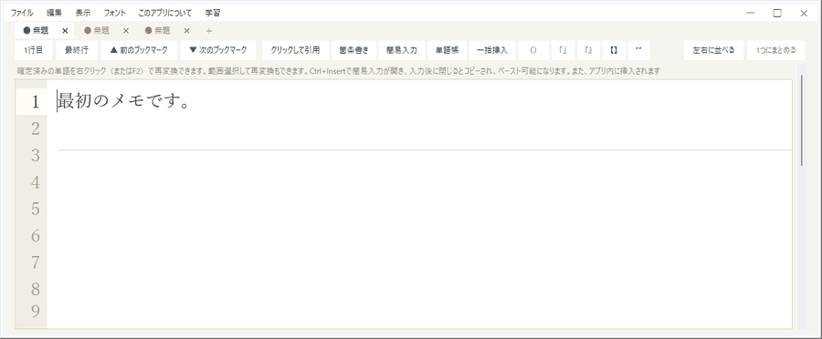</a><figcaption>Turn down for the next tab and up for the previous tab.</figcaption></figure>
<p class="guide-back"><a href="#picture-index">Back to contents</a></p></article>
</section>

<a name="search-replace"></a>
<section>
<hr class="section-rule">
<h2>Find and replace</h2>
<p><span class="kbd">Ctrl+F</span> opens Find and <span class="kbd">Ctrl+H</span> opens Replace.<BR>
Matches are shown enlarged.</p>
<figure class="guide-shot"><a href="assets/readme_manual/manual-087.png">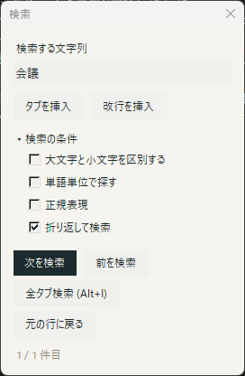</a></figure>

<p><b>Search all tabs</b> searches every tab and lists the results.<BR>
You can also search all tabs by selecting text and pressing <span class="kbd">Alt+I</span>.</p>
<a name="guide-search-return"></a>
<article class="picture-guide">
<h3>Search with Ctrl+F and go back to where you were</h3>
<p>After a search has moved you, press <b>Back to original line</b> to return to where the cursor was before the search.</p>
<figure class="guide-shot"><a href="assets/readme_manual/manual-086.png">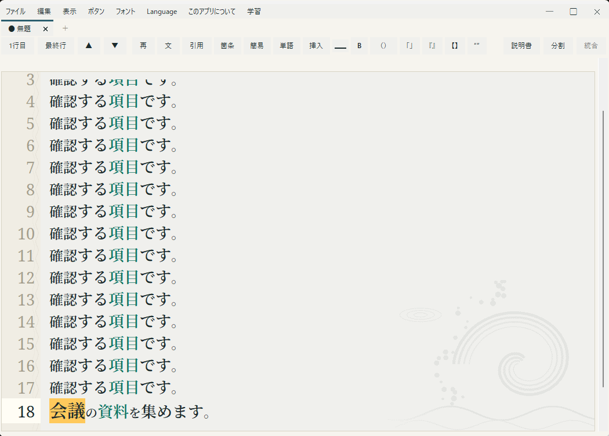</a><figcaption>Moved to where 「会議」 was found.</figcaption></figure>


<p class="guide-back"><a href="#picture-index">Back to contents</a></p></article>
</section>

<a name="goto"></a>
<section>
<hr class="section-rule">
<h2>Ctrl+G ― go to a line or find text</h2>
<p class="sec-intro"><span class="kbd">Ctrl+G</span> opens an input box; type a line number or some text and press <span class="kbd">Enter</span> to go there.<BR>
<span class="kbd">Esc</span> closes it.</p>
<figure class="guide-shot"><a href="assets/readme_manual/manual-048.png">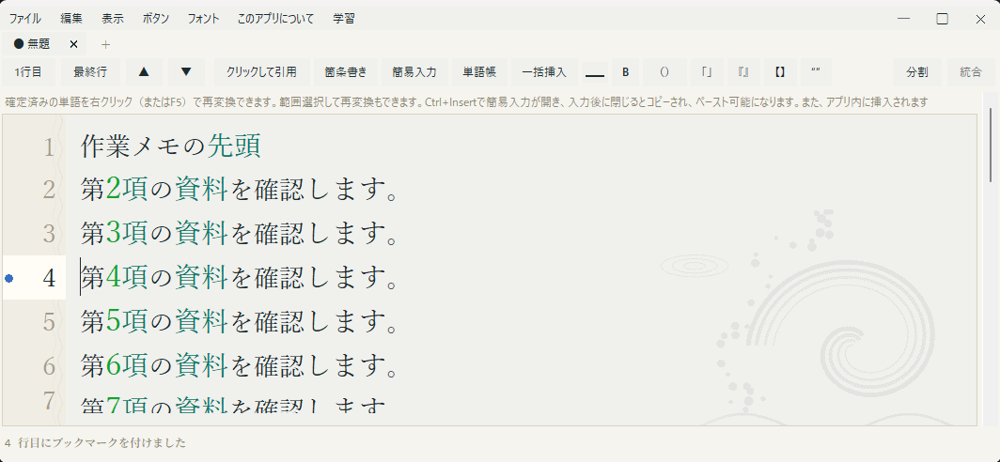</a><figcaption>Type a line number or the text you are looking for.</figcaption></figure>
<figure class="guide-shot"><a href="assets/readme_manual/manual-049.png">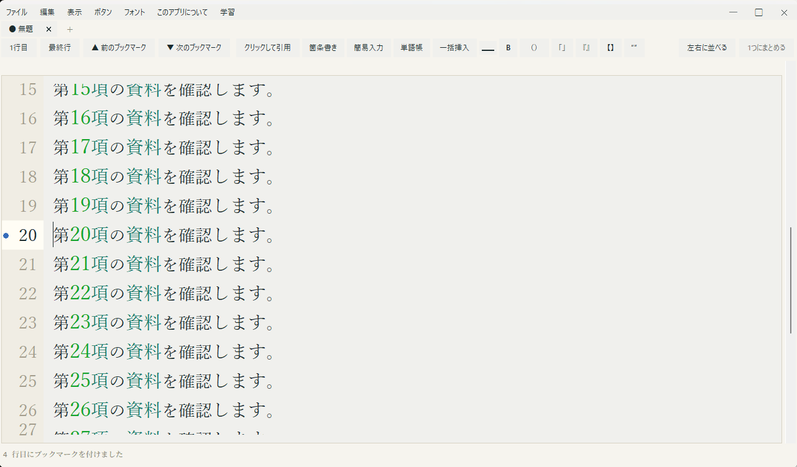</a><figcaption>The cursor moved to the end of 「公園」.</figcaption></figure>
<p class="guide-back"><a href="#picture-index">Back to contents</a></p>
</section>

<a name="bookmarks"></a>
<section>
<hr class="section-rule">
<h2>Bookmarks</h2>
<p>Double-click a line number to bookmark that line.<BR>
The <span class="kbd">Break</span> key and <span class="kbd">Ctrl+Space</span> also toggle bookmarks.<BR>
Use <b>▲ Previous bookmark</b> / <b>▼ Next bookmark</b> or <span class="kbd">Alt+↑</span> <span class="kbd">Alt+↓</span> to move to bookmarked lines.</p>
<a name="guide-bookmarks"></a>
<article class="picture-guide">
<h3>Add with a double-click on the line number and move with the buttons or Alt+Up/Down</h3>
<figure class="guide-shot"><a href="assets/readme_manual/manual-050.gif">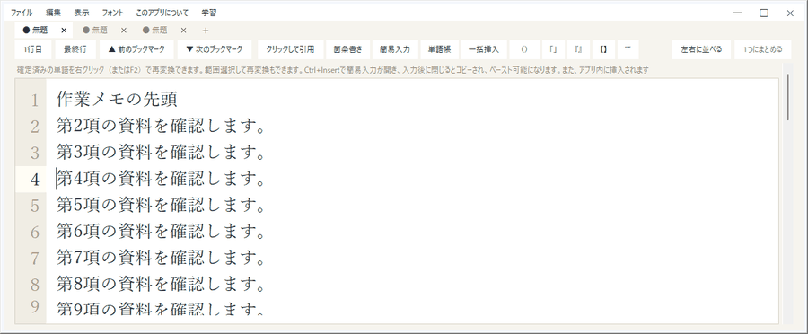</a><figcaption>Moves to the next or previous bookmark.</figcaption></figure>
<p class="guide-back"><a href="#picture-index">Back to contents</a></p></article>
<h3><span class="dot"></span>Making a table of contents from bookmarks</h3>
<p>Bookmarked lines are listed automatically in a table of contents above the text.<BR>
The entries are blue underlined text; click one to go to that line.<BR>
If a bookmarked line is empty, the next line with text is listed instead.<BR>
With no bookmarks, no table of contents is shown.</p>
</section>

<a name="keyboard-layout"></a>
<section>
<hr class="section-rule">
<h2>Keyboard layout and shape</h2>
<p class="sec-intro">Choose the layout and shape of your keyboard.<BR>
Auto-correction uses it when looking for mistyped keys.<BR>
Choose from <b>View → Keyboard layout and shape</b>.</p>
<figure class="guide-shot"><a href="assets/readme_manual/manual-100.png">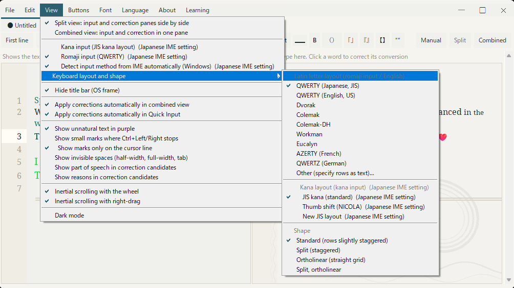</a><figcaption>Choose the letter layout, kana layout and shape.</figcaption></figure>
<table class="keys">
<tr><th>Group</th><th>Options</th><th>Applies to</th></tr>
<tr><td>Letter layout</td><td>QWERTY (Japanese, JIS), QWERTY (English, US), Dvorak, Colemak, Colemak-DH, Workman, Eucalyn, AZERTY (French), QWERTZ (German), Other (specify rows as text)</td><td>Romaji input, English</td></tr>
<tr><td>Kana layout</td><td>JIS kana (standard), Thumb shift (NICOLA), New JIS</td><td>Kana input</td></tr>
<tr><td>Shape</td><td>Standard (rows slightly staggered), Split (staggered), Ortholinear (straight grid), Split ortholinear</td><td>Romaji input, kana input, English</td></tr>
</table>

<p class="guide-back"><a href="#picture-index">Back to contents</a></p>
</section>

<a name="undo-redo"></a>
<section>
<hr class="section-rule">
<h2>Undo/Redo display</h2>
<p>After undoing with <span class="kbd">Ctrl+Z</span>, the text that the next undo will remove is underlined.<BR>
After redoing, the restored text is underlined.</p>
<figure class="guide-shot"><a href="assets/readme_manual/manual-056.png">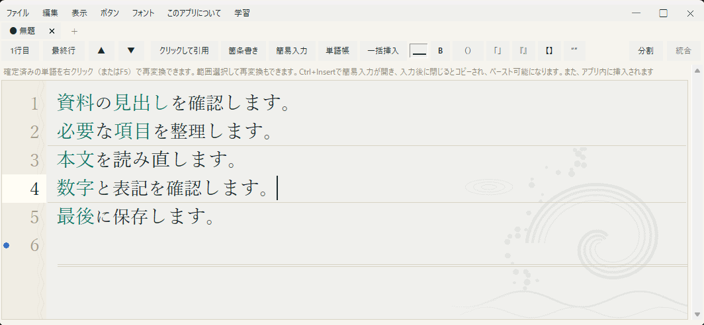</a><figcaption>「大切な」, which the next undo removes, is underlined.</figcaption></figure>
<figure class="guide-shot"><a href="assets/readme_manual/manual-057.png">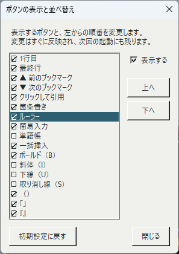</a><figcaption>「新しい」, restored by redo, is underlined.</figcaption></figure>
<p class="guide-back"><a href="#picture-index">Back to contents</a></p>
</section>

<a name="ruler-rows"></a>
<section>
<hr class="section-rule">
<h2>Marking lines with rulers</h2>
<p>Press the horizontal-line button (─) at the top to place a line on the cursor's line.<BR>
Press it again on the same line to remove it. Rulers remain after a restart.</p>
<figure class="guide-shot"><a href="assets/readme_manual/manual-058.png"></a><figcaption>An example with rulers on lines 2 and 4.</figcaption></figure>
<p class="guide-back"><a href="#picture-index">Back to contents</a></p>
</section>

<a name="toolbar-settings"></a>
<section>
<hr class="section-rule">
<h2>Showing and reordering buttons</h2>
<p>From <b>Buttons → Show and reorder…</b>, choose which buttons are shown and in what order.<BR>
Use the checkbox on the left to show or hide a button, and <b>Up</b> / <b>Down</b> to change the order.</p>
<figure class="guide-shot"><a href="assets/readme_manual/manual-101.png">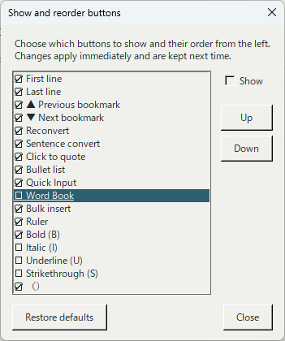</a><figcaption>An example with “Word Book” hidden.</figcaption></figure>
<figure class="guide-shot"><a href="assets/readme_manual/manual-102.png">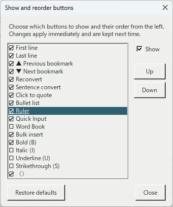</a><figcaption>An example with “Ruler” moved before “Quick Input”.</figcaption></figure>
<h3><span class="dot"></span>Format buttons (B, I, U, S)</h3>
<p>Make the selected text bold, italic, underlined or struck through. Only Bold is shown by default.<BR>
If you copy with formatting, you can paste it as is into Excel or Word.<BR>
Formatting is not stored in the saved text file.</p>
<p class="guide-back"><a href="#picture-index">Back to contents</a></p>
</section>

<a name="display"></a>
<section>
<hr class="section-rule">
<h2>Display settings</h2>
<h3><span class="dot"></span>Font</h3>
<p><b>Font → Choose font and size…</b> changes the typeface and size of the text.<BR>
<b>Font → Size multiplier and text color by part of speech…</b> lets you change the size and color of the text for each part of speech.</p>
<figure class="guide-shot">
<a href="assets/readme_manual/manual-103.svg">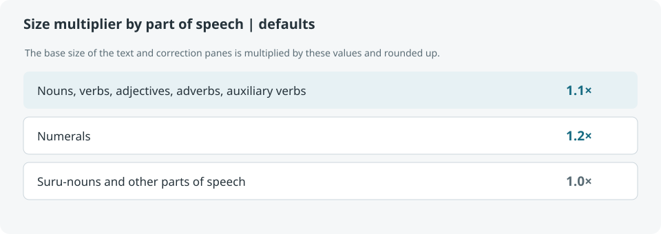</a>
<figcaption>Size multipliers by part of speech (defaults)</figcaption>
</figure>
<figure class="guide-shot">
<a href="assets/readme_manual/manual-104.svg">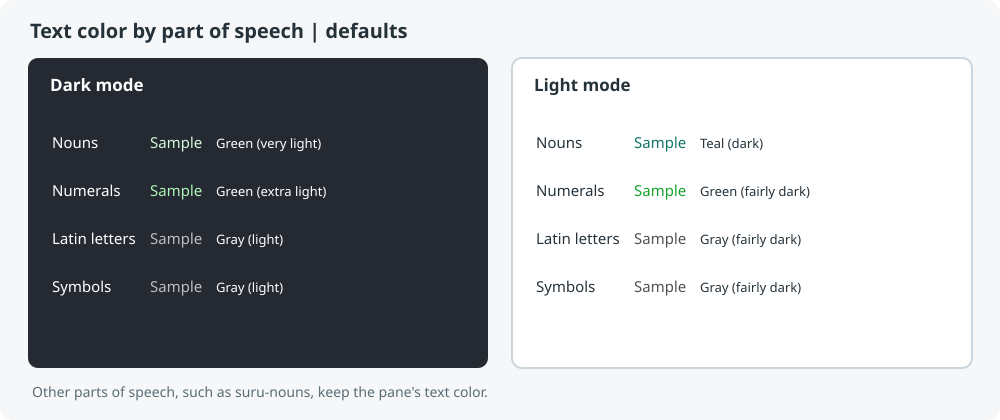</a>
<figcaption>Text colors by part of speech (defaults)</figcaption>
</figure>

<hr class="section-rule">

<h3><span class="dot"></span>Dark mode</h3>
<p>Switch with <b>View → Dark mode</b>. Other color schemes are in <a href="#appearance">Appearance</a>.</p>
<a name="memory-usage"></a>

<hr class="section-rule">

<a name="guide-whitespace"></a>
<article class="picture-guide">
<h3>Show whitespace marks from the View menu</h3>
<p><b>View → Show invisible spaces (half-width, full-width, tab)</b> marks the spaces.<BR>
The marks are only on screen and are not stored in the saved file.</p>
<figure class="guide-shot"><a href="assets/readme_manual/manual-065.png">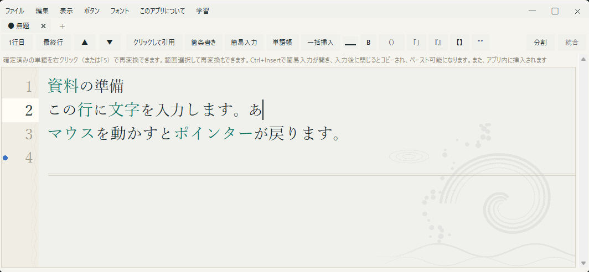</a><figcaption>The spaces are now marked.</figcaption></figure>


</article>
<hr class="section-rule">

<a name="guide-typing-pointer"></a>
<article class="picture-guide">
<h3>The pointer hides while you type</h3>
<p>When you type, the mouse pointer is hidden. Move the mouse to bring it back.</p>
<p class="guide-back"><a href="#picture-index">Back to contents</a></p></article>
</section>

<a name="appearance"></a>
<section>
<hr class="section-rule">
<h2>Appearance ― colors and decorations</h2>
<p class="sec-intro">Choose the app's color scheme and a faint picture laid behind the text.<BR>
Choose from <b>About → Appearance</b>. Hovering over an item previews it.</p>
<figure class="guide-shot"><a href="assets/readme_manual/manual-105.png">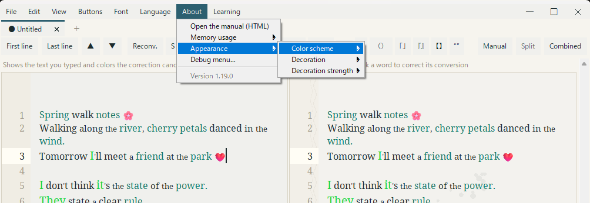</a><figcaption>Choose the color scheme, decoration and decoration strength.</figcaption></figure>
<table class="keys">
<tr><th>Item</th><th>Options</th></tr>
<tr><td>Color scheme</td><td>Standard (light), Matcha, Sky / Standard (dark), Night, Charcoal</td></tr>
<tr><td>Decoration</td><td>None / Japanese patterns, Manuscript paper, Starry sky, Cherry blossoms, Plants, Ink and washi, Fans and obi, Creatures, Waves</td></tr>
<tr><td>Decoration strength</td><td>Light, Normal, Strong</td></tr>
</table>
<figure class="guide-shot"><a href="assets/readme_manual/manual-106.png">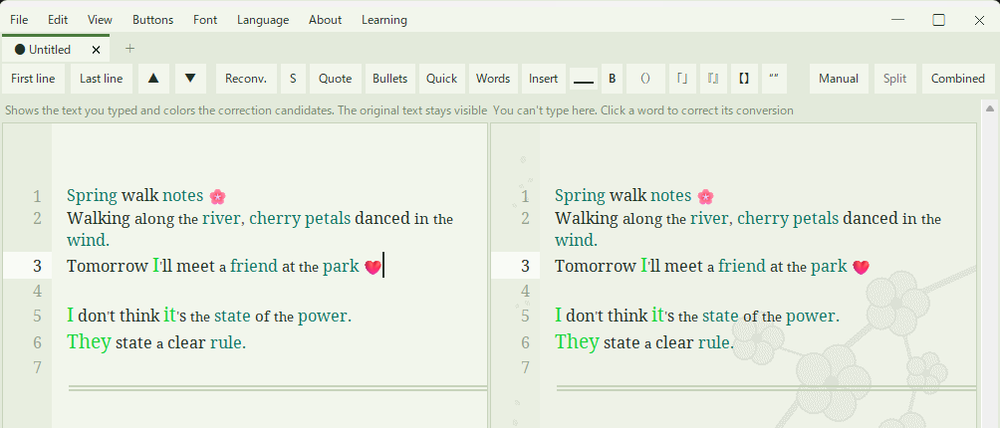</a><figcaption>“Matcha” + “Cherry blossoms” (strength: Normal)</figcaption></figure>
<figure class="guide-shot"><a href="assets/readme_manual/manual-107.png">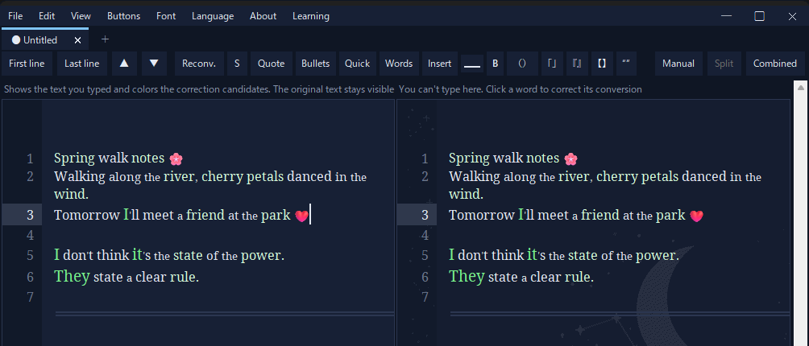</a><figcaption>“Night” + “Starry sky” (strength: Normal)</figcaption></figure>
<figure class="guide-shot"><a href="assets/readme_manual/manual-108.png">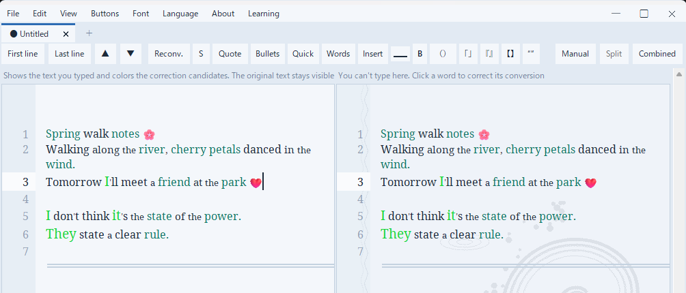</a><figcaption>“Sky” + “Waves” (strength: Normal)</figcaption></figure>
<p class="guide-back"><a href="#picture-index">Back to contents</a></p>
</section>

<a name="ctrl-navigation"></a>
<section>
<hr class="section-rule">
<h2>Moving the cursor with Ctrl</h2>
<a name="guide-cursor"></a>
<article class="picture-guide">
<h3>Ctrl+Left/Right moves the cursor in a way suited to Japanese</h3>
<p>Ctrl+Left/Right moves the cursor by breaks such as particles and punctuation.<BR>
While Ctrl is held, the stopping points are shown with a gray underline.</p>
<figure class="guide-shot"><a href="assets/readme_manual/manual-072.gif">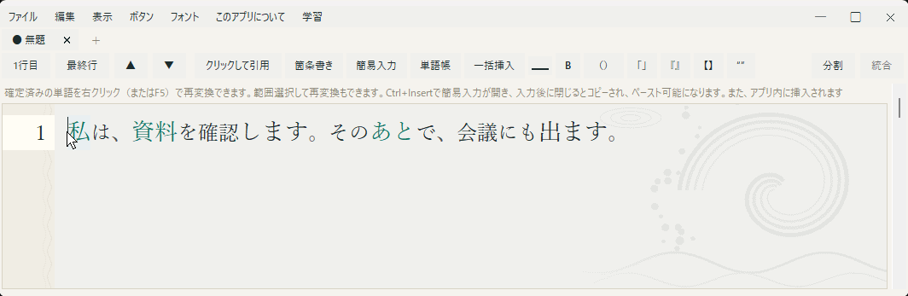</a><figcaption>While Ctrl is held, the stopping points are underlined.</figcaption></figure>
</article>


<hr class="section-rule">

<a name="guide-cursor-vertical"></a>
<article class="picture-guide">
<h3>Ctrl+Up/Down moves between blocks of text</h3>
<p>Ctrl+Up/Down moves to the start or end of a block separated by blank lines.</p>
<figure class="guide-shot"><a href="assets/readme_manual/manual-076.svg">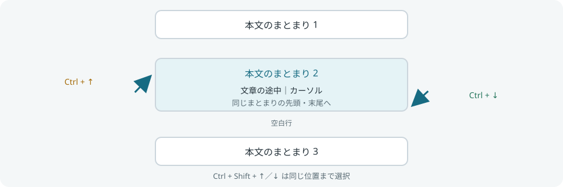</a><figcaption>Ctrl+↑/↓ moves to the start/end of a block.</figcaption></figure>
<p class="guide-back"><a href="#picture-index">Back to contents</a></p></article>
</section>

<a name="edit-shortcuts"></a>
<section>
<hr class="section-rule">
<h2>Editing shortcuts</h2>
<a name="guide-capslock"></a>
<article class="picture-guide">
<h3>Delete characters with CapsLock</h3>
<p>CapsLock can be used like BackSpace. You can turn this on or off in the Edit menu.</p>


</article>
<hr class="section-rule">

<a name="guide-copy"></a>
<article class="picture-guide">
<h3>Copy with F1</h3>
<p>F1 copies the selected text. With nothing selected, it starts quote mode.</p>


</article>
<hr class="section-rule">

<a name="guide-enter"></a>
<article class="picture-guide">
<h3>Enter with F3</h3>
<p>F3 starts a new line, just like Enter.</p>
<figure class="guide-shot"><a href="assets/readme_manual/manual-082.gif">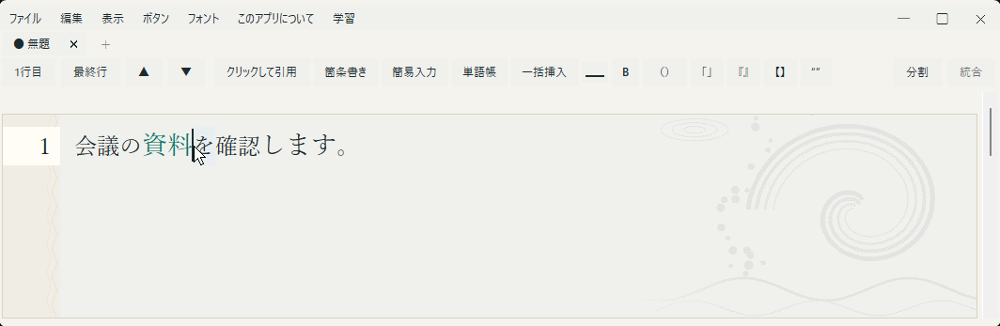</a><figcaption>A line break is inserted at the cursor.</figcaption></figure>

</article>
<hr class="section-rule">

<a name="guide-paste"></a>
<article class="picture-guide">
<h3>Paste with F4</h3>
<p>F4 pastes, just like Ctrl+V.</p>
<p class="guide-back"><a href="#picture-index">Back to contents</a></p></article>

</section>

<a name="shortcuts"></a>
<section>
<hr class="section-rule">
<h2>Shortcut list</h2>
<table class="keys">
<tr><th>Key</th><th>Action</th></tr>
<tr><td class="k"><span class="kbd">Ctrl</span>+<span class="kbd">N</span><br><span class="kbd">Ctrl</span>+<span class="kbd">T</span></td><td>Open a new tab</td></tr>
<tr><td class="k"><span class="kbd">Ctrl</span>+<span class="kbd">W</span></td><td>Close the current tab</td></tr>
<tr><td class="k"><span class="kbd">Ctrl</span>+<span class="kbd">O</span></td><td>Open</td></tr>
<tr><td class="k"><span class="kbd">Ctrl</span>+<span class="kbd">S</span></td><td>Save</td></tr>
<tr><td class="k"><span class="kbd">Ctrl</span>+<span class="kbd">F</span></td><td>Find</td></tr>
<tr><td class="k"><span class="kbd">Ctrl</span>+<span class="kbd">H</span></td><td>Replace</td></tr>
<tr class="key-rule"><td colspan="2"></td></tr>
<tr><td class="k">Right-drag on the margin</td><td>Scroll</td></tr>
<tr><td class="k">Select, then <span class="kbd">Space</span></td><td>Turn the selection back into hiragana and edit it (<a href="#guide-reinput">re-input conversion</a>)</td></tr>
<tr><td class="k"><span class="kbd">Ctrl</span> twice quickly</td><td>Turn the word at the cursor back into hiragana and edit it</td></tr>
<tr><td class="k"><span class="kbd">Shift</span>+<span class="kbd">Space</span></td><td>Select the line<br>Press twice to copy</td></tr>
<tr><td class="k"><span class="kbd">Shift</span>+<span class="kbd">Home</span><br><span class="kbd">Shift</span>+<span class="kbd">End</span></td><td>Select to the start / end of the line<br>Press twice to copy</td></tr>
<tr class="key-rule"><td colspan="2"></td></tr>
<tr><td class="k"><span class="kbd">F1</span></td><td>Copy the selection<br>With nothing selected, quote mode (<a href="#pick">details</a>)</td></tr>
<tr><td class="k"><span class="kbd">F2</span></td><td>Wrap the selection in brackets<br>With nothing selected, insert brackets<br>Press again to change the bracket type</td></tr>
<tr><td class="k"><span class="kbd">Ctrl</span>+<span class="kbd">F2</span></td><td>Wrap the last conversion in brackets</td></tr>
<tr><td class="k"><span class="kbd">Alt</span>+<span class="kbd">F2</span></td><td>Insert empty brackets at the cursor</td></tr>
<tr><td class="k"><span class="kbd">F3</span></td><td>New line<br>With a selection, search it in the browser</td></tr>
<tr><td class="k"><span class="kbd">F4</span></td><td>Paste</td></tr>
<tr><td class="k"><span class="kbd">F5</span></td><td>Reconvert the word at the cursor (<a href="#choose">details</a>)<br>Press again to move to the word on the left</td></tr>
<tr><td class="k"><span class="kbd">F5</span>, then <span class="kbd">←</span> <span class="kbd">→</span></td><td>Move the reconversion target back and forth</td></tr>
<tr><td class="k"><span class="kbd">F6</span><br><span class="kbd">F7</span></td><td>Convert the selection to hiragana / katakana</td></tr>
<tr><td class="k"><span class="kbd">F8</span><br><span class="kbd">F9</span></td><td>Convert the selection to half-width / the alphanumeric keys of the JIS kana layout</td></tr>
<tr><td class="k"><span class="kbd">CapsLock</span></td><td>Delete the character left of the cursor</td></tr>
<tr><td class="k">Left-click while holding the right button</td><td>Copy the selection<br>With nothing selected, paste</td></tr>
<tr class="key-rule"><td colspan="2"></td></tr>
<tr><td class="k"><span class="kbd">Ctrl</span>+<span class="kbd">G</span></td><td>Go to a line / find text (<a href="#goto">details</a>)</td></tr>
<tr><td class="k"><span class="kbd">Ctrl</span>+<span class="kbd">←</span><br><span class="kbd">Ctrl</span>+<span class="kbd">→</span></td><td>Move the cursor by breaks<br>With Shift, select</td></tr>
<tr><td class="k"><span class="kbd">Ctrl</span>+<span class="kbd">↑</span><br><span class="kbd">Ctrl</span>+<span class="kbd">↓</span></td><td>Move to the start / end of a block<br>With Shift, select</td></tr>
<tr><td class="k">Right double-click (hold)</td><td>Overview (release to return)</td></tr>
<tr><td class="k">Right-click a line number</td><td>Scroll that line to the top or middle of the screen; add a ruler or bookmark (<a href="#lineselect">details</a>)</td></tr>
<tr><td class="k"><span class="kbd">Ctrl</span>+<span class="kbd">Home</span></td><td>Go to the first line<br>Press twice to return to the original line</td></tr>
<tr><td class="k"><span class="kbd">Ctrl</span>+<span class="kbd">End</span></td><td>Go to the last line<br>Press twice to return to the original line</td></tr>
<tr class="key-rule"><td colspan="2"></td></tr>
<tr><td class="k"><span class="kbd">Break</span><br><span class="kbd">Ctrl</span>+<span class="kbd">Space</span><br>Double-click a line number</td><td>Toggle a bookmark</td></tr>
<tr><td class="k"><span class="kbd">Alt</span>+<span class="kbd">↑</span><br><span class="kbd">Alt</span>+<span class="kbd">↓</span></td><td>Previous / next bookmark</td></tr>
<tr class="key-rule"><td colspan="2"></td></tr>
<tr><td class="k"><span class="kbd">Insert</span></td><td>Toggle quote mode (<a href="#pick">details</a>)</td></tr>
<tr><td class="k"><span class="kbd">=</span> (in full-width input, <span class="kbd">Shift</span>+<span class="kbd">-</span>)</td><td>Toggle quote mode</td></tr>
<tr><td class="k"><span class="kbd">Ctrl</span>+<span class="kbd">C</span> (nothing selected)</td><td>Enter quote mode</td></tr>
<tr class="key-rule"><td colspan="2"></td></tr>
<tr><td class="k"><span class="combo"><span class="kbd">Ctrl</span>+<span class="kbd">Insert</span></span><br><span class="combo"><span class="kbd">Ctrl</span>+<span class="kbd">Shift</span>+<span class="kbd">-</span></span></td><td>Open the Quick Input window<br>Works even while you are using another app (<a href="#quick">details</a>)</td></tr>
<tr><td class="k"><span class="combo"><span class="kbd">Ctrl</span>+<span class="kbd">Alt</span>+<span class="kbd">Insert</span></span><br><span class="combo"><span class="kbd">Ctrl</span>+<span class="kbd">Alt</span>+<span class="kbd">Shift</span>+<span class="kbd">-</span></span></td><td>Open or close the word book<br>Works even while you are using another app (<a href="#wordbook">details</a>)</td></tr>
<tr class="key-rule"><td colspan="2"></td></tr>
<tr><td class="k"><span class="combo"><span class="kbd">Ctrl</span>+<span class="kbd">Tab</span></span><br><span class="combo"><span class="kbd">Ctrl</span>+<span class="kbd">PageDown</span></span></td><td>Next tab</td></tr>
<tr><td class="k"><span class="combo"><span class="kbd">Ctrl</span>+<span class="kbd">Shift</span>+<span class="kbd">Tab</span></span><br><span class="combo"><span class="kbd">Ctrl</span>+<span class="kbd">PageUp</span></span></td><td>Previous tab</td></tr>
<tr><td class="k">Right-click a tab</td><td>Tab menu</td></tr>
<tr><td class="k">Wheel over the tabs<br>Wheel while holding the right button</td><td>Move to the next tab</td></tr>
<tr class="key-rule"><td colspan="2"></td></tr>
<tr><td class="k"><span class="kbd">Ctrl</span>+<span class="kbd">B</span><br><span class="kbd">Ctrl</span>+<span class="kbd">2</span></td><td>Bold on/off</td></tr>
<tr><td class="k"><span class="kbd">Ctrl</span>+<span class="kbd">I</span><br><span class="kbd">Ctrl</span>+<span class="kbd">3</span></td><td>Italic on/off</td></tr>
<tr><td class="k"><span class="kbd">Ctrl</span>+<span class="kbd">U</span><br><span class="kbd">Ctrl</span>+<span class="kbd">4</span></td><td>Underline on/off</td></tr>
<tr><td class="k"><span class="kbd">Ctrl</span>+<span class="kbd">5</span></td><td>Strikethrough on/off</td></tr>
</table>
</section>

<a name="credits"></a>
<section>
<hr class="section-rule">
<h2>License and sources</h2>
<p>CorrectNote is released under the GNU General Public License v3.0. If you distribute it modified or embedded in something else, you must also publish the source code of what you distribute under the same license.<br>Copyright (C) 2026 Takahashi Yuu</p>
<p>The corrections and part-of-speech analysis use the following public data and software.</p>
<ul>
<li><b>Word meaning classes and synonyms</b>: National Institute for Japanese Language and Linguistics (2004), <i>Word List by Semantic Principles, Revised and Enlarged Edition, Database</i> (ver.1.0.1) (all classes). <a href="https://creativecommons.org/licenses/by-nc-sa/3.0/">CC BY-NC-SA 3.0</a></li>
<li><b>Japanese dictionary</b>: IPA dictionary mecab-ipadic-2.7.0-20070801 (Nara Institute of Science and Technology, Information-technology Promotion Agency). <a href="https://github.com/taku910/mecab/blob/master/mecab-ipadic/COPYING">IPADIC License</a></li>
<li><b>Japanese morphological analysis</b>: Janome (Tomoko Uchida). <a href="https://www.apache.org/licenses/LICENSE-2.0">Apache License 2.0</a></li>
<li><b>English word-pair frequencies</b> (English corrections and preposition links in sentence conversion): SymSpell English bigram dictionary based on Google Books Ngram (Wolf Garbe). <a href="https://creativecommons.org/licenses/by/3.0/">CC BY 3.0</a> (SymSpell is under the <a href="https://github.com/wolfgarbe/SymSpell/blob/master/LICENSE">MIT License</a>)</li>
<li><b>Word frequency (English and Japanese)</b>: wordfreq (Robyn Speer). <a href="https://creativecommons.org/licenses/by-sa/4.0/">CC BY-SA 4.0</a></li>
<li><b>English pronunciation (homophones)</b>: CMU Pronouncing Dictionary (Carnegie Mellon University). <a href="https://github.com/cmusphinx/cmudict/blob/master/LICENSE">BSD License</a></li>
<li><b>English parts of speech</b>: WordNet 3.0 (Princeton University). <a href="https://wordnet.princeton.edu/license-and-commercial-use">WordNet License</a></li>
<li><b>Japanese–English translations</b> (English words, noun types and predicate translations in sentence conversion): JMdict (Electronic Dictionary Research and Development Group). <a href="https://www.edrdg.org/edrdg/licence.html">CC BY-SA 4.0</a></li>
<li><b>English inflections</b>: lemminflect (Brad Jascob). <a href="https://github.com/bjascob/LemmInflect/blob/master/LICENSE">MIT License</a></li>
<li><b>Jōyō kanji list</b>: KANJIDIC2 (Electronic Dictionary Research and Development Group). <a href="https://www.edrdg.org/edrdg/licence.html">CC BY-SA 4.0</a></li>
<li><b>Jōyō kanji list</b>: kanji-data (David Gouveia). <a href="https://github.com/davidluzgouveia/kanji-data/blob/master/LICENSE">MIT License</a></li>
<li><b>Spellings that exist as single Japanese words</b>: SudachiDict (Works Applications Co., Ltd.; includes parts of UniDic and NEologd). <a href="https://www.apache.org/licenses/LICENSE-2.0">Apache License 2.0</a></li>
<li><b>Book-based word ordering and kanji readings</b>: UniDic (The UniDic Consortium). <a href="https://clrd.ninjal.ac.jp/unidic/">Modified BSD License</a></li>
<li><b>Kanji readings (supplement)</b>: Unihan database (Unicode, Inc.). <a href="https://www.unicode.org/license.txt">Unicode License</a></li>
<li><b>English word list</b> (the range of the English part-of-speech and frequency tables): SCOWL (Kevin Atkinson). <a href="http://wordlist.aspell.net/scowl-readme/">SCOWL License</a></li>
<li><b>English word-pair frequencies</b> (source of the dictionary file): symspellpy (mammothb). <a href="https://github.com/mammothb/symspellpy/blob/master/LICENSE">MIT License</a></li>
<li><b>Japanese example sentences</b>: <a href="https://tatoeba.org/">Tatoeba</a> (Tatoeba Association). <a href="https://creativecommons.org/licenses/by/2.0/fr/">CC BY 2.0 FR</a></li>
</ul>
<p class="guide-back"><a href="#picture-index">Back to contents</a></p>
</section>

<footer>CorrectNote Manual</footer>

## Usage

### Run the exe

Download `CorrectNote.exe` from [Releases](../../releases), put it in any folder and run it. No Python installation is needed.

### Run from source

You need Python 3.9 or later and tkinter (usually included with Python).

```
pip install janome
py app.py
```

janome is required. You can check it with `py check_janome.py`.

### Build it yourself

Double-click

```
build_exe.bat
```

to create `dist\CorrectNote.exe`. Install PyInstaller and janome first. To use a different Python, set `CORRECTNOTE_PYTHON` to the path of `python.exe`.

## Tests

```
py tests_mock.py
```

These tests are for environments without janome. Checks with the real dictionary and the Windows screen are run with `python ci_smoke_test.py`, and pre-release checks with `python release_checks.py`.

## License

Released under the GNU General Public License v3.0 ([LICENSE](LICENSE)).

If you distribute this software modified or embedded in something else, the GPL requires you to publish the source code of what you distribute under the same license.

Copyright (C) 2026 Takahashi Yuu
