<h1>CorrectNote 説明書</h1>
<p class="muted">バージョン 1.18.3</p>
<p class="store-badge"><a href="https://apps.microsoft.com/detail/9NJZGX71LHTZ?referrer=appbadge&amp;mode=direct"></a></p>


<a name="intro"></a>
<section>
<h2>CorrectNoteとは</h2>
<p class="intro-copy">
効率よく文字を編集できるメモ帳です。<br>
誤字を補正し、確定後も素早く再変換を選べます。<br>
また、<br>
別のアプリ操作中でも小さな入力欄を出してメモを取る機能や、<br>
近くの文字をコピー、複数の行を選択、カーソル移動などの操作を<br>
素早く実行する機能があります。
</p>
<figure class="guide-shot intro-animation"><a href="assets/readme_manual/manual-001.gif">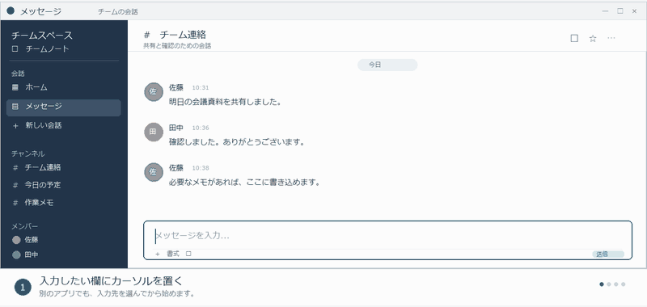</a></figure>
<hr style="border:0;border-top:1px solid var(--rule);margin:18px 0 22px;">

<div class="grid2">
<div class="card">
<h3><span class="dot"></span>オフラインで完結</h3>
<p style="margin-bottom:0">
ネット通信やAIは使いません。APIは不要、アカウントも不要です。入力した内容がパソコンの外に出ることはなく、すべてローカルで実行されます。
</p>
</div>
<div class="card">
<h3><span class="dot"></span>いつでも再変換</h3>
<p style="margin-bottom:0">
確定済みの単語も、クリックや <span class="kbd">F5</span> でいつでも候補から選び直せます。
変換をやり直すために、消して打ち直す必要はありません。
</p>
</div>
</div>
</section>

<a name="picture-index"></a>
<nav class="picture-index" aria-labelledby="contents-heading">
<a name="contents-heading"></a>
<h2>目次</h2>
<p>知りたい項目を選んでください。操作画像はクリックすると拡大できます。</p>
<div class="toc-columns">
<ol class="toc-column">
<li><a href="#screen">画面の見かた</a></li>
<li><a href="#choose">再変換 ― 候補から選び直す</a><ul><li><a href="#guide-reinput">再入力変換 ― 確定した語の読みを直して変換する</a></li></ul></li>
<li><a href="#quick">簡易入力ウィンドウ</a><ul><li><a href="#guide-quick">簡易入力ウィンドウで下書きし、Escで閉じて元の欄へ自動で貼り付ける</a></li></ul></li>
<li><a href="#quick-selected-text">選択した文字を簡易入力へ取り込む</a></li>
<li><a href="#autofix">自動補正</a></li>
<li><a href="#pick">単語を拾って引用する</a><ul><li><a href="#guide-quote">カーソルを置き、本文をクリック／ドラッグして引用する</a></li></ul></li>
<li><a href="#bracket">括弧で括る</a><ul><li><a href="#guide-bracket">選択範囲をボタン／F2で括る</a></li></ul></li>
<li><a href="#listmode">箇条書き・選択範囲の文字種</a><ul><li><a href="#guide-list">本文の文字をクリック／ドラッグして1行ずつ並べる</a></li></ul></li>
<li><a href="#wordbook">単語帳</a><ul><li><a href="#guide-wordbook">文字を登録し、クリックで貼り付ける</a></li></ul></li>
<li><a href="#bulk-insert">一括挿入</a><ul><li><a href="#guide-bulk">複数行の指定位置に同じ文字を入れる</a></li></ul></li>
<li><a href="#lineselect">行をまるごと選ぶ</a></li>
<li><a href="#dragscroll">余白のドラッグでスクロール</a><ul><li><a href="#guide-right-scroll">右クリックしたままドラッグしてスクロールする</a></li></ul></li>
<li><a href="#overview">縮小表示 ― 右ダブルクリック</a><ul><li><a href="#guide-overview">右ボタンを2回押し、2回目を押したまま動かす</a></li></ul></li>
</ol>
<ol class="toc-column" start="14">
<li><a href="#edit">編集の基本機能</a><ul><li><a href="#guide-autosave">保存せずに閉じても次回続きを開く</a></li></ul></li>
<li><a href="#wheel-tabs">ホイールでタブを往復する</a><ul><li><a href="#guide-tabs">ホイールで別のタブへ切り替える</a></li></ul></li>
<li><a href="#search-replace">検索と置換</a><ul><li><a href="#guide-search-return">Ctrl＋Fで検索し、検索前の位置へ戻る</a></li></ul></li>
<li><a href="#goto">Ctrl＋G ― 行へ移る・文字を探す</a></li>
<li><a href="#bookmarks">ブックマーク</a><ul><li><a href="#guide-bookmarks">行番号のダブルクリックで登録し、ボタン／Alt＋上下で移動</a></li></ul></li>
<li><a href="#keyboard-layout">キーボードの配列と形</a></li>
<li><a href="#undo-redo">Undo／Redoの表示</a></li>
<li><a href="#ruler-rows">ルーラーで行に目印を置く</a></li>
<li><a href="#toolbar-settings">ボタンの表示と並べ替え</a></li>
<li><a href="#display">表示の設定</a><ul><li><a href="#guide-whitespace">表示メニューで空白の目印を表示する</a></li><li><a href="#guide-typing-pointer">本文に入力するとポインターが隠れる</a></li></ul></li>
<li><a href="#appearance">外見 ― 配色と装飾</a></li>
<li><a href="#ctrl-navigation">Ctrlキーによるカーソル移動</a><ul><li><a href="#guide-cursor">Ctrl＋左右キーで日本語向けにカーソル移動</a></li><li><a href="#guide-cursor-vertical">Ctrl＋上下キーで本文のまとまりを移動</a></li></ul></li>
<li><a href="#edit-shortcuts">編集のショートカット</a><ul><li><a href="#guide-capslock">CapsLockで文字を削除</a></li><li><a href="#guide-copy">F1でコピー</a></li><li><a href="#guide-enter">F3でエンター</a></li><li><a href="#guide-paste">F4でペースト</a></li></ul></li>
<li><a href="#faq">よくある質問</a></li>
<li><a href="#shortcuts">ショートカット一覧</a></li>
<li><a href="#credits">ライセンスと出典</a></li>
</ol>
</div>
</nav>

<a name="screen"></a>
<section>
<hr class="section-rule">
<h2>画面の見かた</h2>
<p class="sec-intro">CorrectNote には、2つの画面レイアウトがあります。<br>
  <b>左右に並べる</b> と <b>1つにまとめる</b> のボタンで、いつでも切り替えられます。</p>
<figure class="guide-shot"><a href="assets/readme_manual/manual-002.png">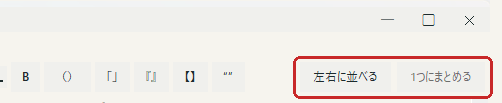</a><br>
  <figcaption>ウインドウ右上のボタンからレイアウトを切り替えます。</figcaption></figure>

<p>文章の補正は入力に合わせて進みます。</p>
<p>行番号に表示される茶色の縦線は、補正中の行を表します。確認が済むと縦線が消えます。</p>

<h3><span class="dot"></span>左右に並べるレイアウト（既定）</h3>
<p>左に自分が打った文章、右にその補正結果を表示します。両者は常に見比べられる状態にあります。</p>
<table>
<tr><th>メモ（入力）</th><th>補正結果</th></tr>
<tr><td>文字入力を<mark>性格</mark>に反映する</td><td>文字入力を<b>正確</b>に反映する</td></tr>
</table>
<ul>
<li><b>左（メモ欄）</b> ― 打った内容がそのまま残ります。色の付いた箇所に、補正の候補があります。</li>
<li><b>右（補正欄）</b> ― 自動的に直った結果を表示します。単語をクリックすると、
別の候補に選び直せます（詳しくは<a href="#choose">再変換</a>）。</li>
</ul>

<h3><span class="dot"></span>1つにまとめるレイアウト</h3>
<p>
入力欄と補正欄をひとつにまとめ、画面を広く使えるようにしたレイアウトです。
確定した単語を右クリックで再変換できます。
</p>
<table>
<tr><th>メモ</th></tr>
<tr><td>文字入力を<mark>性格</mark>に反映する</td></tr>
</table>


<p>文字入力時、マウスポインターを隠します。上部メニューなどにある場合は表示したままです。マウスを動かす・ドラッグする・別のアプリへ切り替えると表示が戻り、次の文字入力で再び隠れます。</p>

<h3><span class="dot"></span>色の意味</h3>
<p></p>

<h3><span class="dot"></span>紫 ― 不自然な文字列</h3>
<p>
メモ欄の文字が<b>紫</b>で塗られているときは、CorrectNote が補正しようとしたが、
補正する文字列を見つけられなかったものです。
</p>
<p>
その場合は必要に応じて、クリックや <span class="kbd">F5</span> で候補から選び直せます（<a href="#choose">再変換</a>）。
</p>
</section>

<a name="choose"></a>
<section>
<hr class="section-rule">
<h2>再変換 ― 候補から選び直す</h2>
<p class="sec-intro">確定済みの単語を再変換できます。</p>

<h3><span class="dot"></span>F5</h3>
<p>
メモ欄で <span class="kbd">F5</span> を押すと、カーソルのすぐ前の語の候補が開きます。<BR>
一覧を開いたまま <span class="kbd">F5</span> を押すたびに、対象がひとつ左の語へ移っていくので、<BR>
少し前に書いた語も手を止めずにたどって直せます。いま対象になっている語には色が付きます。<BR>
行の先頭まで来たら、前の行の末尾の語へ続けて遡ります。<BR>

</p>
<figure class="guide-shot"><a href="assets/readme_manual/manual-003.gif">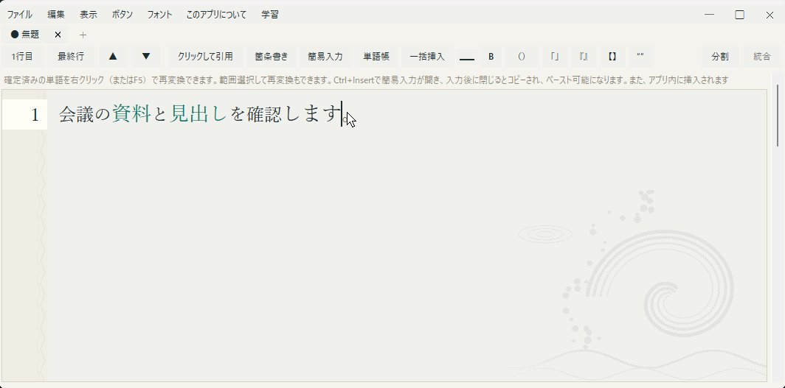</a><figcaption>その場で一覧が開きます。</figcaption></figure>

<h3><span class="dot"></span>左右キーで対象を変更</h3>
<p>
候補の一覧が開いているあいだ、<span class="kbd">←</span>
<span class="kbd">→</span> キーで<b>対象の語を前後に移せます</b>。<BR>
上下キーで候補を選び、エンターまたはスペースで決定します。
</p>

<h3><span class="dot"></span>範囲選択で選ぶ</h3>
<p>
<b>範囲をドラッグで選んでから</b>右クリックすると、選んだ範囲で候補を探します。
</p>

<h3><span class="dot"></span>候補の一覧から再入力変換へ</h3>
<p>
候補の一覧が開いているとき、候補を動かす前に <span class="kbd">スペース</span> を押す（または <span class="kbd">Ctrl</span> を素早く2回押す）と、
その語で下の<a href="#guide-reinput">再入力変換</a>が始まります。
</p>
<a name="guide-reinput"></a>
<article class="picture-guide">
<h3>再入力変換 ― 確定した語の読みを直して変換する</h3>
<p>選択範囲をひらがなに戻し、キーボードで編集を加えてから変換できます。</p>
<figure class="guide-shot"><a href="assets/readme_manual/manual-004.gif">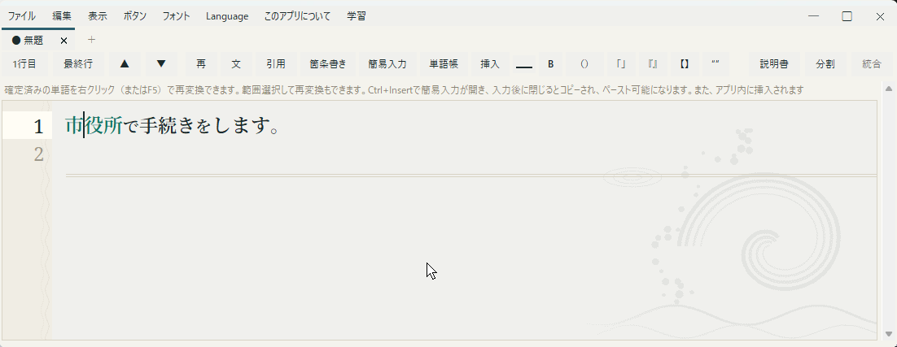</a></figure>
  
<p>F5キーを通さず、範囲を選択してスペースキーを押すだけでも再入力変換を開始できます。</p>
<p class="guide-note">範囲の外へカーソルを出すと、再入力変換は終わります。<br>字を変えていなければ元の字に戻り、字を変えていれば変換して終わります。</p>
<p class="guide-back"><a href="#picture-index">目次に戻る</a></p></article>
</section>

<a name="quick"></a>
<section>
<hr class="section-rule">
<h2>簡易入力ウィンドウ</h2>
<p class="sec-intro">別のアプリを使っている最中でも、下書きをすぐに書ける小さなウィンドウです。<BR>
  CorrectNoteを開いておき、<span class="kbd">Ctrl+Insert</span> または <span class="kbd">Ctrl+Shift+-</span> で呼び出します。<BR>
  簡易入力はほかのウィンドウより手前に表示されます。</p>
  
<a name="guide-quick"></a>
<article class="picture-guide">
<h3>簡易入力ウィンドウで下書きし、Escで閉じて元の欄へ自動で貼り付ける</h3>
<p>Escで簡易入力ウィンドウを閉じます。<BR>
  閉じると、開く前に使っていたウィンドウの入力欄へ内容をペーストします。</p>
  
<figure class="guide-shot"><a href="assets/readme_manual/manual-005.gif">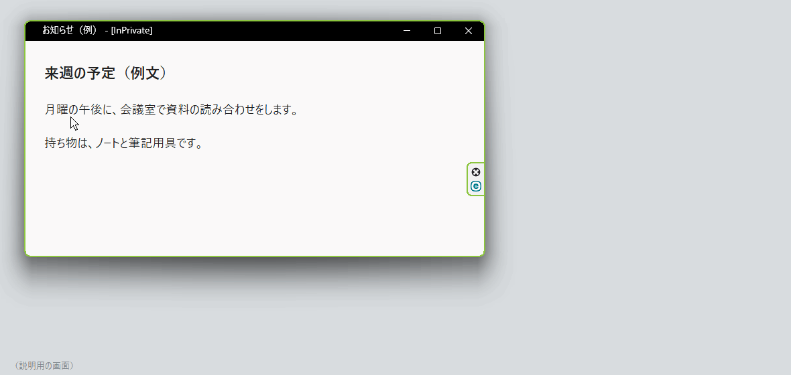</a><figcaption>チャット画面風のイメージです。</figcaption></figure>

<h3><span class="dot"></span>こんなときに使えます</h3>
<ul>
<li><b>思いつきをすぐにメモする。</b>作業中に浮かんだことを簡易入力へ書き、<span class="kbd">Esc</span> で閉じると本体のメモへ残せます。</li>
<li><b>Slackなどに送る文章を先に整える。</b> 簡易入力の中では <span class="kbd">Enter</span> が改行になるので、送信を気にせず複数行の下書きを書けます。Escで閉じると、初期設定では下書きが元の送信欄へ自動で貼り付けられます。</li>

</ul>
<p class="guide-back"><a href="#picture-index">目次に戻る</a></p></article>
</section>

<a name="quick-selected-text"></a>
<section>
<hr class="section-rule">
<h2>選択した文字を簡易入力へ取り込む</h2>
<p>本体のメモや補正結果、別のアプリで選択した文字を、簡易入力の下書きへ取り込めます。ブラウザで見つけた文章や、チャット履歴の文字を使いたいときも、文字を取り込めます。</p>
<figure class="guide-shot"><a href="assets/readme_manual/manual-006.gif">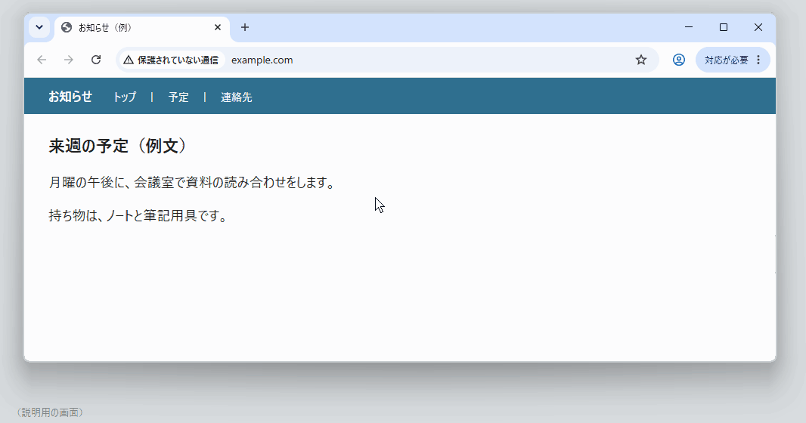</a></figure>
  
<p>Excelのセルなど表の文字は、列の間をタブ、行の間を改行で区切って取り込みます。</p>

<p class="guide-back"><a href="#picture-index">目次に戻る</a></p>
</section>


<a name="autofix"></a>
<section>
<hr class="section-rule">
<h2>自動補正</h2>

<p class="sec-intro">入力した文章の誤字や誤変換を自動的に直します。</p>

<figure class="guide-shot"><a href="assets/readme_manual/manual-007.svg">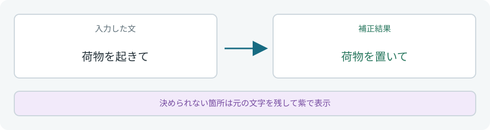</a></figure>

<p>補正先を決められない不自然な箇所は、元の文字を残して紫で示します。</p>

</section>


<a name="pick"></a>
<section>
<hr class="section-rule">
<h2>単語を拾って引用する</h2>
<p class="sec-intro">メモの中の単語を、クリックで拾って入力できます。</p>

<a name="guide-quote"></a>
<article class="picture-guide">
<h3>カーソルを置き、本文をクリック／ドラッグして引用する</h3>
<p>文字を入れたい場所にカーソルを置き、<b>クリックして引用</b> を押します。<BR>
  拾いたい単語をクリックするか、範囲をドラッグすると、カーソルの位置に入ります。<BR>
  選択していないときの <span class="kbd">F1</span> でも始められます。やめるときは <span class="kbd">Esc</span> を押します。</p>
<figure class="guide-shot"><a href="assets/readme_manual/manual-008.gif"></a><figcaption>拾った文字がカーソルの位置に入ります。</figcaption></figure>
<p class="guide-back"><a href="#picture-index">目次に戻る</a></p></article>

<h3><span class="dot"></span>行番号を入力して引用する</h3>
<p>引用モードで行番号を入力して <span class="kbd">Enter</span> を押すと、その行の本文が入ります。<BR>
  <b>-1</b> は1行前、<b>+1</b> は1行後です。</p>

<h3><span class="dot"></span>数式を入力して計算する</h3>
<p>引用モードで数式を入力して <span class="kbd">Enter</span> を押すと、補正欄に計算結果を表示します。<BR>
  符号で始まる数字（+1 など）は、行番号として扱います。</p>
</section>

<a name="bracket"></a>
<section>
<hr class="section-rule">
<h2>括弧で括る</h2>
<p class="sec-intro">ツールバーのボタンで、文字を括弧で囲めます。</p>
<table class="keys">
<tr><th>ボタン</th><th>括弧の種類</th></tr>
<tr><td class="k">（）</td><td>丸括弧</td></tr>
<tr><td class="k">「」</td><td>かぎ括弧</td></tr>
<tr><td class="k">『』</td><td>二重かぎ括弧</td></tr>
<tr><td class="k">【】</td><td>すみ付き括弧</td></tr>
<tr><td class="k">“”</td><td>ダブルクォーテーション</td></tr>
</table>
<p>範囲を選択して押すと、選んだ文字を括弧で囲みます。<BR>
  選択していないときは、カーソルの位置に括弧を入れます。</p>
<p><span class="kbd">F2</span> を続けて押すと、括弧の種類が（）→「」→『』→【】→“” の順に変わります。<BR>
  <span class="kbd">Esc</span> で括弧を取り消します。<BR>
  変換中の文字を括るときは <span class="kbd">Ctrl</span>+<span class="kbd">F2</span> を押します。</p>
<a name="guide-bracket"></a>
<article class="picture-guide">
<h3>選択範囲をボタン／F2で括る</h3>
<figure class="guide-shot"><a href="assets/readme_manual/manual-009.gif">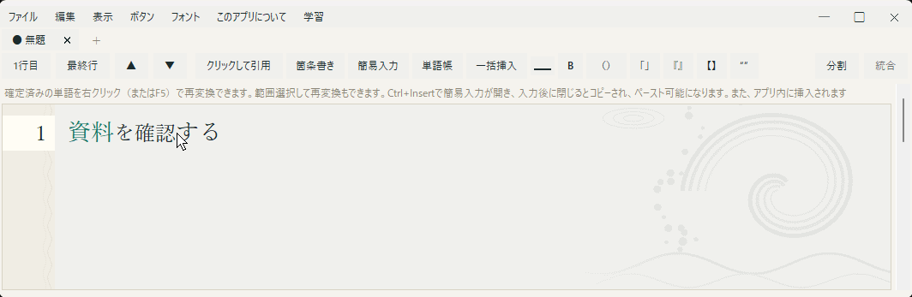</a><figcaption>「」ボタンで括り、F2で種類を変え、Escで戻します。</figcaption></figure>
<p class="guide-back"><a href="#picture-index">目次に戻る</a></p></article>
</section>

<a name="listmode"></a>
<section>
<hr class="section-rule">
<h2>箇条書き・選択範囲の文字種</h2><a name="guide-list"></a>
<article class="picture-guide">
<h3>本文の文字をクリック／ドラッグして1行ずつ並べる</h3>
<p><b>箇条書き</b> を押して、本文の単語をクリックするか、範囲をドラッグします。<BR>
  拾った文字が、カーソル行の下に1行ずつ並びます。<BR>
  <span class="kbd">Esc</span> で終わります。</p>
<figure class="guide-shot"><a href="assets/readme_manual/manual-010.gif">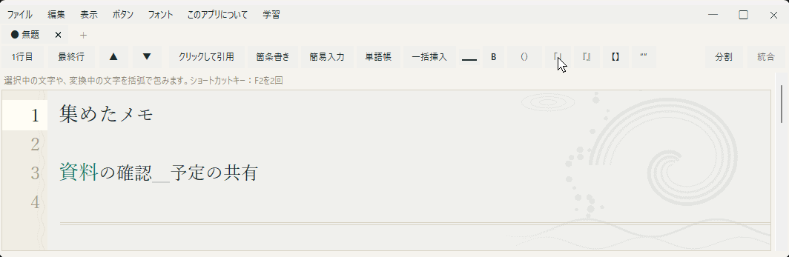</a><figcaption>拾った文字が1行ずつ並びます。</figcaption></figure>
<p>簡易入力から送った文字に背景色が付いているときは、<b>箇条書き</b> を押すと、色の付いた部分を1行ずつ並べます。</p>
<figure class="guide-shot"><a href="assets/readme_manual/manual-011.svg">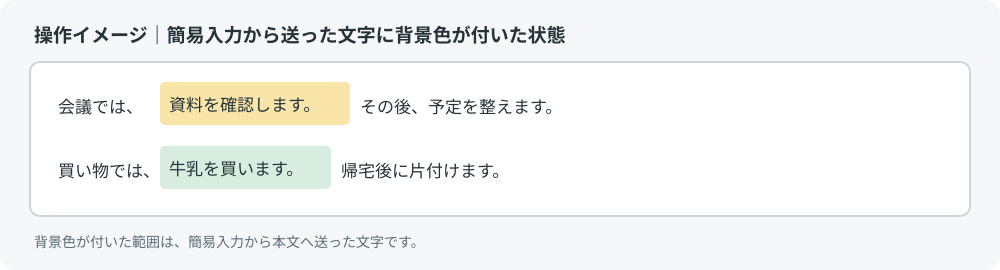</a><figcaption>背景色の部分は、簡易入力から送った文字です。</figcaption></figure>
<figure class="guide-shot"><a href="assets/readme_manual/manual-012.svg">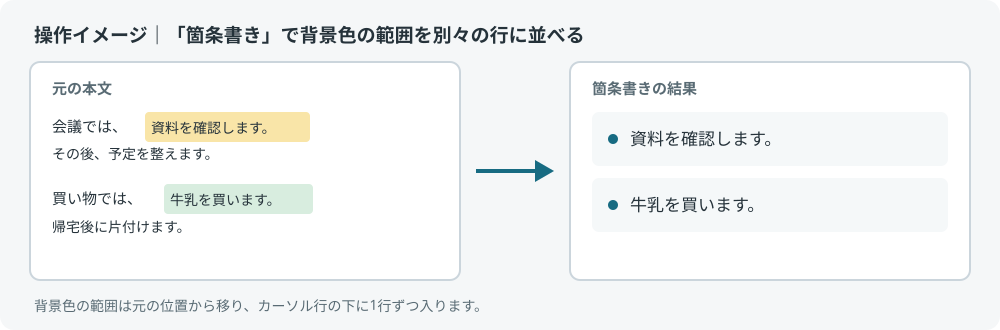</a><figcaption>「箇条書き」で1行ずつ並べた例です。</figcaption></figure>
<p class="guide-back"><a href="#picture-index">目次に戻る</a></p></article>

<h3><span class="dot"></span>選択範囲の文字種を変える</h3>
<p>選択範囲を <span class="kbd">F6</span> でひらがな、<span class="kbd">F7</span> でカタカナ、<span class="kbd">F8</span> で半角に変えます。<BR>
  <span class="kbd">F9</span> は JISかな配列の英数字キー列に変えます。</p>
<figure class="guide-shot"><a href="assets/readme_manual/manual-013.gif"></a><figcaption>確定済みの文字も、F6でひらがなになります。</figcaption></figure>
</section>

<a name="wordbook"></a>
<section>
<hr class="section-rule">
<h2>単語帳</h2>
<p class="sec-intro">よく使う単語を登録しておき、クリックで入力欄に貼り付けます。</p>
<p>単語帳の <b>追加</b> を押してから、本文の単語をクリックするか、範囲をドラッグすると登録できます。<BR>
  登録した語をクリックすると、直前に使っていた入力欄へ貼り付けます。</p>
<p><span class="kbd">Ctrl+Alt+Insert</span> または <span class="kbd">Ctrl+Alt+Shift+-</span> で、別のアプリを使っている最中でも単語帳を開閉できます。</p>
<p>語を押したまま上下に動かすと、並べ替えられます。<BR>
  語を消すときは、右クリックして「消す」を選びます。<BR>
  <b>編集 → 単語帳セットを切り替える</b> で、4つのセットを使い分けられます。</p>
<figure class="guide-shot"><a href="assets/readme_manual/manual-014.png">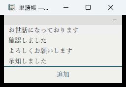</a><figcaption>押したまま動かすと、入る位置に線が出ます。</figcaption></figure>
<a name="guide-wordbook"></a>
<article class="picture-guide">
<h3>文字を登録し、クリックで貼り付ける</h3>
<figure class="guide-shot"><a href="assets/readme_manual/manual-015.gif">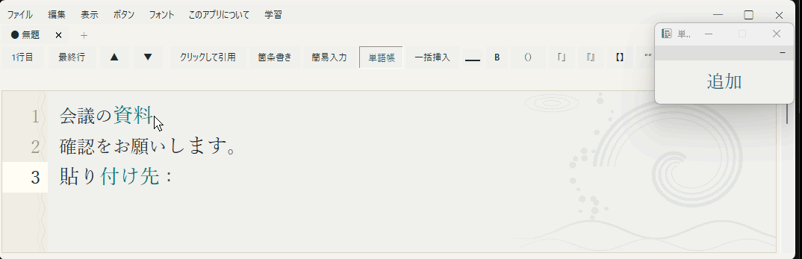</a><figcaption>「追加」を押してから本文をドラッグすると、単語帳に入ります。</figcaption></figure>
<figure class="guide-shot"><a href="assets/readme_manual/manual-016.gif">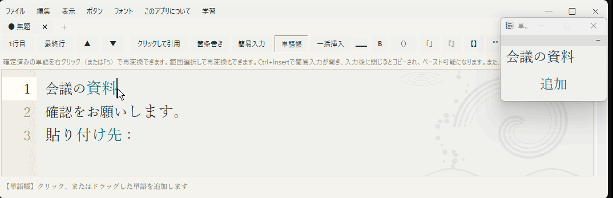</a><figcaption>単語帳の語をクリックすると、カーソルの位置に入ります。</figcaption></figure>
<figure class="guide-shot"><a href="assets/readme_manual/manual-017.png">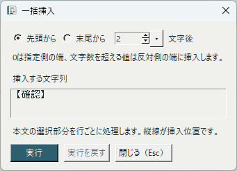</a><figcaption>上の帯で移動、右上の「－」で最小化します。</figcaption></figure>
<p class="guide-back"><a href="#picture-index">目次に戻る</a></p></article>
</section>

<a name="bulk-insert"></a>
<section>
<hr class="section-rule">
<h2>一括挿入</h2>
<a name="guide-bulk"></a>
<article class="picture-guide">
<h3>複数行の指定位置に同じ文字を入れる</h3>
<p>選択した各行の同じ位置に、同じ文字をまとめて入れます。</p>
<p>範囲を選択して <b>一括挿入</b> を押します。<BR>
  「先頭から」か「末尾から」を選び、文字数と入れる文字を入力します。<BR>
  本文の縦線で入る位置を確かめて、<b>実行</b> を押します。</p>
<figure class="guide-shot"><a href="assets/readme_manual/manual-018.png">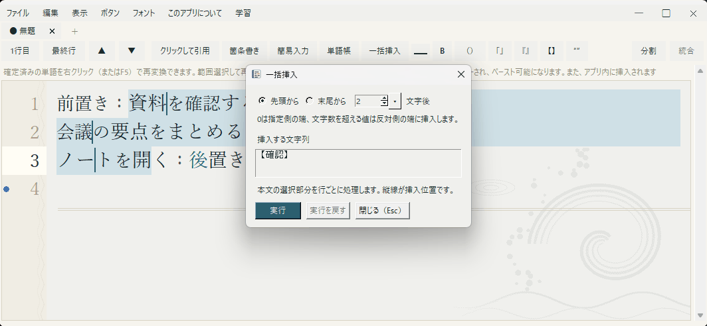</a><figcaption>入れたい行を選択します。</figcaption></figure>
<figure class="guide-shot"><a href="assets/readme_manual/manual-021.png"></a><figcaption>入れる位置と文字を指定します。</figcaption></figure>
<figure class="guide-shot"><a href="assets/readme_manual/manual-022.png"></a><figcaption>縦線が入る位置を示します。</figcaption></figure>
<figure class="guide-shot"><a href="assets/readme_manual/manual-023.png">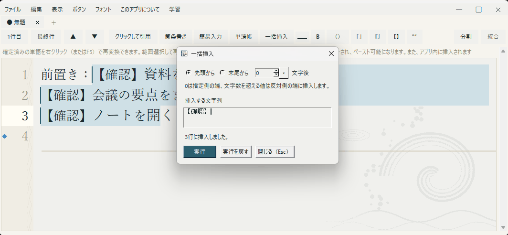</a><figcaption>各行に「【確認】」が入りました。</figcaption></figure>
<p><b>実行を戻す</b> で、直前の一括挿入を取り消します。<span class="kbd">Esc</span> で閉じます。</p>
<p class="guide-back"><a href="#picture-index">目次に戻る</a></p></article>
</section>

<a name="lineselect"></a>
<section>
<hr class="section-rule">
<h2>行をまるごと選ぶ</h2>
<p>行番号をクリックすると、その行を選択します。<BR>
  上下にドラッグすると、複数の行を選べます。</p>
<figure class="guide-shot"><a href="assets/readme_manual/manual-026.gif"></a><figcaption>行番号のドラッグで、行をまとめて選べます。</figcaption></figure>
<p>選択の上下の端にある空白行は、自動で選択から外します。</p>
<figure class="guide-shot"><a href="assets/readme_manual/manual-027.gif">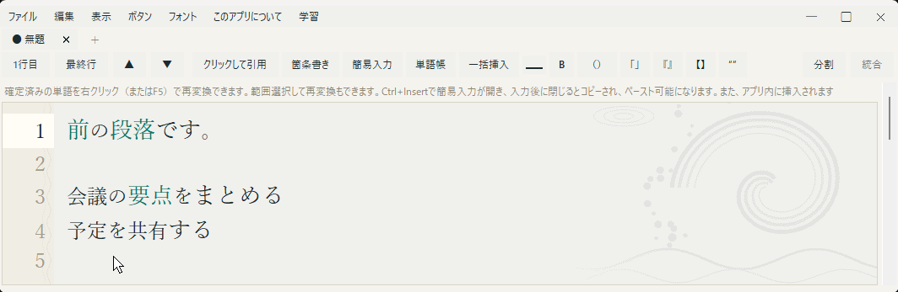</a><figcaption>離すと本文の行だけが選ばれます。</figcaption></figure>
<h3><span class="dot"></span>キーボードで選ぶ</h3>
<p><b>Shift+スペース</b> で、カーソルのある行を選びます。もう一度押すとコピーします。<BR>
  <b>Ctrl+スペース</b> で、その行にブックマークを付け外しします。</p>
<figure class="guide-shot"><a href="assets/readme_manual/manual-028.gif">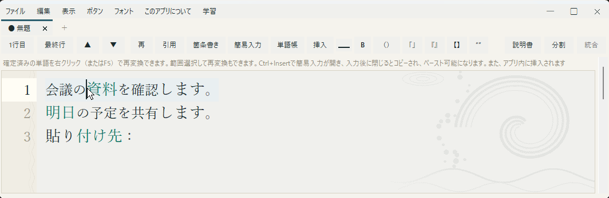</a><figcaption>Shift+スペースで行を選び、もう一度押すとコピーします。</figcaption></figure>
<h3><span class="dot"></span>行番号を右クリックしてスクロールする</h3>
<p>行番号を右クリックして <b>この行が上に来る位置にスクロール</b> を選ぶと、その行が画面の一番上に来ます。<BR>
  同じメニューで、中央に来る位置も選べます。</p>
<figure class="guide-shot"><a href="assets/readme_manual/manual-029.gif">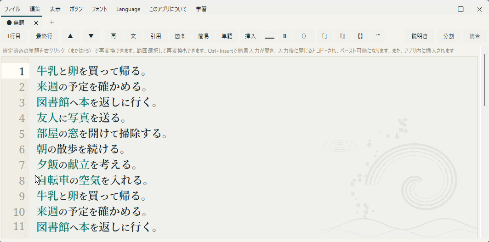</a><figcaption>9行目が画面の一番上に来ます。</figcaption></figure>
</section>

<a name="dragscroll"></a>
<section>
<hr class="section-rule">
<h2>余白のドラッグでスクロール</h2>
<p class="sec-intro">文字のない余白を右クリックしたまま上下に動かすと、画面がスクロールします。<BR>
  タッチ画面では、1本指でなぞってスクロールできます。</p>
<a name="guide-right-scroll"></a>
<article class="picture-guide">
<h3>右クリックしたままドラッグしてスクロールする</h3>
<figure class="guide-shot"><a href="assets/readme_manual/manual-030.png">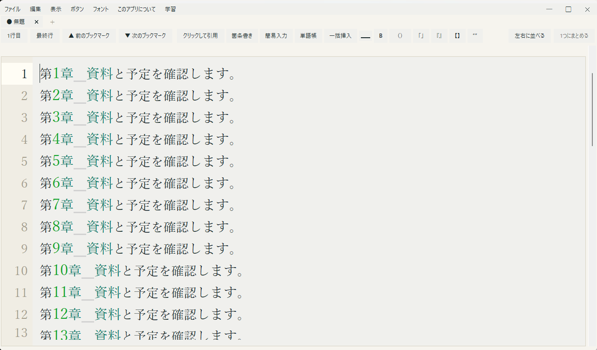</a><figcaption>スクロール前の画面です。</figcaption></figure>
<figure class="guide-shot"><a href="assets/readme_manual/manual-031.png">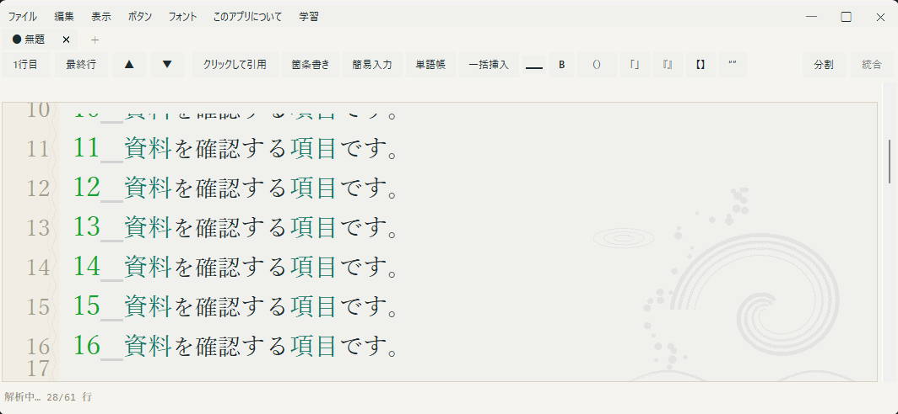</a><figcaption>上へドラッグすると、下の行が見えます。</figcaption></figure>
<p class="guide-back"><a href="#picture-index">目次に戻る</a></p></article>
</section>

<a name="overview"></a>
<section>
<hr class="section-rule">
<h2>縮小表示 ― 右ダブルクリック</h2>
<p class="sec-intro">長いメモの中で、目当ての場所へすぐに移れます。</p>
<p>右ボタンをダブルクリックし、2回目を押したままにすると、文字が小さくなり広い範囲が見えます。<BR>
  そのまま上下に動かすとスクロールし、離すと元の大きさに戻ります。</p>
<a name="guide-overview"></a>
<article class="picture-guide">
<h3>右ボタンを2回押し、2回目を押したまま動かす</h3>
<figure class="guide-shot"><a href="assets/readme_manual/manual-033.gif">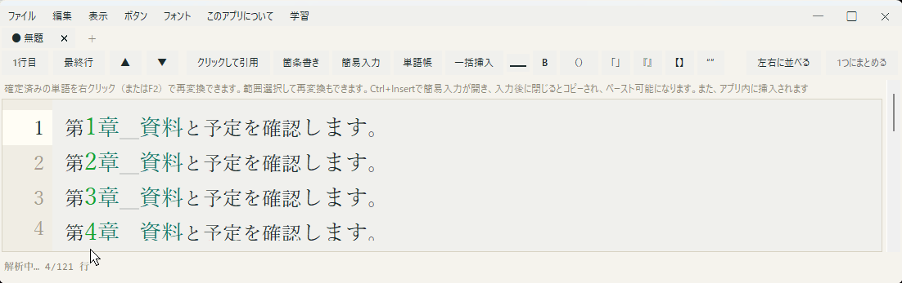</a><figcaption>押したまま動かし、離すと元の大きさに戻ります。</figcaption></figure>
<figure class="guide-shot"><a href="assets/readme_manual/manual-035.png">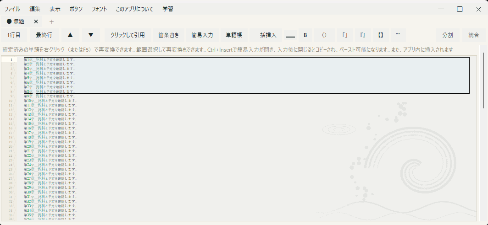</a><figcaption>縮小中は、多くの行を見渡せます。</figcaption></figure>
<p class="guide-back"><a href="#picture-index">目次に戻る</a></p></article>
</section>

<a name="edit"></a>
<section>
<hr class="section-rule">
<h2>編集の基本機能</h2>

<h3><span class="dot"></span>タブで複数のメモを開く</h3>
<p>＋ボタンで新しいタブを開きます。タブはドラッグで並べ替えられます。</p>
<table class="keys">
<tr><th>キー</th><th>動作</th></tr>
<tr><td class="k"><span class="combo"><span class="kbd">Ctrl</span>+<span class="kbd">Tab</span></span> /
<span class="combo"><span class="kbd">Ctrl</span>+<span class="kbd">PageDown</span></span></td><td>次のタブへ</td></tr>
<tr><td class="k"><span class="combo"><span class="kbd">Ctrl</span>+<span class="kbd">Shift</span>+<span class="kbd">Tab</span></span> /
<span class="combo"><span class="kbd">Ctrl</span>+<span class="kbd">PageUp</span></span></td><td>前のタブへ</td></tr>
<tr><td class="k"><span class="combo"><span class="kbd">Ctrl</span>+<span class="kbd">T</span></span></td><td>新しいタブを開く</td></tr>
<tr><td class="k"><span class="combo"><span class="kbd">Ctrl</span>+<span class="kbd">W</span></span></td><td>いまのタブを閉じる</td></tr>
</table>
<p>タブを右クリックすると、<b>先頭のタブに移動</b> や <b>別のウィンドウで表示する</b> を選べます。</p>
<figure class="guide-shot"><a href="assets/readme_manual/manual-038.png">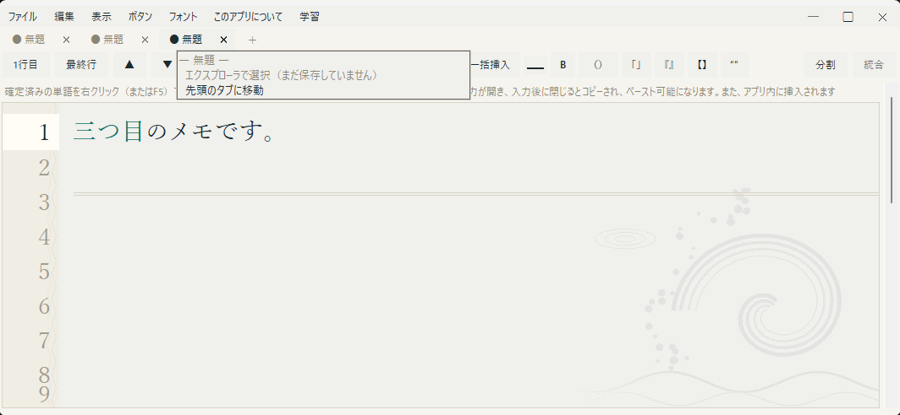</a><figcaption>タブを右クリックした一覧です。</figcaption></figure>

<a name="guide-autosave"></a>
<h3><span class="dot"></span>自動保存</h3>
<p>書いた内容は、タブごとに自動で保存します。<BR>
  保存せずに閉じても、次に開いたときに続きから書けます。</p>

<h3><span class="dot"></span>バックアップ</h3>
<p>内容が変わったタブのバックアップを、1日に1つ作ります。1つのタブにつき5つまで残します。<BR>
  タブを右クリックすると、バックアップの一覧が出ます。選ぶと中身を見られます。<BR>
  <b>ファイル → 手動でバックアップを作成</b> で、その場で作ることもできます。</p>

<h3><span class="dot"></span>コピーした範囲の表示</h3>
<p>コピーした範囲を白い枠で囲み、文字を大きくして示します。</p>

<h3><span class="dot"></span>文字コードと改行</h3>
<p>開いたファイルの文字コード（UTF-8・Shift_JIS・UTF-16）と改行の形のまま保存します。<BR>
  <b>ファイル → このタブの文字コード</b> で変えられます。</p>
</section>

<a name="wheel-tabs"></a>
<section>
<hr class="section-rule">
<h2>ホイールでタブを往復する</h2>
<p>タブの上でホイールを回すと、隣のタブへ移ります。下へ回すと右、上へ回すと左です。<BR>
  本文の上では、右ボタンを押したままホイールを回します。</p>
<a name="guide-tabs"></a>
<article class="picture-guide">
<h3>ホイールで別のタブへ切り替える</h3>
<figure class="guide-shot"><a href="assets/readme_manual/manual-039.gif">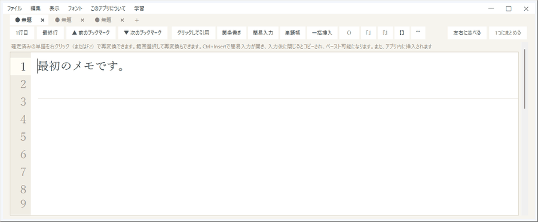</a><figcaption>下へ回すと次のタブへ、上へ回すと前のタブへ移ります。</figcaption></figure>
<p class="guide-back"><a href="#picture-index">目次に戻る</a></p></article>
</section>

<a name="search-replace"></a>
<section>
<hr class="section-rule">
<h2>検索と置換</h2>
<p><span class="kbd">Ctrl+F</span> で検索、<span class="kbd">Ctrl+H</span> で置換を開きます。<BR>
  見つかった文字は、大きく表示して示します。</p>
<p><b>全タブ検索</b> で、すべてのタブから探して一覧にします。<BR>
  文字を選んで <span class="kbd">Alt+I</span> を押しても、全タブ検索ができます。</p>
<a name="guide-search-return"></a>
<article class="picture-guide">
<h3>Ctrl＋Fで検索し、検索前の位置へ戻る</h3>
<p>検索で移動した後、<b>元の行に戻る</b> を押すと、検索前のカーソル位置へ戻ります。</p>
<figure class="guide-shot"><a href="assets/readme_manual/manual-086.png">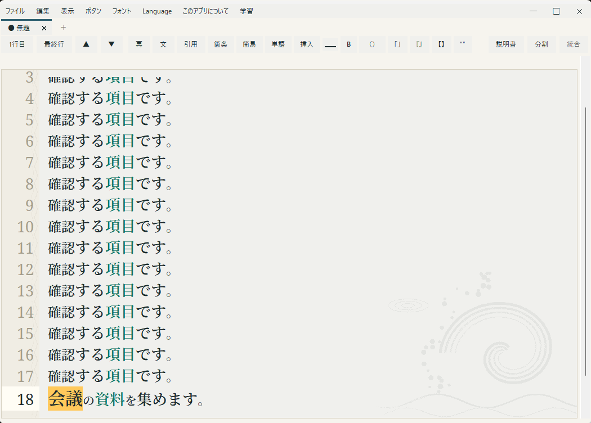</a><figcaption>「会議」が見つかった位置へ移りました。</figcaption></figure>
<figure class="guide-shot"><a href="assets/readme_manual/manual-087.png">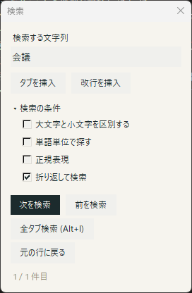</a><figcaption>「元の行に戻る」は、検索ウィンドウのいちばん下にあります。</figcaption></figure>
<p class="guide-back"><a href="#picture-index">目次に戻る</a></p></article>
</section>

<a name="goto"></a>
<section>
<hr class="section-rule">
<h2>Ctrl＋G ― 行へ移る・文字を探す</h2>
<p class="sec-intro"><span class="kbd">Ctrl+G</span> で入力欄を出し、行番号か文字を入れて <span class="kbd">Enter</span> を押すと、その場所へ移ります。<BR>
  <span class="kbd">Esc</span> で閉じます。</p>
<figure class="guide-shot"><a href="assets/readme_manual/manual-048.png">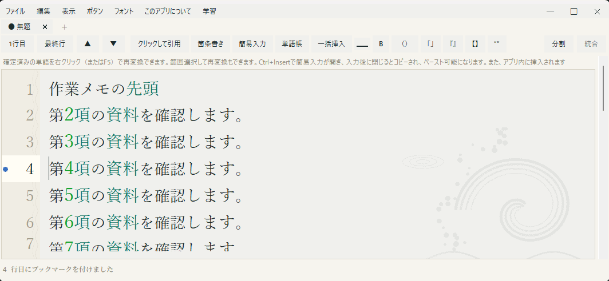</a><figcaption>行番号か、探したい文字を入れます。</figcaption></figure>
<figure class="guide-shot"><a href="assets/readme_manual/manual-049.png">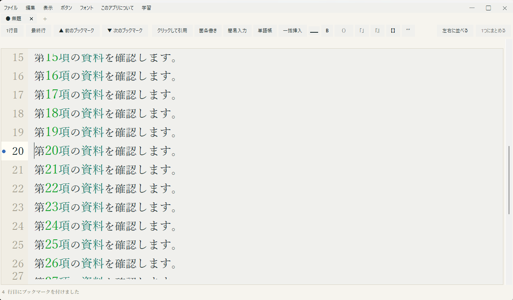</a><figcaption>「公園」の末尾にカーソルが移りました。</figcaption></figure>
<p class="guide-back"><a href="#picture-index">目次に戻る</a></p>
</section>

<a name="bookmarks"></a>
<section>
<hr class="section-rule">
<h2>ブックマーク</h2>
<p>行番号をダブルクリックすると、その行にブックマークを付けます。<BR>
  <span class="kbd">Break</span> や <span class="kbd">Ctrl+Space</span> でも付け外しできます。<BR>
  <b>▲前のブックマーク</b> <b>▼次のブックマーク</b> または <span class="kbd">Alt+↑</span> <span class="kbd">Alt+↓</span> で、付けた行へ移ります。</p>
<a name="guide-bookmarks"></a>
<article class="picture-guide">
<h3>行番号のダブルクリックで登録し、ボタン／Alt＋上下で移動</h3>
<figure class="guide-shot"><a href="assets/readme_manual/manual-050.gif">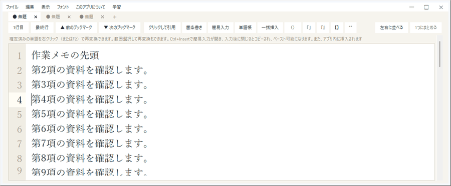</a><figcaption>次・前のブックマークへ移ります。</figcaption></figure>
<p class="guide-back"><a href="#picture-index">目次に戻る</a></p></article>
</section>

<a name="keyboard-layout"></a>
<section>
<hr class="section-rule">
<h2>キーボードの配列と形</h2>
<p class="sec-intro">お使いのキーボードの配列と形を選べます。<BR>
  <a href="#autofix">自動補正</a>が、キーの押し間違いを探すときに使います。<BR>
  <b>表示 → キーボードの配列と形</b> から選びます。</p>
<figure class="guide-shot"><a href="assets/readme_manual/manual-055.png">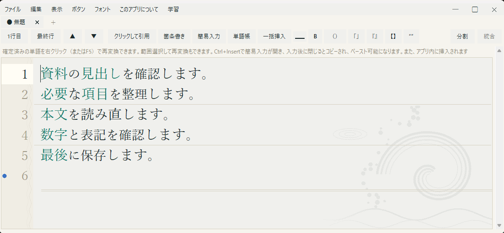</a><figcaption>英字の配列・かなの配列・形を選びます。</figcaption></figure>
<table class="keys">
<tr><th>組</th><th>選べるもの</th><th>効く入力</th></tr>
<tr><td>英字の配列</td><td>QWERTY（日本語配列・JIS）・QWERTY（英語配列・US）・Dvorak・Colemak・Colemak-DH・Workman・Eucalyn・AZERTY（フランス語）・QWERTZ（ドイツ語）・その他（段を文字で指定）</td><td>ローマ字入力・英語</td></tr>
<tr><td>かなの配列</td><td>JISかな（標準）・親指シフト（NICOLA）・新JIS配列</td><td>かな入力</td></tr>
<tr><td>形</td><td>標準（段が少しずつずれている）・左右に分割（段ずれあり）・格子（縦横まっすぐに並ぶ）・左右に分割・格子</td><td>ローマ字入力・かな入力・英語</td></tr>
</table>
<p>普段のキーボードであれば、変える必要はありません。</p>
<p class="guide-back"><a href="#picture-index">目次に戻る</a></p>
</section>

<a name="undo-redo"></a>
<section>
<hr class="section-rule">
<h2>Undo／Redoの表示</h2>
<p><span class="kbd">Ctrl+Z</span> で戻した後は、次に戻すと消える文字に下線を付けます。<BR>
  やり直した後は、戻った文字に下線を付けます。</p>
<figure class="guide-shot"><a href="assets/readme_manual/manual-056.png"></a><figcaption>次に取り消すと消える「大切な」に下線が付きます。</figcaption></figure>
<figure class="guide-shot"><a href="assets/readme_manual/manual-057.png">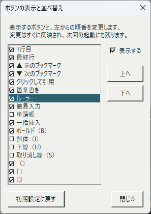</a><figcaption>やり直しで戻った「新しい」に下線が付きます。</figcaption></figure>
<p class="guide-back"><a href="#picture-index">目次に戻る</a></p>
</section>

<a name="ruler-rows"></a>
<section>
<hr class="section-rule">
<h2>ルーラーで行に目印を置く</h2>
<p>上部の横線ボタン（─）を押すと、カーソルのある行に横線を置きます。<BR>
  同じ行でもう一度押すと消えます。横線は再起動後も残ります。</p>
<figure class="guide-shot"><a href="assets/readme_manual/manual-058.png">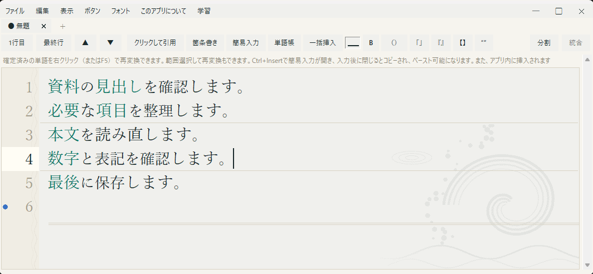</a><figcaption>2行目と4行目にルーラーを置いた例です。</figcaption></figure>
<p class="guide-back"><a href="#picture-index">目次に戻る</a></p>
</section>

<a name="toolbar-settings"></a>
<section>
<hr class="section-rule">
<h2>ボタンの表示と並べ替え</h2>
<p><b>ボタン → 表示と並べ替え…</b> から、表示するボタンと並び順を選べます。<BR>
  左端のチェックで表示を切り替え、<b>上へ</b>・<b>下へ</b> で順番を変えます。</p>
<figure class="guide-shot"><a href="assets/readme_manual/manual-060.png">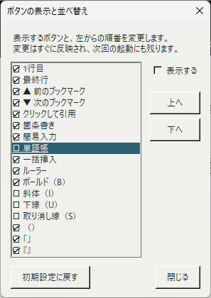</a><figcaption>「単語帳」の表示をオフにした例です。</figcaption></figure>
<figure class="guide-shot"><a href="assets/readme_manual/manual-061.png">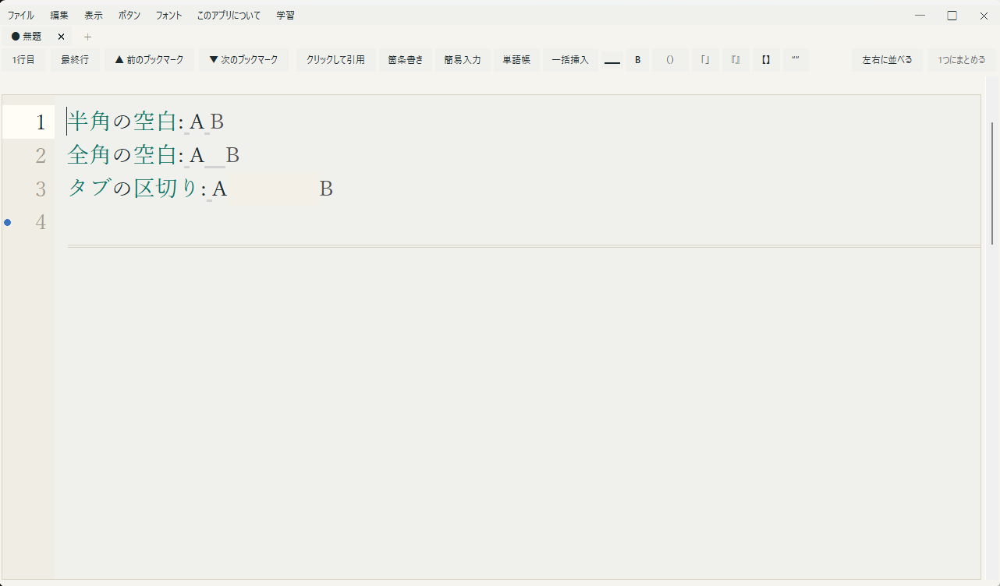</a><figcaption>「ルーラー」を「簡易入力」の前へ移した例です。</figcaption></figure>
<h3><span class="dot"></span>書式ボタン（B・I・U・S）</h3>
<p>選んだ文字を、ボールド・斜体・下線・取り消し線にします。初期状態で表示されるのはボールドだけです。<BR>
  書式ごとコピーすると、Excel や Word にもそのまま貼り付けられます。<BR>
  保存するテキストファイルには、書式は入りません。</p>
<p class="guide-back"><a href="#picture-index">目次に戻る</a></p>
</section>

<a name="display"></a>
<section>
<hr class="section-rule">
<h2>表示の設定</h2>
<h3><span class="dot"></span>フォント</h3>
<p><b>フォント → 種類・サイズを選択</b> で、文字の種類と大きさを変えます。<BR>
  <b>フォント → 品詞ごとのサイズ倍率と文字色</b> で、品詞ごとに文字の大きさと色を変えられます。</p>
<figure class="guide-shot">
<a href="assets/readme_manual/manual-062.svg">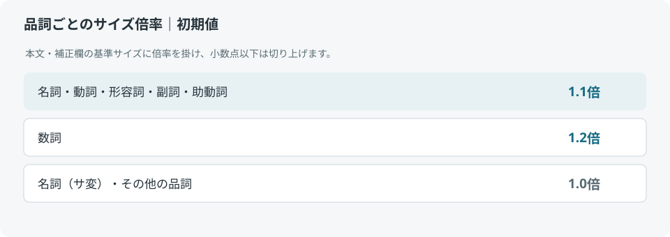</a>
<figcaption>品詞ごとのサイズ倍率（初期値）</figcaption>
</figure>
<figure class="guide-shot">
<a href="assets/readme_manual/manual-063.svg">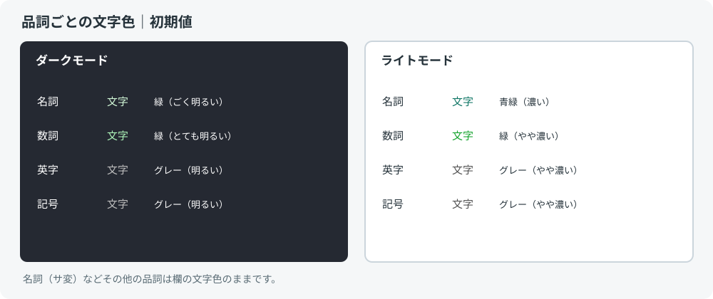</a>
<figcaption>品詞ごとの文字色（初期値）</figcaption>
</figure>
<h3><span class="dot"></span>ダークモード</h3>
<p><b>表示 → ダークモード</b> で切り替えます。ほかの配色は<a href="#appearance">外見</a>で選べます。</p>
<a name="memory-usage"></a>
<h3><span class="dot"></span>メモリ使用量</h3>
<p><b>このアプリについて → メモリ使用量</b> で、低・中・高から選べます。既定は中です。<BR>
  高はメモリを多く使うかわりに、補正の待ち時間が短くなります。補正の内容は変わりません。</p>
<h3><span class="dot"></span>ホットキーの個別設定</h3>
<p>簡易入力と単語帳のホットキーは、編集メニューでそれぞれオン・オフできます。<BR>
  反応しないときは、<b>ホットキーの状態を確認…</b> で確かめられます。</p>
<a name="guide-whitespace"></a>
<article class="picture-guide">
<h3>表示メニューで空白の目印を表示する</h3>
<p><b>表示 → 見えない空白（半角・全角・タブ）を表示</b> で、空白に印を付けます。<BR>
  印は画面だけで、保存するファイルには入りません。</p>
<figure class="guide-shot"><a href="assets/readme_manual/manual-065.png">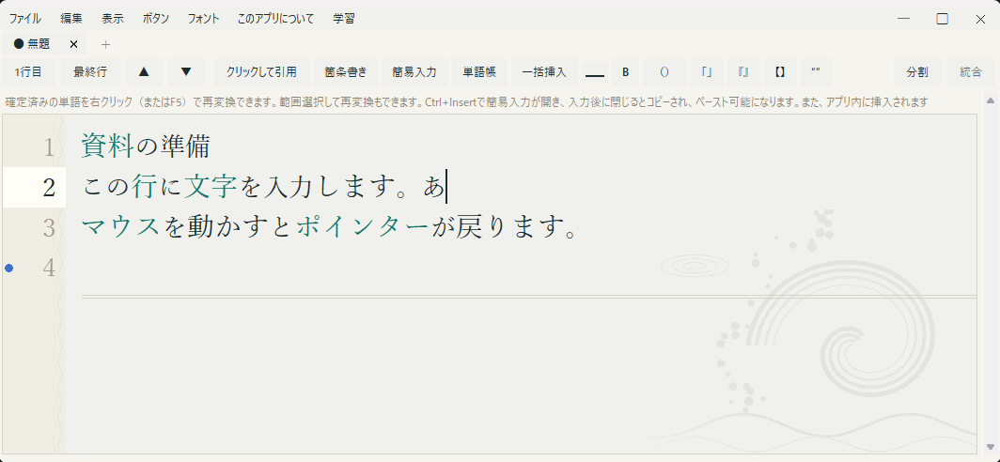</a><figcaption>空白に目印が付きました。</figcaption></figure>
<p class="guide-back"><a href="#picture-index">目次に戻る</a></p></article>
<a name="guide-typing-pointer"></a>
<article class="picture-guide">
<h3>本文に入力するとポインターが隠れる</h3>
<p>文字を入力すると、マウスポインターを隠します。マウスを動かすと戻ります。</p>
<p class="guide-back"><a href="#picture-index">目次に戻る</a></p></article>
</section>

<a name="appearance"></a>
<section>
<hr class="section-rule">
<h2>外見 ― 配色と装飾</h2>
<p class="sec-intro">アプリの色合いと、本文の裏に敷く薄い絵を選べます。<BR>
  <b>このアプリについて → 外見</b> から選びます。項目にマウスを乗せると、試しに表示されます。</p>
<figure class="guide-shot"><a href="assets/readme_manual/manual-068.png">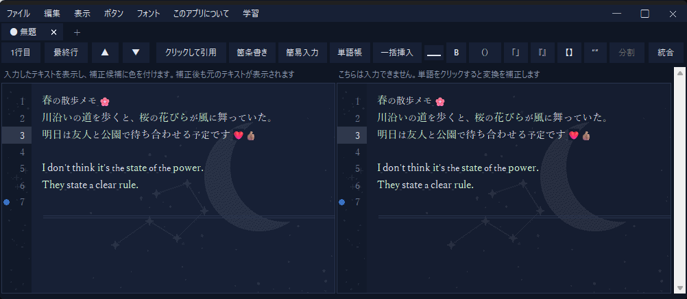</a><figcaption>配色・装飾・装飾の濃さを選びます。</figcaption></figure>
<table class="keys">
<tr><th>項目</th><th>選べるもの</th></tr>
<tr><td>配色</td><td>標準（ライト）・抹茶・空 ／ 標準（ダーク）・夜・炭</td></tr>
<tr><td>装飾</td><td>なし ／ 和文様・原稿・星空・桜・草木・墨と和紙・扇と帯・いきもの・波</td></tr>
<tr><td>装飾の濃さ</td><td>薄い・普通・濃い</td></tr>
</table>
<figure class="guide-shot"><a href="assets/readme_manual/manual-069.png">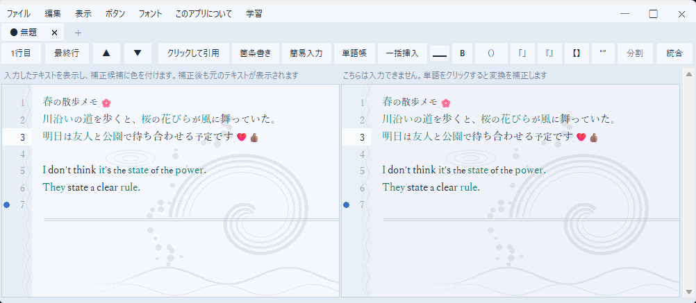</a><figcaption>配色「抹茶」＋装飾「桜」（濃さ：普通）</figcaption></figure>
<figure class="guide-shot"><a href="assets/readme_manual/manual-070.png"></a><figcaption>配色「夜」＋装飾「星空」（濃さ：普通）</figcaption></figure>
<figure class="guide-shot"><a href="assets/readme_manual/manual-071.png">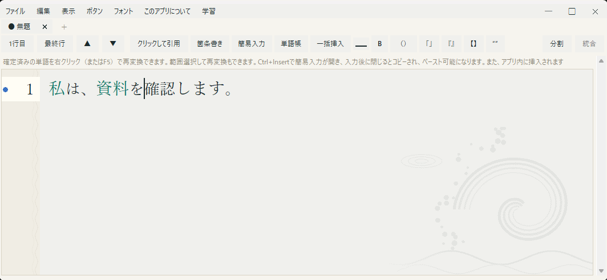</a><figcaption>配色「空」＋装飾「波」（濃さ：普通）</figcaption></figure>
<p class="guide-back"><a href="#picture-index">目次に戻る</a></p>
</section>

<a name="ctrl-navigation"></a>
<section>
<hr class="section-rule">
<h2>Ctrlキーによるカーソル移動</h2>
<a name="guide-cursor"></a>
<article class="picture-guide">
<h3>Ctrl＋左右キーで日本語向けにカーソル移動</h3>
<p>Ctrl＋左右キーで、助詞や句読点などの区切りごとにカーソルを動かします。<BR>
  Ctrlを押している間は、止まる場所に灰色の下線が出ます。</p>
<figure class="guide-shot"><a href="assets/readme_manual/manual-072.gif">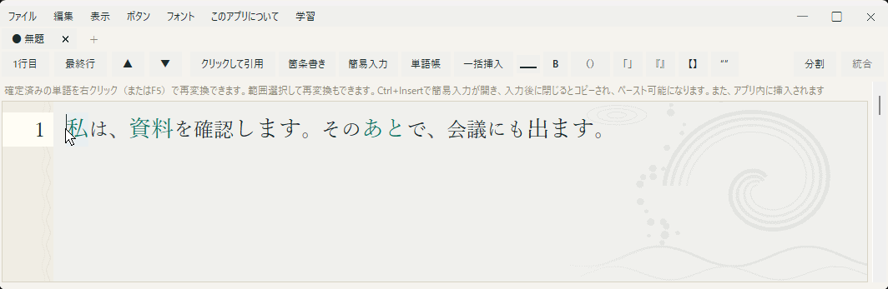</a><figcaption>Ctrlを押している間は、止まる場所に下線が出ます。</figcaption></figure>
<p class="guide-back"><a href="#picture-index">目次に戻る</a></p>
</article>
<a name="guide-cursor-vertical"></a>
<article class="picture-guide">
<h3>Ctrl＋上下キーで本文のまとまりを移動</h3>
<p>Ctrl＋上下キーで、空白行で区切られたまとまりの先頭・末尾へ移ります。</p>
<figure class="guide-shot"><a href="assets/readme_manual/manual-076.svg">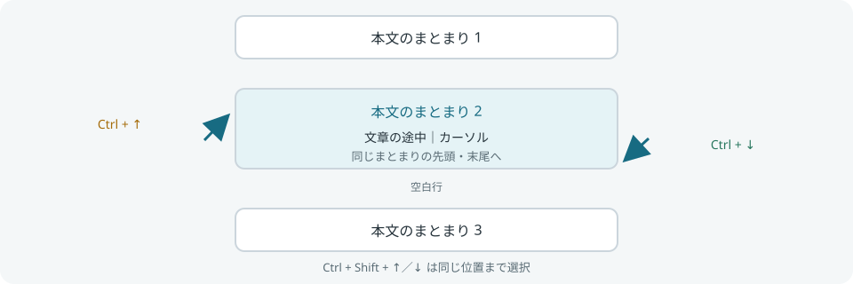</a><figcaption>Ctrl＋↑／↓で、まとまりの先頭／末尾へ移ります。</figcaption></figure>
<p class="guide-back"><a href="#picture-index">目次に戻る</a></p></article>
</section>

<a name="edit-shortcuts"></a>
<section>
<hr class="section-rule">
<h2>編集のショートカット</h2>
<a name="guide-capslock"></a>
<article class="picture-guide">
<h3>CapsLockで文字を削除</h3>
<p>CapsLock を BackSpace と同じように使えます。編集メニューでオン・オフできます。</p>
<p class="guide-back"><a href="#picture-index">目次に戻る</a></p></article>
<a name="guide-copy"></a>
<article class="picture-guide">
<h3>F1でコピー</h3>
<p>選んだ文字を F1 でコピーします。選択していないときは、引用モードになります。</p>
<p class="guide-back"><a href="#picture-index">目次に戻る</a></p></article>
<a name="guide-enter"></a>
<article class="picture-guide">
<h3>F3でエンター</h3>
<p>F3 で、Enter と同じように改行します。</p>
<figure class="guide-shot"><a href="assets/readme_manual/manual-082.gif">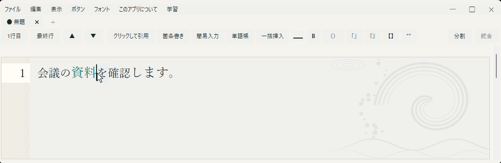</a><figcaption>カーソルの位置で改行します。</figcaption></figure>
<p class="guide-back"><a href="#picture-index">目次に戻る</a></p></article>
<a name="guide-paste"></a>
<article class="picture-guide">
<h3>F4でペースト</h3>
<p>F4 で、Ctrl+V と同じように貼り付けます。</p>
<p class="guide-back"><a href="#picture-index">目次に戻る</a></p></article>
</section>

<a name="faq"></a>
<section>
<hr class="section-rule">
<h2>よくある質問</h2>

<h3><span class="dot"></span>意図と違う表記に直されてしまいます</h3>
<p>その語をクリックするか <span class="kbd">F5</span> を押し、候補から選び直してください（<a href="#choose">再変換</a>）。</p>

<h3><span class="dot"></span>入力した内容は外部に送信されますか</h3>
<p>いいえ。CorrectNote は通信を行いません。辞書や学習した内容は、すべてパソコンの中に保存されます。</p>

<h3><span class="dot"></span>簡易入力のショートカットキーが反応しません</h3>
<p>編集メニューの <b>ホットキーの状態を確認…</b> で確かめてください。<BR>
  ほかのアプリが同じキーを使っていると、登録できません。</p>
</section>

<a name="shortcuts"></a>
<section>
<hr class="section-rule">
<h2>ショートカット一覧</h2>
<table class="keys">
<tr><th>キー</th><th>動作</th></tr>
<tr><td class="k"><span class="kbd">Ctrl</span>+<span class="kbd">N</span><br><span class="kbd">Ctrl</span>+<span class="kbd">T</span></td><td>新しいタブを開く</td></tr>
<tr><td class="k"><span class="kbd">Ctrl</span>+<span class="kbd">W</span></td><td>いまのタブを閉じる</td></tr>
<tr><td class="k"><span class="kbd">Ctrl</span>+<span class="kbd">O</span></td><td>開く</td></tr>
<tr><td class="k"><span class="kbd">Ctrl</span>+<span class="kbd">S</span></td><td>保存</td></tr>
<tr><td class="k"><span class="kbd">Ctrl</span>+<span class="kbd">F</span></td><td>検索</td></tr>
<tr><td class="k"><span class="kbd">Ctrl</span>+<span class="kbd">H</span></td><td>置換</td></tr>
<tr class="key-rule"><td colspan="2"></td></tr>
<tr><td class="k">余白を右ドラッグ</td><td>スクロール</td></tr>
<tr><td class="k">選択して <span class="kbd">スペース</span></td><td>選択範囲をひらがなに戻して編集する（<a href="#guide-reinput">再入力変換</a>）</td></tr>
<tr><td class="k"><span class="kbd">Ctrl</span> を素早く2回</td><td>カーソルのある単語をひらがなに戻して編集する</td></tr>
<tr><td class="k"><span class="kbd">Shift</span>+<span class="kbd">Space</span></td><td>行を選択する<br>2回押すとコピーする</td></tr>
<tr><td class="k"><span class="kbd">Shift</span>+<span class="kbd">Home</span><br><span class="kbd">Shift</span>+<span class="kbd">End</span></td><td>行頭 / 行末までを選択する<br>2回押すとコピーする</td></tr>
<tr class="key-rule"><td colspan="2"></td></tr>
<tr><td class="k"><span class="kbd">F1</span></td><td>選択範囲をコピーする<br>選択していないときは引用モード（<a href="#pick">詳しく</a>）</td></tr>
<tr><td class="k"><span class="kbd">F2</span></td><td>選択範囲を括弧で括る<br>選択していないときは括弧を入れる<br>続けて押すと括弧の種類が変わる</td></tr>
<tr><td class="k"><span class="kbd">Ctrl</span>+<span class="kbd">F2</span></td><td>直前の変換を括弧で括る</td></tr>
<tr><td class="k"><span class="kbd">Alt</span>+<span class="kbd">F2</span></td><td>カーソル位置に空の括弧を入れる</td></tr>
<tr><td class="k"><span class="kbd">F3</span></td><td>改行する<br>選択中はブラウザで検索する</td></tr>
<tr><td class="k"><span class="kbd">F4</span></td><td>貼り付け</td></tr>
<tr><td class="k"><span class="kbd">F5</span></td><td>カーソル位置の語を再変換する（<a href="#choose">詳しく</a>）<br>続けて押すと左の語へ移る</td></tr>
<tr><td class="k"><span class="kbd">F5</span> のあと <span class="kbd">←</span> <span class="kbd">→</span></td><td>再変換の対象の語を前後に移す</td></tr>
<tr><td class="k"><span class="kbd">F6</span><br><span class="kbd">F7</span></td><td>選択範囲をひらがな / カタカナへ変換</td></tr>
<tr><td class="k"><span class="kbd">F8</span><br><span class="kbd">F9</span></td><td>選択範囲を半角 / JISかな配列の英数字キー列へ変換</td></tr>
<tr><td class="k"><span class="kbd">CapsLock</span></td><td>カーソルの左の文字を消す</td></tr>
<tr><td class="k">右クリックしながら左クリック</td><td>選択範囲をコピーする<br>選択していないときは貼り付け</td></tr>
<tr class="key-rule"><td colspan="2"></td></tr>
<tr><td class="k"><span class="kbd">Ctrl</span>+<span class="kbd">G</span></td><td>行へ移る／文字を探す（<a href="#goto">詳しく</a>）</td></tr>
<tr><td class="k"><span class="kbd">Ctrl</span>+<span class="kbd">←</span><br><span class="kbd">Ctrl</span>+<span class="kbd">→</span></td><td>区切りごとにカーソルを移動する<br>Shiftも押すと選択する</td></tr>
<tr><td class="k"><span class="kbd">Ctrl</span>+<span class="kbd">↑</span><br><span class="kbd">Ctrl</span>+<span class="kbd">↓</span></td><td>まとまりの先頭／末尾へ移動する<br>Shiftも押すと選択する</td></tr>
<tr><td class="k">右ダブルクリック（押したまま）</td><td>縮小表示（離すと元に戻る）</td></tr>
<tr><td class="k">行番号を右クリック</td><td>その行を画面の上や中央へスクロール・ルーラーやブックマークを入れる（<a href="#lineselect">詳しく</a>）</td></tr>
<tr><td class="k"><span class="kbd">Ctrl</span>+<span class="kbd">Home</span></td><td>1行目に移動する<br>2回押すと元の行に戻る</td></tr>
<tr><td class="k"><span class="kbd">Ctrl</span>+<span class="kbd">End</span></td><td>最終行に移動する<br>2回押すと元の行に戻る</td></tr>
<tr class="key-rule"><td colspan="2"></td></tr>
<tr><td class="k"><span class="kbd">Break</span><br><span class="kbd">Ctrl</span>+<span class="kbd">Space</span><br>行番号ダブルクリック</td><td>ブックマークの付け外し</td></tr>
<tr><td class="k"><span class="kbd">Alt</span>+<span class="kbd">↑</span><br><span class="kbd">Alt</span>+<span class="kbd">↓</span></td><td>前 / 次のブックマークへ移動</td></tr>
<tr class="key-rule"><td colspan="2"></td></tr>
<tr><td class="k"><span class="kbd">Insert</span></td><td>引用モードの切り替え（<a href="#pick">詳しく</a>）</td></tr>
<tr><td class="k"><span class="kbd">=</span>（全角時 <span class="kbd">Shift</span>+<span class="kbd">-</span>）</td><td>引用モードの切り替え（メモ欄だけ）</td></tr>
<tr><td class="k"><span class="kbd">Ctrl</span>+<span class="kbd">C</span>（選択なし）</td><td>引用モードに入る</td></tr>
<tr class="key-rule"><td colspan="2"></td></tr>
<tr><td class="k"><span class="combo"><span class="kbd">Ctrl</span>+<span class="kbd">Insert</span></span><br><span class="combo"><span class="kbd">Ctrl</span>+<span class="kbd">Shift</span>+<span class="kbd">-</span></span></td><td>簡易入力ウィンドウを開く<br>別のアプリを使っている最中でも使える（<a href="#quick">詳しく</a>）</td></tr>
<tr><td class="k"><span class="combo"><span class="kbd">Ctrl</span>+<span class="kbd">Alt</span>+<span class="kbd">Insert</span></span><br><span class="combo"><span class="kbd">Ctrl</span>+<span class="kbd">Alt</span>+<span class="kbd">Shift</span>+<span class="kbd">-</span></span></td><td>単語帳を開く・閉じる<br>別のアプリを使っている最中でも使える（<a href="#wordbook">詳しく</a>）</td></tr>
<tr class="key-rule"><td colspan="2"></td></tr>
<tr><td class="k"><span class="combo"><span class="kbd">Ctrl</span>+<span class="kbd">Tab</span></span><br><span class="combo"><span class="kbd">Ctrl</span>+<span class="kbd">PageDown</span></span></td><td>次のタブへ</td></tr>
<tr><td class="k"><span class="combo"><span class="kbd">Ctrl</span>+<span class="kbd">Shift</span>+<span class="kbd">Tab</span></span><br><span class="combo"><span class="kbd">Ctrl</span>+<span class="kbd">PageUp</span></span></td><td>前のタブへ</td></tr>
<tr><td class="k">タブ上の右クリック</td><td>タブメニュー</td></tr>
<tr><td class="k">タブ上でホイール<br>右クリックしながらホイール</td><td>隣のタブへ移動</td></tr>
<tr class="key-rule"><td colspan="2"></td></tr>
<tr><td class="k"><span class="kbd">Ctrl</span>+<span class="kbd">B</span><br><span class="kbd">Ctrl</span>+<span class="kbd">2</span></td><td>ボールドのオン・オフ</td></tr>
<tr><td class="k"><span class="kbd">Ctrl</span>+<span class="kbd">I</span><br><span class="kbd">Ctrl</span>+<span class="kbd">3</span></td><td>斜体のオン・オフ</td></tr>
<tr><td class="k"><span class="kbd">Ctrl</span>+<span class="kbd">U</span><br><span class="kbd">Ctrl</span>+<span class="kbd">4</span></td><td>下線のオン・オフ</td></tr>
<tr><td class="k"><span class="kbd">Ctrl</span>+<span class="kbd">5</span></td><td>取り消し線のオン・オフ</td></tr>
</table>
</section>

<a name="credits"></a>
<section>
<hr class="section-rule">
<h2>ライセンスと出典</h2>
<p>CorrectNote は GNU General Public License v3.0 で公開しています。改変したり組み込んだりして配布する場合は、その配布物のソースコードも同じライセンスで公開する必要があります。<br>Copyright (C) 2026 Takahashi Yuu</p>
<p>補正や品詞の判定には、次の公開データとソフトウェアを使っています。</p>
<ul>
<li><b>語の意味の分類と類語</b>：国立国語研究所(2004)『分類語彙表増補改訂版データベース』(ver.1.0.1)（体・用・相・その他の全ての類）。<a href="https://creativecommons.org/licenses/by-nc-sa/3.0/">CC BY-NC-SA 3.0</a></li>
<li><b>日本語の辞書</b>：IPA辞書 mecab-ipadic-2.7.0-20070801（奈良先端科学技術大学院大学・情報処理推進機構）。<a href="https://github.com/taku910/mecab/blob/master/mecab-ipadic/COPYING">IPADIC License</a></li>
<li><b>日本語の形態素解析</b>：Janome（Tomoko Uchida）。<a href="https://www.apache.org/licenses/LICENSE-2.0">Apache License 2.0</a></li>
<li><b>英単語の組の多さ</b>（英文の補正と、文変換の前置詞などのつながり）：Google Books Ngram をもとにした SymSpell 英語バイグラム辞書（Wolf Garbe）。<a href="https://creativecommons.org/licenses/by/3.0/">CC BY 3.0</a>（SymSpell は <a href="https://github.com/wolfgarbe/SymSpell/blob/master/LICENSE">MIT License</a>）</li>
<li><b>単語の使われやすさ（英語・日本語）</b>：wordfreq（Robyn Speer）。<a href="https://creativecommons.org/licenses/by-sa/4.0/">CC BY-SA 4.0</a></li>
<li><b>英単語の発音（同じ音の語）</b>：CMU Pronouncing Dictionary（Carnegie Mellon University）。<a href="https://github.com/cmusphinx/cmudict/blob/master/LICENSE">BSD License</a></li>
<li><b>英単語の品詞</b>：WordNet 3.0（Princeton University）。<a href="https://wordnet.princeton.edu/license-and-commercial-use">WordNet License</a></li>
<li><b>日本語と英語の対訳</b>（文変換の英語の語・名詞の種類・述語の訳）：JMdict（Electronic Dictionary Research and Development Group）。<a href="https://www.edrdg.org/edrdg/licence.html">CC BY-SA 4.0</a></li>
<li><b>英単語の活用形</b>：lemminflect（Brad Jascob）。<a href="https://github.com/bjascob/LemmInflect/blob/master/LICENSE">MIT License</a></li>
<li><b>常用漢字の表</b>：KANJIDIC2（Electronic Dictionary Research and Development Group）。<a href="https://www.edrdg.org/edrdg/licence.html">CC BY-SA 4.0</a></li>
<li><b>常用漢字の表</b>：kanji-data（David Gouveia）。<a href="https://github.com/davidluzgouveia/kanji-data/blob/master/LICENSE">MIT License</a></li>
<li><b>日本語の1語として在る表記</b>：SudachiDict（Works Applications Co., Ltd.。UniDic と NEologd の一部を含む）。<a href="https://www.apache.org/licenses/LICENSE-2.0">Apache License 2.0</a></li>
<li><b>書籍を基準にした語の並べ替え・漢字の音訓</b>：UniDic（The UniDic Consortium）。<a href="https://clrd.ninjal.ac.jp/unidic/">修正 BSD License</a></li>
<li><b>漢字の音訓（補い）</b>：Unihan データベース（Unicode, Inc.）。<a href="https://www.unicode.org/license.txt">Unicode License</a></li>
<li><b>英単語の一覧</b>（英単語の品詞と使われやすさの表の範囲）：SCOWL（Kevin Atkinson）。<a href="http://wordlist.aspell.net/scowl-readme/">SCOWL License</a></li>
<li><b>英単語の組の多さ</b>（辞書ファイルの入手元）：symspellpy（mammothb）。<a href="https://github.com/mammothb/symspellpy/blob/master/LICENSE">MIT License</a></li>
<li><b>日本語の例文</b>：<a href="https://tatoeba.org/">Tatoeba</a>（Tatoeba Association）。<a href="https://creativecommons.org/licenses/by/2.0/fr/">CC BY 2.0 FR</a></li>
</ul>
<p class="guide-back"><a href="#picture-index">目次に戻る</a></p>
</section>

<footer>CorrectNote 説明書</footer>

## 使い方

### exe をそのまま使う

[Releases](../../releases) から `CorrectNote.exe` をダウンロードして、好きなフォルダに置いて実行します。Python のインストールは不要です。

### ソースから実行する

Python 3.9 以降と tkinter（通常は Python に同梱）が必要です。

```
pip install janome
py app.py
```

janome は必須です。`py check_janome.py` で確認できます。

### 自分でビルドする

```
build_exe.bat
```

をダブルクリックすると、`dist\CorrectNote.exe` を作ります。PyInstaller と janome を先に入れてください。別の Python を使うときは、`CORRECTNOTE_PYTHON` に `python.exe` のパスを指定します。

## テスト

```
py tests_mock.py
```

janome の無い環境用のテストです。実辞書・Windows 画面の検査は `python ci_smoke_test.py`、公開前の確認は `python release_checks.py` で行います。

## ライセンス

GNU General Public License v3.0（[LICENSE](LICENSE)）で公開しています。

このソフトウェアを改変・組み込みして配布する場合、GPL の定めにより、その配布物のソースコードも同じライセンスで公開する必要があります。

Copyright (C) 2026 Takahashi Yuu
