<h1>CorrectNote 説明書</h1>
<p class="muted">バージョン 1.13.17</p>
    

<a name="intro"></a>
<section>
<h2>CorrectNoteとは</h2>
<p class="intro-copy">
効率よく文字を編集できるメモ帳です。<br>
誤字を補正し、確定後も素早く再変換を選べます。<br>
また、<br>
別のアプリ操作中でも小さな入力欄を出してメモを取る機能や、<br>
近くの文字をコピー、複数の行を選択、カーソル移動などの操作を<br>
素早く実行する機能があります。
</p>
<figure class="guide-shot intro-animation"><a href="assets/readme_manual/manual-001.gif">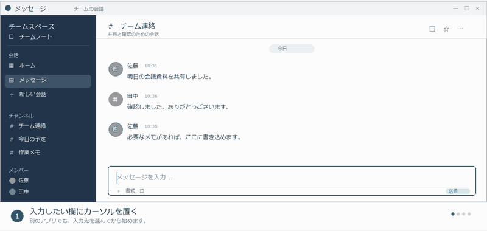</a></figure>
<hr style="border:0;border-top:1px solid var(--rule);margin:18px 0 22px;">

<div class="grid2">
<div class="card">
<h3><span class="dot"></span>オフラインで完結</h3>
<p style="margin-bottom:0">
ネット通信やAIは使いません。APIは不要、アカウントも不要です。入力した内容がパソコンの外に出ることはなく、すべてローカルで実行されます。
</p>
</div>
<div class="card">
<h3><span class="dot"></span>いつでも再変換</h3>
<p style="margin-bottom:0">
確定済みの単語も、クリックや <span class="kbd">F2</span> でいつでも候補から選び直せます。
変換をやり直すために、消して打ち直す必要はありません。
</p>
</div>
</div>
</section>

<a name="picture-index"></a>
<nav class="picture-index" aria-labelledby="contents-heading">
<a name="contents-heading"></a>
<h2>目次</h2>
<p>知りたい項目を選んでください。操作画像はクリックすると拡大できます。</p>
<div class="toc-columns">
<ol class="toc-column">
<li><a href="#screen">画面の見かた</a></li>
<li><a href="#choose">再変換 ― 候補から選び直す</a></li>
<li><a href="#quick">簡易入力ウィンドウ</a><ul><li><a href="#guide-quick">小窓で下書きし、Escで閉じて元の欄へ自動で貼り付ける</a></li></ul></li>
<li><a href="#quick-selected-text">選択した文字を簡易入力へ取り込む</a></li>
<li><a href="#autofix">自動補正</a></li>
<li><a href="#pick">単語を拾って引用する</a><ul><li><a href="#guide-quote">カーソルを置き、本文をクリック／ドラッグして引用する</a></li></ul></li>
<li><a href="#bracket">括弧で括る</a><ul><li><a href="#guide-bracket">選択範囲をボタン／F5で括る</a></li></ul></li>
<li><a href="#listmode">箇条書き・選択範囲の文字種</a><ul><li><a href="#guide-list">本文の文字をクリック／ドラッグして1行ずつ並べる</a></li></ul></li>
<li><a href="#wordbook">単語帳</a><ul><li><a href="#guide-wordbook">文字を登録し、クリックで貼り付ける</a></li></ul></li>
<li><a href="#bulk-insert">一括挿入</a><ul><li><a href="#guide-bulk">複数行の指定位置に同じ文字を入れる</a></li></ul></li>
<li><a href="#lineselect">行をまるごと選ぶ</a></li>
<li><a href="#dragscroll">余白のドラッグでスクロール</a><ul><li><a href="#guide-right-scroll">右クリックしたままドラッグしてスクロールする</a></li></ul></li>
<li><a href="#overview">縮小表示 ― 右ダブルクリック</a><ul><li><a href="#guide-overview">右ボタンを2回押し、2回目を押したまま動かす</a></li></ul></li>
</ol>
<ol class="toc-column" start="14">
<li><a href="#edit">編集の基本機能</a><ul><li><a href="#guide-autosave">保存せずに閉じても次回続きを開く</a></li></ul></li>
<li><a href="#wheel-tabs">ホイールでタブを往復する</a><ul><li><a href="#guide-tabs">ホイールで別のタブへ切り替える</a></li></ul></li>
<li><a href="#search-replace">検索と置換</a><ul><li><a href="#guide-search-return">Ctrl＋Fで検索し、検索前の位置へ戻る</a></li></ul></li>
<li><a href="#goto">Ctrl＋G ― 行へ移る・文字を探す</a></li>
<li><a href="#bookmarks">ブックマーク</a><ul><li><a href="#guide-bookmarks">行番号のダブルクリックで登録し、ボタン／Alt＋上下で移動</a></li></ul></li>
<li><a href="#keyboard-layout">キーボードの配列と形</a></li>
<li><a href="#undo-redo">Undo／Redoの表示</a></li>
<li><a href="#ruler-rows">ルーラーで行に目印を置く</a></li>
<li><a href="#toolbar-settings">ボタンの表示と並べ替え</a></li>
<li><a href="#display">表示の設定</a><ul><li><a href="#guide-whitespace">表示メニューで空白の目印を表示する</a></li><li><a href="#guide-typing-pointer">本文に入力するとポインターが隠れる</a></li></ul></li>
<li><a href="#appearance">外見 ― 配色と装飾</a></li>
<li><a href="#ctrl-navigation">Ctrlキーによるカーソル移動</a><ul><li><a href="#guide-cursor">Ctrl＋左右キーで日本語向けにカーソル移動</a></li><li><a href="#guide-cursor-vertical">Ctrl＋上下キーで本文のまとまりを移動</a></li></ul></li>
<li><a href="#edit-shortcuts">編集のショートカット</a><ul><li><a href="#guide-capslock">CapsLockで文字を削除</a></li><li><a href="#guide-copy">F1でコピー</a></li><li><a href="#guide-enter">F3でエンター</a></li><li><a href="#guide-paste">F4でペースト</a></li></ul></li>
<li><a href="#faq">よくある質問</a></li>
<li><a href="#shortcuts">ショートカット一覧</a></li>
</ol>
</div>
</nav>

<a name="screen"></a>
<section>
<hr class="section-rule">
<h2>画面の見かた</h2>
<p class="sec-intro">CorrectNote には、書き方の異なる2つの画面レイアウトがあります。ツールバーの
<span class="kbd">左右に並べる</span> と <span class="kbd">1つにまとめる</span> のボタンで、いつでも切り替えられます。</p>
<figure class="guide-shot"><a href="assets/readme_manual/manual-002.png">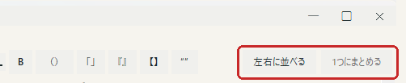</a><figcaption>画面右上のボタンで、レイアウトを切り替えます。</figcaption></figure>

<p>文章の補正は入力に合わせて進みます。日本語を変換している途中の文字は書き換えません。</p>
<p>行番号の右端にある薄い茶色の線は、補正の確認がまだ済んでいない行の目印です。確認が済むと消えます。</p>

<h3><span class="dot"></span>左右に並べるレイアウト（既定）</h3>
<p>左に自分が打った文章、右にその補正結果を表示します。両者は常に見比べられる状態にあります。</p>
<div class="mock">
<div class="bar"><div class="dots"><span></span><span></span><span></span></div>CorrectNote</div>
<div class="body">
<div class="pane">
<div class="ptitle">メモ（入力）</div>
文字入力を<mark class="s">性格</mark>に反映する
</div>
<div class="pane">
<div class="ptitle">補正結果</div>
文字入力を<b>正確</b>に反映する
</div>
</div>
</div>
<ul>
<li><b>左（メモ欄）</b> ― 打った内容がそのまま残ります。色の付いた箇所に、補正の候補があります。</li>
<li><b>右（補正欄）</b> ― 自動的に直った結果を表示します。単語をクリックすると、
別の候補に選び直せます（詳しくは<a href="#choose">再変換</a>）。</li>
</ul>

<h3><span class="dot"></span>1つにまとめるレイアウト</h3>
<p>
入力欄と補正欄をひとつにまとめ、画面を広く使えるようにしたレイアウトです。
確定した単語を右クリックで再変換できます。
</p>
<div class="mock">
<div class="bar"><div class="dots"><span></span><span></span><span></span></div>CorrectNote ― 1つにまとめる</div>
<div class="body">
<div class="pane" style="flex:1">
<div class="ptitle">メモ</div>
文字入力を<mark class="s">性格</mark>に反映する
</div>
</div>
</div>
 

<p>文字入力時、マウスポインターを隠します。上部メニューなどにある場合は表示したままです。マウスを動かす・ドラッグする・別のアプリへ切り替えると表示が戻り、次の文字入力で再び隠れます。</p>

<h3><span class="dot"></span>色の意味</h3>
<div class="swatch-row">
<span class="swatch"><i style="background:#f8cdc1;border-color:#e9c9c3"></i>補正の候補がある箇所</span>
<span class="swatch"><i style="background:#e6cbf3"></i>不自然な文字列</span>
<span class="swatch"><i style="background:#e9eff1"></i>マウスが乗っている語（選び直せる合図）</span>
<span class="swatch"><i style="background:#ffe9a8"></i>検索で見つかった箇所</span>
</div>

<h3><span class="dot"></span>紫 ― 不自然な文字列</h3>
<p>
メモ欄の文字が<b>紫</b>で塗られているときは、CorrectNote が補正しようとしたが、
補正する文字列を見つけられなかったものです。
</p>
<p>
その場合は必要に応じて、クリックや <span class="kbd">F2</span> で候補から選び直せます（<a href="#choose">再変換</a>）。
</p>
</section>

<a name="choose"></a>
<section>
<hr class="section-rule">
<h2>再変換 ― 候補から選び直す</h2>
<p class="sec-intro">確定済みの単語を、いつでも再変換できます。自動で直らなかった語や、直った語をさらに別の表記に変えたいときも、同じ操作で選び直せます。</p>

<p>別の表記に変えたいときは、一覧に表示される候補から選べます。
入力欄・補正欄・簡易入力で利用でき、候補を選ぶと必要な語の範囲をまとめて変更します。
一覧を開いた後にその行を編集した場合は、候補を開き直してください。</p>

<h3><span class="dot"></span>F2 でスムーズに直す</h3>
<p>
メモ欄で <span class="kbd">F2</span> を押すと、カーソルのすぐ前の語の候補が開きます。
一覧を開いたまま <span class="kbd">F2</span> を押すたびに、対象がひとつ左の語へ移っていくので、
少し前に書いた語も手を止めずにたどって直せます。いま対象になっている語には色が付きます。
行の先頭まで来たら、前の行の末尾の語へ続けて遡ります。
簡易入力ウィンドウの中でも同じように使えます。
</p>
<figure class="guide-shot"><a href="assets/readme_manual/manual-003.gif">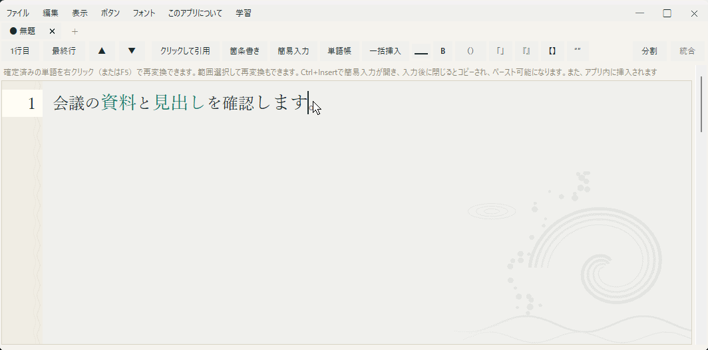</a><figcaption>F2を押すたび、候補を開く対象の語が左へ移ります。</figcaption></figure>

<h3><span class="dot"></span>左右キーで対象の語を選び直す</h3>
<p>
候補の一覧が開いているあいだ、<span class="kbd">←</span>
<span class="kbd">→</span> キーで<b>対象の語を前後に移せます</b>。
上下キーは候補を選ぶために使います。
</p>

<h3><span class="dot"></span>範囲選択で選ぶ</h3>
<p>
<b>範囲をドラッグで選んでから</b>右クリックすると、選んだ範囲で候補を探します。
</p>

</section>

<a name="quick"></a>
<section>
<hr class="section-rule">
<h2>簡易入力ウィンドウ</h2>
<p class="sec-intro">別のアプリを使っている最中でも、補正付きの下書きをすぐに書ける小さなウィンドウです。CorrectNoteを開いておき、<span class="kbd">Ctrl+Insert</span> または <span class="kbd">Ctrl+Shift+-</span> で呼び出します。簡易入力はほかのウィンドウより手前に表示されます。</p>
<p>簡易入力の窓が開いたまま、ほかのウィンドウの後ろに隠れているときにショートカットキーを押すと、簡易入力が前に出て、入力欄にカーソルが入ります。簡易入力が前に出ているときに押すと、最小化します。</p>
<a name="guide-quick"></a>
<article class="picture-guide">
<h3>小窓で下書きし、Escで閉じて元の欄へ自動で貼り付ける</h3>
<p>別アプリの入力欄にカーソルを置いてCtrl+Insertで小窓を開き、下書きします。Escで閉じると、初期設定では開く前に使っていた入力欄へ自動で貼り付けられます。本体から開いた場合は、カーソル位置に挿入されます。</p>
<figure class="guide-shot"><a href="assets/readme_manual/manual-004.gif">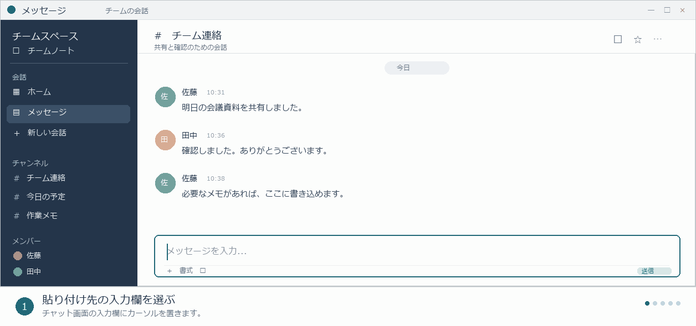</a><figcaption>チャット画面風のイメージです。小窓は背景画面と同じ縮尺で約3分の1幅です。図のCtrl+Vは、自動貼り付けをオフにした場合の操作です。初期設定ではEscで閉じると、元の入力欄へ自動で貼り付けられます。</figcaption></figure>
<ol class="steps picture-steps">
<li><h4>貼り付け先の入力欄を選びます</h4><p>別アプリでは、文章を入れたい欄にカーソルを置いてからCtrl+Insertを押します。本体で使うときは、本文の挿入位置にカーソルを置いて「簡易入力」を押します。</p></li>
<li><h4>小窓で下書きします</h4><p>普通の入力欄と同じように入力できます。Enterで改行でき、文字の長さに合わせて窓の大きさが変わります。</p></li>
<li><h4>Escで閉じ、元の入力欄へ貼り付けます</h4><p>別アプリから開いた場合は、初期設定で元の入力欄へ自動貼り付けされます。自動貼り付けをオフにした場合は、戻った欄でCtrl+Vを押します。本体から開いた場合は、文章が挿入位置に入ります。</p></li>
</ol>
<p class="guide-note">自動貼り付けは表示メニューの「簡易入力を閉じたら、元の入力欄へ貼り付ける」で切り替えられます（初期状態はオン）。簡易入力を開いたあとでほかのアプリへ切り替えてから閉じても、開く前の入力欄へ戻ってから貼り付けます。元の入力欄へ戻れなかったときは貼り付けず、窓の下の欄に「元の入力欄に戻れなかったので貼り付けていません」と表示します。オフの場合も下書きはクリップボードにコピーされるため、貼り付け先でCtrl+Vを押せます。<br>下書きをクリップボードに残したくないときは、表示メニューの「簡易入力を閉じたら、クリップボードに入れる」をオフにします（初期状態はオン）。オフでも、元の入力欄への自動貼り付けは行います。ほかのアプリへ貼り付けるときだけ約1秒クリップボードを使い、その後は元の内容に戻します。</p>

<p class="guide-back"><a href="#picture-index">目次に戻る</a></p></article>
<h3><span class="dot"></span>こんなときに使えます</h3>
<ul>
<li><b>思いつきをすぐにメモする。</b>作業中に浮かんだことを簡易入力へ書き、<span class="kbd">Esc</span> で閉じると本体のメモへ残せます。</li>
<li><b>Slackなどに送る文章を先に整える。</b> 簡易入力の中では <span class="kbd">Enter</span> が改行になるので、送信を気にせず複数行の下書きを書けます。Escで閉じると、初期設定では下書きが元の送信欄へ自動で貼り付けられます。</li>
        
</ul>
      
      

      

<h3><span class="dot"></span>簡易入力でも引用など利用可能</h3>
<p>
窓の中でも <span class="kbd">F1</span> または選択なしの <span class="kbd">Ctrl</span>+<span class="kbd">C</span> で
引用モードに入り、本体のメモ欄にある語をクリックして拾えます（範囲をドラッグして選ぶこともできます）。
<span class="kbd">F2</span> での再変換・遡りも本体と同じように使えます。
選んだ後も、同じ語の候補を開いて選び直せます。
</p>
<p>
<span class="kbd">F5</span> で括弧を挿入し、続けて押すと括弧の種類を切り替えます。
選択範囲や <span class="kbd">F2</span> で選んだ語を囲む操作、修飾キーとの組合せも本体と共通です。
IME変換中は確定した文字を囲みます。直後の <span class="kbd">Esc</span> で括弧を取り消し、
もう一度押すと簡易入力を閉じます。
</p>

    
</section>

<a name="quick-selected-text"></a>
<section>
<hr class="section-rule">
<h2>選択した文字を簡易入力へ取り込む</h2>
<p>本体のメモや補正結果、別のアプリで選択した文字を、簡易入力の下書きへ取り込めます。ブラウザーのページで見つけた文章やチャット履歴の文字を使いたいときも、次の手順で呼び出します。</p>
<figure class="guide-shot"><a href="assets/readme_manual/manual-005.gif">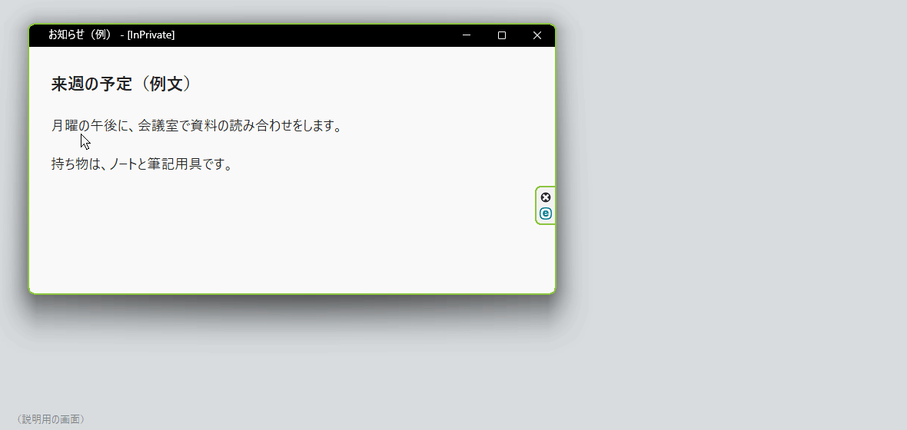</a><figcaption>ブラウザで選んだ文字が、開いた簡易入力に入ります。</figcaption></figure><ol class="steps">
<li><b>取り込みたい文字を選択します。</b><p>本体ではメモ欄か補正結果、別のアプリではそのページや入力欄で文字を選択したままにします。</p></li>
<li><b>簡易入力を呼び出します。</b><p>本体では「簡易入力」ボタンを押します。別のアプリでは、<span class="kbd">Ctrl+Insert</span> または <span class="kbd">Ctrl+Shift+-</span> を押します。呼び出しキーは「表示」メニューで個別にオン・オフを切り替えられます。</p></li>
<li><b>取り込んだ文字を確かめて編集します。</b><p>選択文字は簡易入力のカーソル位置に追加されます。以前の下書きは残り、取り込んだ分は1回のUndoで戻せます。</p></li>
</ol>
<p>Excelのセルなど表の文字は、列の間をタブ、行の間を改行で区切って取り込みます。</p>


<p class="guide-back"><a href="#picture-index">目次に戻る</a></p>
</section>

<a name="autofix"></a>
<section>
<hr class="section-rule">
<h2>自動補正</h2>
<p>補正には未解決の不一致があります。直らない入力、意図と異なる変換、漢字表記まで完成しない場合があるため、補正後の本文を確認してください。</p>
<p class="sec-intro">入力した文章の誤字や誤変換を自動的に直します。「左右に並べる」レイアウトでは、右の補正欄で結果を確認できます。</p>

<table class="keys">
<tr><th>誤りの種類</th><th>説明・例</th></tr>
<tr><td>キーの押し間違い</td><td>例：荷物を起きて → 荷物を置いて</td></tr>
<tr><td>濁点・半濁点の付け忘れ／余分</td><td>「゛」「゜」の有無や位置の誤り</td></tr>
<tr><td>「ゃ」「っ」などの小書き忘れ</td><td>小さいかなを、大きいかなで入力した誤り</td></tr>
<tr><td>1文字の打ち忘れ</td><td>囚虜時 → 終了時（「しゅうりょじ」と入力した場合も対象）</td></tr>
<tr><td>余分な隣接キーの巻き込み</td><td>右田でブルクリック → 右ダブルクリック</td></tr>
<tr><td>打つ順番の入れ替わり</td><td>続けて打つキーの順序が逆になった誤り</td></tr>
<tr><td>濁点・半濁点が離れて入力された</td><td>保存したか゜像を確認します。 → 保存した画像を確認します。</td></tr>
<tr><td>文中の誤変換</td><td>出るカマで考える → 出るかまで考える</td></tr>
<tr><td>日本語入力をオフのまま入力</td><td>md@i(4l)h → 文字入力</td></tr>
<tr><td>日本語入力オフのままローマ字入力</td><td>mojinyuuryoku → 文字入力</td></tr>
<tr><td>文頭の「?」（変換前の記号の打ち間違い）</td><td>?今日の予定 → ・今日の予定</td></tr>
</table>
<figure class="guide-shot"><a href="assets/readme_manual/manual-006.svg">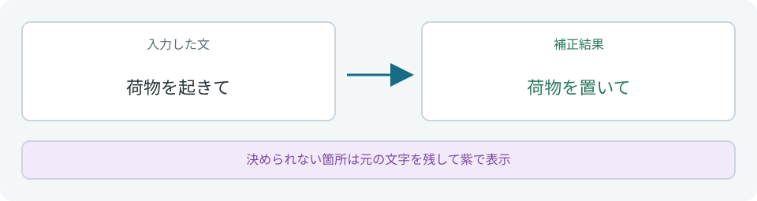</a><figcaption>補正先を決められない箇所は元の文字を残して紫で示します。</figcaption></figure>      <p>
かなで入力した言葉を漢字・カタカナへ変換する補正にも対応しています。
直せない不自然な箇所は、元の文字を残して紫で示します。
</p>
<p>
「1つにまとめる」レイアウトでも、自動補正を有効にすると、入力した文と貼り付けた文を補正します。
複数行の貼り付けも対象です。
</p>

<p>意図と違う補正になったときは、<a href="#choose">再変換</a>で候補から別の表記を選び直せます。補正先を決められない不自然な箇所は、元の文字を残して紫で示します。</p>

</section>


<a name="pick"></a>
<section>
<hr class="section-rule">
<h2>単語を拾って引用する</h2>
<p class="sec-intro">
メモの中で、以前に書いた単語をもう一度使いたいときに、探して打ち直す手間を省く機能です。
</p>
      
<a name="guide-quote"></a>
<article class="picture-guide">
<h3>カーソルを置き、本文をクリック／ドラッグして引用する</h3>
<p>本文にある文字を、別の場所へコピーして差し込めます。</p>
<figure class="guide-shot"><a href="assets/readme_manual/manual-007.gif">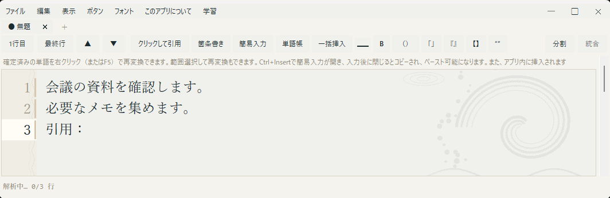</a><figcaption>「クリックして引用」を押してから本文をドラッグすると、カーソルの位置へ写ります。</figcaption></figure>
<ol class="steps picture-steps">
<li><h4>差し込み先にカーソルを置きます</h4><p>先に、文字を入れたい場所を決めます。例では3行目の「引用：」の直後です。</p>
</li>
<li><h4>「クリックして引用」を押します</h4><p>ボタンを押すと引用モードになり、本文の上に操作案内が出ます。選択していない状態のF1やInsertでも始められます。</p>
</li>
<li><h4>拾いたい文字を選びます</h4><p>単語ならクリックします。複数の文字をまとめて拾う場合は、左ボタンを押したまま範囲をドラッグします。</p>
</li>
<li><h4>マウスボタンを離します</h4><p>選んだ文字が、最初に指定した差し込み先へコピーされ、引用モードが終わります。元の文章は残ります。</p>
</li>
</ol>
<p class="guide-note">中断するときはEscを押します。別タブの文字も拾えます。文字を選択した状態のF1は通常のコピーになるので、引用を始める場合は先に選択を解除してください。</p>
<p class="guide-back"><a href="#picture-index">目次に戻る</a></p></article>
<p>
<span class="kbd">=</span>（全角では<span class="kbd">Shift</span>+<span class="kbd">-</span>）
キーからも同じモードに入れます。まず「＝」がその場に打たれ、
そのまま文字を入力すると引用を解除し、「＝」の文字が残ります。矢印キーでの移動・範囲選択は続けられます。
単語を引用できたときだけ、その「＝」は消えて引用した語に置き換わります。
</p>
<h3><span class="dot"></span>行番号を入力して引用する</h3>
<p>
選択なしの <span class="kbd">Ctrl</span>+<span class="kbd">C</span> または
<span class="kbd">クリックして引用</span> で引用モードに入り、行番号を数字だけで入力して
<span class="kbd">Enter</span> を押すと、その行の本文を差し込みます。入力した行番号は引用文に置き換わります。<b>-1</b>は1行前、<b>+1</b>は1行後、符号の後の数値で相対行を指定できます。折り返しではなく改行で区切った行を数えます。簡易入力では開始時の本体カーソル行を基準にします。範囲外なら入力を残してモードを続けます。
</p>
<h3><span class="dot"></span>数式を入力して計算する</h3>
<p>
選択なしで <span class="kbd">Ctrl</span>+<span class="kbd">C</span> を押すか、
<span class="kbd">クリックして引用</span> ボタンを押してから数式を入力し、
<span class="kbd">Enter</span> で確定すると引用モードが終わります。イコールは不要です。
四則演算・小数・括弧と全角の数字や記号を使えます。
符号付き整数だけは相対行番号です。計算には <b>40+0</b> や <b>-1+2</b> のように数値の後ろへ演算子を入れてください。計算を続ける場合も <b>+3*1</b> のように数値の後ろに演算子を付けてください。
</p>
<p>
メモ欄には式の原文を残し、補正欄には半角の計算結果を表示します。
統合表示では自動補正オプションに従って結果を表示します。
簡易入力での選択なしコピーも利用でき、その窓の自動補正オプションに従います。
式が未完成なら、入力を続けてからEnterで確定できます。
入力中の式は、確定または取消しまで自動で書き換えません。
</p>
    
</section>

<a name="bracket"></a>
<section>
<hr class="section-rule">
<h2>括弧で括る</h2>
<p>F5を続けて押すと、表示設定で有効にした括弧の種類を順番に切り替えます。</p>
<p class="sec-intro">ツールバーのボタンで、文字を括弧で囲めます。</p>
<table class="keys">
<tr><th>ボタン</th><th>括弧の種類</th></tr>
<tr><td class="k">（）</td><td>丸括弧</td></tr>
<tr><td class="k">「」</td><td>かぎ括弧</td></tr>
<tr><td class="k">『』</td><td>二重かぎ括弧</td></tr>
<tr><td class="k">【】</td><td>すみ付き括弧</td></tr>
<tr><td class="k">“”</td><td>ダブルクォーテーション</td></tr>
</table>
<p>
範囲を選択してから押すと、選んだ文字の頭と末尾をその括弧で囲みます。
何も選んでいないときは、カーソルの位置に括弧だけが差し込まれ、
カーソルは開き括弧のすぐ後ろに残るので、そのまま中身を書き始められます。
</p>
<p>
<span class="kbd">F5</span>を続けて押すと、直前の括弧を置き換えながら
（）→「」→『』→【】→“”→（）の順に切り替わります。
選択範囲の中またはすぐ外に対応する括弧があれば差し替えます。F5で両端と指定の括弧が同じなら次の種類へ進みます。
括弧ボタンは指定の種類へ差し替え、同じボタンを押しても括弧を取り除きません。
<span class="kbd">Esc</span>で直前の括弧操作を取りやめ、差し替え前の括弧へ戻します。
ほかの場所のクリック、上下キー、タブ移動の後はその括弧が確定します。
</p>
<a name="guide-bracket"></a>
<article class="picture-guide">
<h3>選択範囲をボタン／F5で括る</h3>
<p>選んだ文字を、ボタンやF5で括弧に包みます。</p>
<figure class="guide-shot"><a href="assets/readme_manual/manual-008.gif">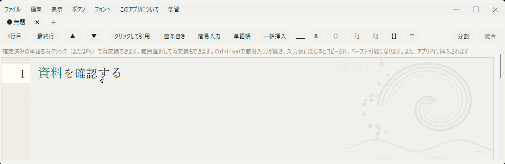</a><figcaption>「」ボタンで括り、F5で種類を切り替え、Escで括る前に戻します。</figcaption></figure>
<ol class="steps picture-steps">
<li><h4>括りたい文字を選択します</h4><p>本文をドラッグし、括弧に入れたい部分を選びます。</p>
</li>
<li><h4>使いたい括弧のボタンを押します</h4><p>一括挿入の右にある（）・「」・『』・【】・“”から選びます。例では「」を押します。</p>
</li>
<li><h4>F5で種類を切り替えられます</h4><p>続けてF5を押すたびに括弧の種類が変わります。既存の括弧を重ねるのではなく、種類を差し替えます。</p>
</li>
<li><h4>取りやめるときはEscを押します</h4><p>ほかの場所をクリックする前など、括弧操作を続けている間ならEscで元へ戻せます。</p>
</li>
</ol>
<p class="guide-note">文字を選んでいない場合は、空の括弧をカーソル位置へ入れます。そのまま括弧の中に入力できます。</p>
<p class="guide-back"><a href="#picture-index">目次に戻る</a></p></article>
</section>

<a name="listmode"></a>
<section>
<hr class="section-rule">
<h2>箇条書き・選択範囲の文字種</h2><a name="guide-list"></a>
<article class="picture-guide">
<h3>本文の文字をクリック／ドラッグして1行ずつ並べる</h3>
<p>本文から拾った文字を、1行ずつ順番に並べます。</p>
<figure class="guide-shot"><a href="assets/readme_manual/manual-009.gif">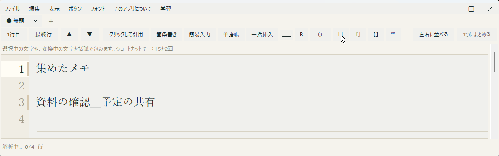</a><figcaption>拾った文字が、見出しの下に1行ずつ並びます。</figcaption></figure>
<ol class="steps picture-steps">
<li><h4>並べ始める位置を決めます</h4><p>見出しなど、一覧を作りたい場所の行にカーソルを置きます。</p>
</li>
<li><h4>「箇条書き」を押します</h4><p>上部の「箇条書き」ボタンで開始します。本文の上に操作案内が表示されます。</p>
</li>
<li><h4>最初の文字を拾います</h4><p>単語をクリックするか、範囲をドラッグして離します。カーソル行の下に空白行を1行挟んで、拾った文字を写します。</p>
</li>
<li><h4>続けて拾い、Escで終了します</h4><p>次の文字も同じ操作で拾うと、その下の行に追加します。並べ終えたらEscを押します。通常の文字入力でもモードを終了できます。</p>

</li>
<li><h4>簡易入力から送った文字も並べられます</h4><p>簡易入力から送った文字に背景色が付いている場合は、「箇条書き」を押すと、その背景の区切りごとに文字を抜き出して改行します。</p>
<figure class="guide-shot"><a href="assets/readme_manual/manual-010.svg">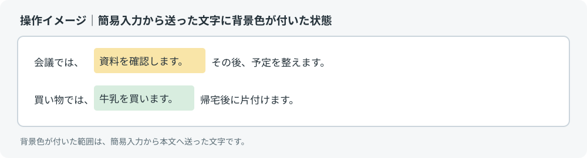</a><figcaption>背景色が付いた部分は、簡易入力から本文へ送った文字です。</figcaption></figure>
<figure class="guide-shot"><a href="assets/readme_manual/manual-011.svg">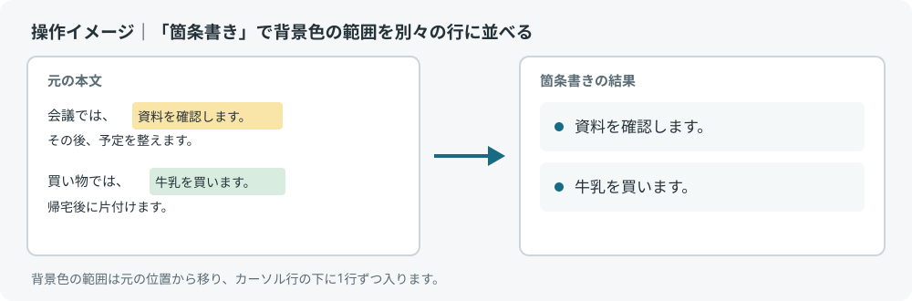</a><figcaption>「箇条書き」で、背景色の範囲を元の文から抜き出して1行ずつ並べます。</figcaption></figure></li>
</ol>
<p class="guide-note">クリックやドラッグで拾うときは元の文字が残ります。簡易入力の背景色から並べる場合は、その部分を元の場所から移します。</p>
<p class="guide-back"><a href="#picture-index">目次に戻る</a></p></article>

<p>括弧ボタン群の左の<b>箇条書き</b>を押し、単語をクリックするか範囲をドラッグします。
開始時のカーソル行の下に空白行を1行挟み、拾った文字を写します。モードは継続し、次に拾った文字は次の行へ追加します。
<span class="kbd">Esc</span>または文字入力で解除します。別タブで拾った場合も開始したタブへ戻して写します。</p>
<p>簡易入力から送った文字に背景色が付いている場合は、背景の区切りごとにその部分だけを元の文から抜き出し、
カーソル行の下に空白行を挟んで1行ずつ並べます。この操作の後はモードを終了します。
並べた最後の行のすぐ次の行に別の文字があるときは、間に空白行を1行入れて区切ります。
改行を含む項目は、前後に空白行を1行ずつ入れて区切ります。空白行が2行続くことはありません。</p>
<p>メモ欄・簡易入力の選択範囲は、<span class="kbd">F6</span>で平仮名、<span class="kbd">F7</span>でカタカナ、
<span class="kbd">F8</span>で半角、<span class="kbd">F9</span>でJISかな配列の英数字キー列へ変換できます。
漢字も平仮名やカタカナへ変換できます。F8では半角カタカナになります。変換できない文字はそのまま残ります。取り消しはCtrl+Zです。</p>
    
</section>

<a name="wordbook"></a>
<section>
<hr class="section-rule">
<h2>単語帳</h2>
<p>単語帳に登録した語をクリックすると、直前に使っていた入力欄へ自動で貼り付けます。よく使う単語をすぐ入力できます。</p>
<p>単語帳ウインドウの追加を押してから単語をクリック、または範囲をドラッグすると、その文字列を登録できます。</p>
<p><b>編集 → 単語帳セットを切り替える</b>からセット1〜4を選べます。
<b>現在の単語帳をリセットする</b>では、表示されたセット番号を確認してから消去します。
選択していないセットは消えません。</p>
<p>登録内容、選択中のセット、幅、表示状態を保存し、次回起動時に復元します。
上部の色が付いた帯をドラッグすると、単語帳を移動できます。右端の「－」は最小化ボタンです。単語帳は本体と別に最小化できます。簡易入力と同じく、タスクバーやAlt+Tabから独立して切り替えられます。本体の単語帳ボタンでも戻せます。貼り付け後は直前の窓へ戻りますが、その窓が閉じられた場合や既に別の窓へ切り替えた場合は移動しません。</p>
<p>単語帳の語を押したときに、その語をクリップボードにも残すかどうかは、編集メニューの「単語帳を押したら、クリップボードに入れる」で切り替えます（初期状態はオン）。オフのときも貼り付けは行います。CorrectNote の中の欄へは直接入れ、ほかのアプリへ貼り付けるときだけ約1秒クリップボードを使って、その後は元の内容に戻します。</p>
<h3><span class="dot"></span>並べ替える</h3>
<p>登録した語を<b>左ボタンで押したまま上下に少し動かす</b>と、並べ替えになります。入る位置に線が出て、ボタンを離した位置へ移ります。<span class="kbd">Esc</span> を押すか、一覧の外で離すと元の並びのままです。並べ替えたときは貼り付けません。</p>
<p>語を右クリックして「ひとつ上と入れ替え」を選ぶと、1つ上の語と入れ替わります（いちばん上の語では選べません）。並び順は保存され、次回起動時も同じ順で表示されます。</p>
<figure class="guide-shot"><a href="assets/readme_manual/manual-012.png">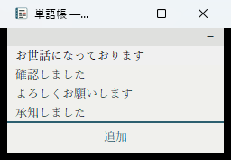</a><figcaption>押したまま動かすと、入る位置に線が出ます。</figcaption></figure>
<a name="guide-wordbook"></a>
<article class="picture-guide">
<h3>文字を登録し、クリックで貼り付ける</h3>
<p>よく使う文字を登録しておき、ボタンをクリックすると直前の入力欄へ自動で貼り付けます。</p>
<ol class="steps picture-steps">
<li><h4>「単語帳」を押します</h4><p>「簡易入力」の右側にあるボタンから開きます。単語帳は本体と別のウインドウです。</p>

</li>
<li><h4>「追加」を押し、登録する範囲を選びます</h4><p>単語帳の「追加」を押してから、本体の単語をクリックするか、文字をドラッグして離します。</p>
<figure class="guide-shot"><a href="assets/readme_manual/manual-013.gif">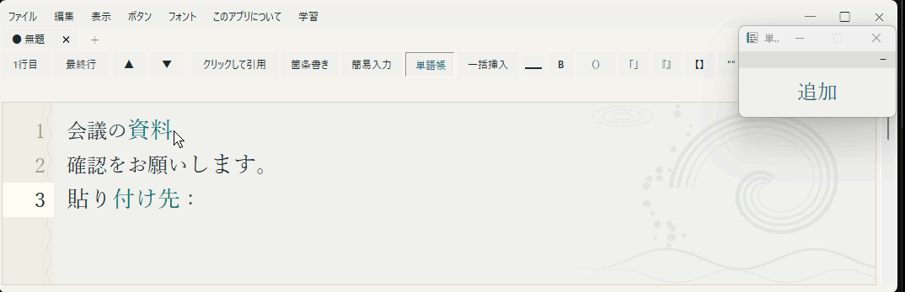</a><figcaption>「追加」を押してから本文をドラッグすると、その文字が単語帳に入ります。</figcaption></figure></li>
<li><h4>登録した語をクリックします</h4><p>文字が単語帳のボタンになります。そのボタンを押すと、直前に使っていた入力欄へ貼り付けられます。</p>
<figure class="guide-shot"><a href="assets/readme_manual/manual-014.gif"></a><figcaption>単語帳の語をクリックすると、直前の入力欄のカーソル位置へ入ります。</figcaption></figure></li>
<li><h4>貼り付け結果を確認します</h4><p>直前に使っていた入力欄へ戻り、登録した語が入力されます。</p>
</li>
<li><h4>移動や最小化もできます</h4><p>上部の少し色が違う帯を左ドラッグすると移動します。右上の「－」で最小化できます。タスクバーやAlt+Tab、本体の単語帳ボタンから戻せます。</p>
<figure class="guide-shot"><a href="assets/readme_manual/manual-015.png">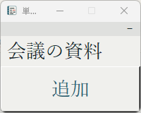</a><figcaption>上の帯が移動用、右上の「－」が最小化用です。</figcaption></figure></li>
</ol>
<p class="guide-note">登録内容はアプリを閉じても残ります。語を消すときは、そのボタンを右クリックして「消す」を選びます。「編集 → 単語帳セットを切り替える」から、4セットを使い分けられます。</p>
<p class="guide-back"><a href="#picture-index">目次に戻る</a></p></article>
</section>

<a name="bulk-insert"></a>
<section>
<hr class="section-rule">
<h2>一括挿入</h2>
<a name="guide-bulk"></a>
<article class="picture-guide">
<h3>複数行の指定位置に同じ文字を入れる</h3>
<p>選択した各行の指定位置に、同じ文字列をまとめて入れます。</p>
<ol class="steps picture-steps">
<li><h4>挿入する範囲を選びます</h4><p>対象の文字をドラッグして選択します。行の途中から選んだ場合は、その行の選択部分の先頭と末尾を基準に数えます。選択外の文字は基準に含めません。</p>
<figure class="guide-shot"><a href="assets/readme_manual/manual-016.png">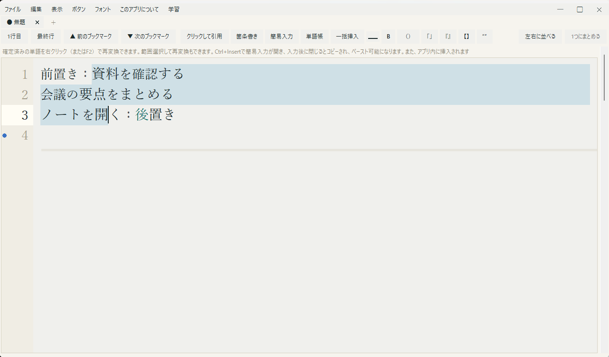</a><figcaption>1行目の「前置き：」と3行目の「：後置き」は選択外です。</figcaption></figure></li>
<li><h4>「一括挿入」を開いて指定します</h4><p>単語帳の右の「一括挿入」を押します。「先頭から」または「末尾から」を選び、数値と挿入する文字列を入力します。数値は直接入力・上下ボタン・右の▼から変更できます。</p>
<figure class="guide-shot"><a href="assets/readme_manual/manual-017.png">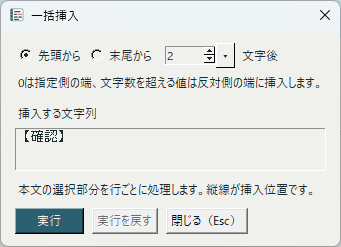</a><figcaption>先頭から2文字後へ「【確認】」を入れる指定です。</figcaption></figure>
<figure class="guide-shot"><a href="assets/readme_manual/manual-018.png"></a><figcaption>窓を操作している間も本文の選択範囲が見え、縦線が文字間の挿入位置を示します。</figcaption></figure></li>
<li><h4>縦線を見ながら位置を調整します</h4><p>数値を変えると縦線も動きます。例では0に変更し、各行の選択部分の先頭へ挿入する位置にしています。末尾から0なら、各選択部分の末尾です。</p>
<figure class="guide-shot"><a href="assets/readme_manual/manual-019.png">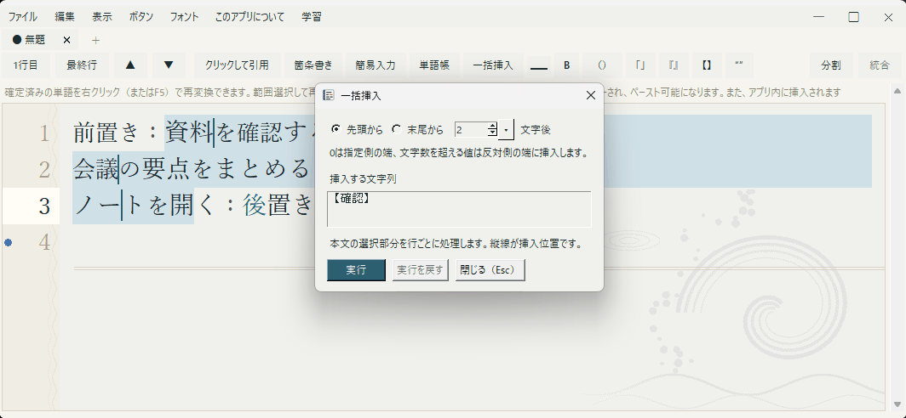</a><figcaption>先頭から0文字後へ変更しました。</figcaption></figure>
<figure class="guide-shot"><a href="assets/readme_manual/manual-020.png">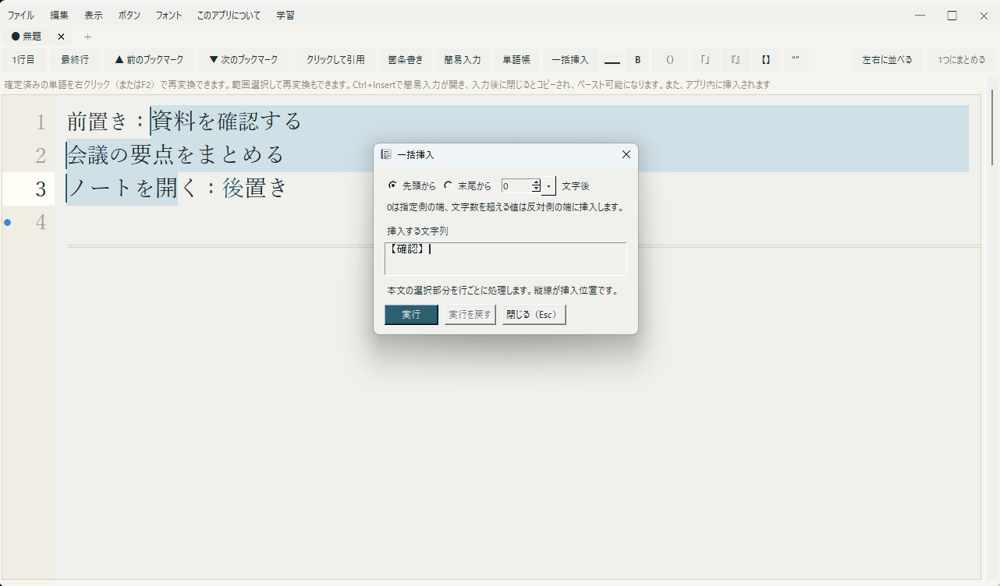</a><figcaption>縦線が各行の選択部分の先頭へ移りました。</figcaption></figure></li>
<li><h4>左側の「実行」を押します</h4><p>各行の縦線の位置に同じ文字が入ります。位置が文字数を超える場合は、先頭指定なら末尾へ、末尾指定なら先頭へ入れます。</p>
<figure class="guide-shot"><a href="assets/readme_manual/manual-021.png"></a><figcaption>3行それぞれの選択部分の先頭へ「【確認】」が入りました。</figcaption></figure>
<figure class="guide-shot"><a href="assets/readme_manual/manual-022.png">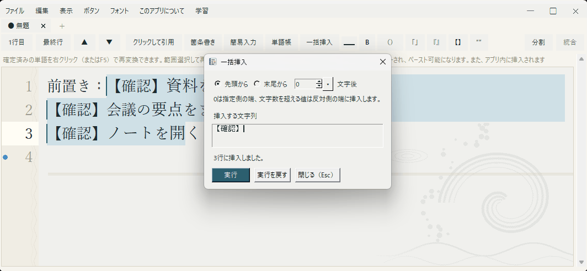</a><figcaption>実行した行数を確認できます。</figcaption></figure></li>
<li><h4>必要なら「実行を戻す」、終わったら「閉じる」を押します</h4><p>中央の「実行を戻す」で直前の一括挿入を取り消します。右の「閉じる」、または本体・一括挿入窓でEscを押すと閉じます。文字列と位置指定は次回起動にも残ります。</p>
<figure class="guide-shot"><a href="assets/readme_manual/manual-023.png">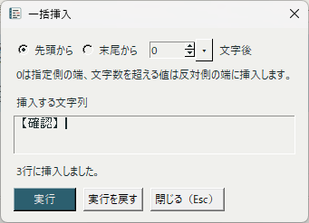</a><figcaption>直前の実行を戻した状態です。元の選択範囲も戻ります。</figcaption></figure></li>
</ol>
<p class="guide-note">続けて行った一括挿入は順に戻せます。途中で別の本文編集やタブ切替をした場合は、「実行を戻す」の対象外になります。</p>
<p class="guide-back"><a href="#picture-index">目次に戻る</a></p></article>
</section>

<a name="lineselect"></a>
<section>
<hr class="section-rule">
<h2>行をまるごと選ぶ</h2>
<p>
行番号を<b>クリック</b>すると、その行がまるごと選択されます。
そのまま上下に<b>ドラッグ</b>すれば、複数の行をまとめて選べます。
選んだあとは、コピー・削除・括弧で括るなど、通常の選択範囲と同じように扱えます。
</p>
<figure class="guide-shot"><a href="assets/readme_manual/manual-024.gif">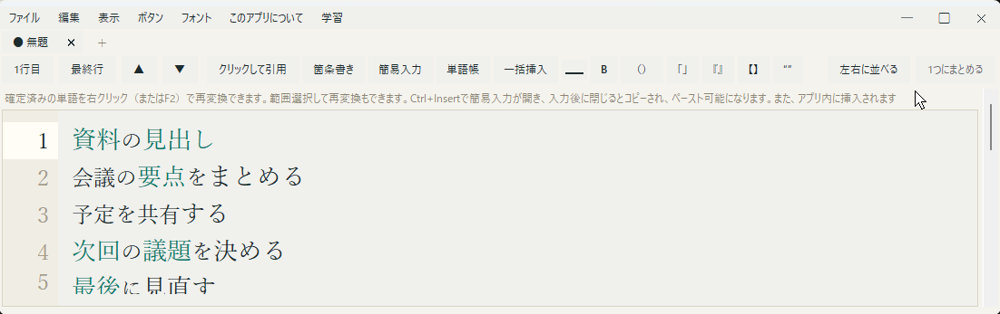</a><figcaption>行番号のドラッグで行をまとめて選び、Shift＋スペースとShift＋上下キーでも選べます。</figcaption></figure>
<p>
本文欄・補正欄・行番号の選択でも、本文を含む通常の複数行選択では、上下端の空白だけの行を自動で選択範囲から外します。
途中の空行、本文行の字下げ・行末の空白は残ります。範囲全体が空白だけの行なら、その選択を保ちます。
すでに選択範囲がある状態でShiftを使って広げたり縮めたりする場合も、空白行を含む範囲を保ちます。
</p>
<figure class="guide-shot"><a href="assets/readme_manual/manual-025.gif">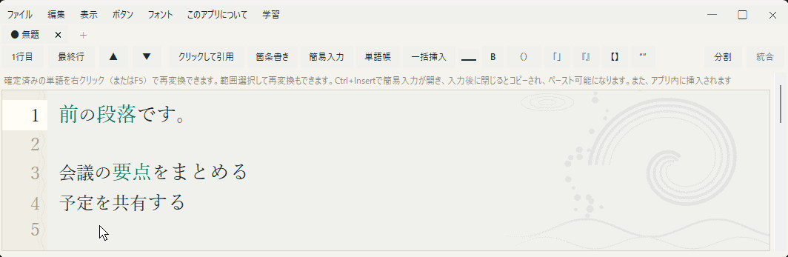</a><figcaption>空白行から空白行までドラッグしても、離すと本文の行だけが選ばれます。</figcaption></figure>
<h3><span class="dot"></span>キーボードだけで選ぶ・印を付ける</h3>
<p>
<b>Shift+スペース</b>で、カーソルのある<b>行の中身</b>が選ばれます。
行番号のクリックと違って<b>末尾の改行を含みません</b>ので、コピーしてそのまま別の行へ貼り直せます。
1行を選んでもう一度押すと、<b>前後の空白を除いた中身</b>まで狭まります。
複数行の一部を先に選んでいるときは、その範囲の行全体まで選択が広がります。
Shiftを押したまま上下キーを押すと、最初の行を起点に行単位で選択を広げたり縮めたりできます。
</p>
<p>
<b>Ctrl+スペース</b>で、その行の<b>ブックマークを付け外し</b>できます。
複数の行を選んでいるときはまとめて扱い、<b>すべてに付いていれば外し、そうでなければすべてに付けます</b>。
</p>
<div class="callout tip">
<div class="icon">🔖</div>
<div><p>行番号を<b>ダブルクリック</b>しても、選択ではなくブックマークになります（詳しくは「編集の基本機能」）。</p></div>
</div>
</section>

<a name="dragscroll"></a>
<section>
<hr class="section-rule">
<h2>余白のドラッグでスクロール</h2>
<p class="sec-intro">文字の書かれていない余白を右クリックしたままドラッグすると、画面がスクロールします。スクロールバーまでマウスを運ばずに、読みたい場所へ手早く移動できます。</p>
      
<p>
本文の上で左ドラッグした場合は、これまでどおり文字の選択になります。
タッチ画面では、1本指でなぞってスクロールできます。
</p>
<a name="guide-right-scroll"></a>
<article class="picture-guide">
<h3>右クリックしたままドラッグしてスクロールする</h3>
<p>右ボタンを押したままマウスを上下に動かすと、本文をつかむようにスクロールできます。ここでは本文の右側の余白を使って説明します。</p>
<ol class="steps picture-steps">
<li><h4>本文の右側の余白で右ボタンを押す</h4><p>文字が書かれていない右側の余白にマウスを置き、右ボタンを押したままにします。まだ離さず、次の手順へ進みます。</p>
<figure class="guide-shot"><a href="assets/readme_manual/manual-026.png">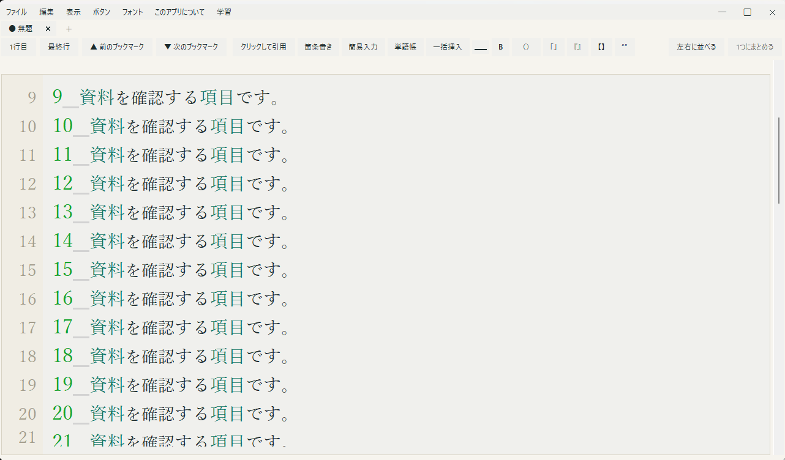</a><figcaption>12行目付近を表示した、スクロール前の画面です。</figcaption></figure></li>
<li><h4>押したまま上か下へ動かす</h4><p>下の行を読みたいときはマウスを上へ、前の行へ戻りたいときは下へ動かします。本文の文字は編集されず、表示位置だけが動きます。つかんでいる間はマウスポインターが隠れます。</p>
<figure class="guide-shot"><a href="assets/readme_manual/manual-027.png">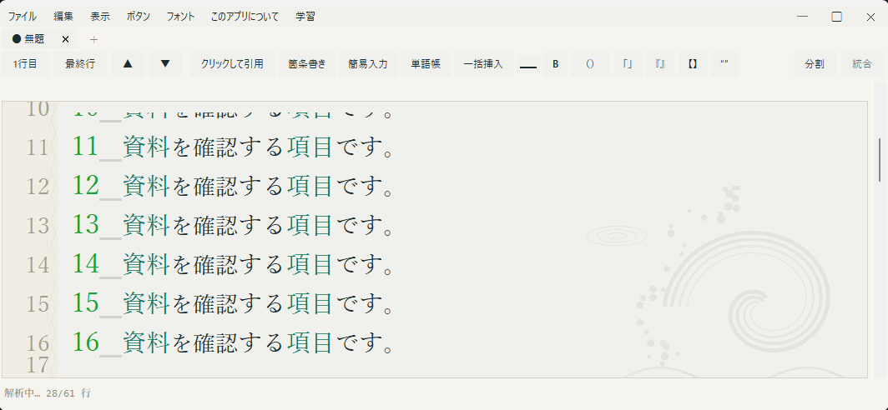</a><figcaption>上へドラッグして、15行目以降が見えるようになった画面です。</figcaption></figure></li>
<li><h4>読みたい位置で右ボタンを離す</h4><p>読みたい位置まで移動したら、マウスの動きを止めてから右ボタンを離します。</p>
<figure class="guide-shot"><a href="assets/readme_manual/manual-028.png">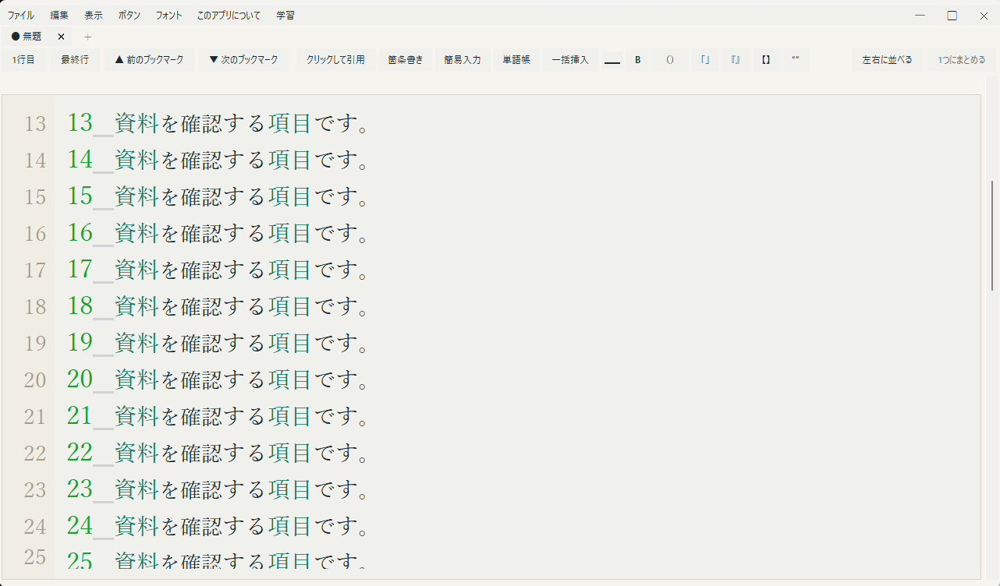</a><figcaption>右ボタンを離した後の画面です。本文の内容は変わっていません。</figcaption></figure></li>
</ol>
<p class="guide-note">通常の左ドラッグで文字を選択する操作は、これまでどおり使用できます。</p><p class="guide-back"><a href="#picture-index">目次に戻る</a></p></article>
</section>

<a name="overview"></a>
<section>
<hr class="section-rule">
<h2>縮小表示 ― 右ダブルクリック</h2>
<p class="sec-intro">長いメモの中で、目当ての場所へ一気に飛ぶための機能です。</p>
<p>
メモ欄（または補正結果欄）で<b>右ボタンをダブルクリックし、2回目を押したまま保つ</b>と、
文字が一時的にとても小さくなり、行間も詰まって、<b>広い範囲が一度に見えます</b>。
そのまま<b>マウスを上下に動かすとスクロール</b>します。
</p>
<p><a href="#guide-overview">画像付きの操作手順へ</a></p>
<div class="callout tip">
<div class="icon">🔍</div>
<div><p>右ボタンを<b>1回だけ</b>押して離した場合は、これまでどおり候補の一覧が開きます。
押したままドラッグすればスクロールです（<a href="#dragscroll">余白のドラッグでスクロール</a>）。</p></div>
</div>
<a name="guide-overview"></a>
<article class="picture-guide">
<h3>右ボタンを2回押し、2回目を押したまま動かす</h3>
<p>長い文章の中から移動先を探すときに、一時的に文字を小さくします。</p>
<figure class="guide-shot"><a href="assets/readme_manual/manual-029.gif">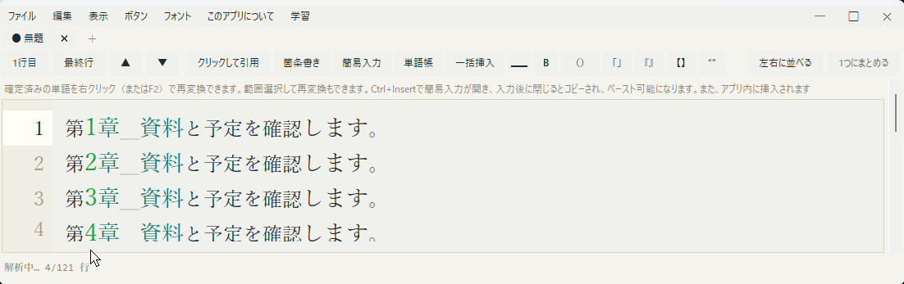</a><figcaption>押したまま動かすと縮小したまま移動し、離すと元の大きさに戻ります。</figcaption></figure>
<ol class="steps picture-steps">
<li><h4>本文の上にマウスを置きます</h4><p>右ボタンを素早く2回押し、2回目は離さずに押したままにします。</p>
<figure class="guide-shot"><a href="assets/readme_manual/manual-030.png">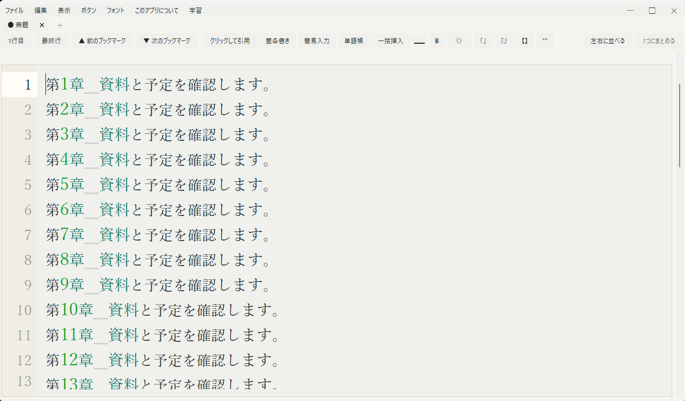</a><figcaption>通常の文字の大きさでは、一部の行だけが見えています。</figcaption></figure></li>
<li><h4>押したまま全体を見渡します</h4><p>文字と行間が小さくなります。四角い枠は、ボタンを離した後に表示される範囲の目印です。</p>
<figure class="guide-shot"><a href="assets/readme_manual/manual-031.png">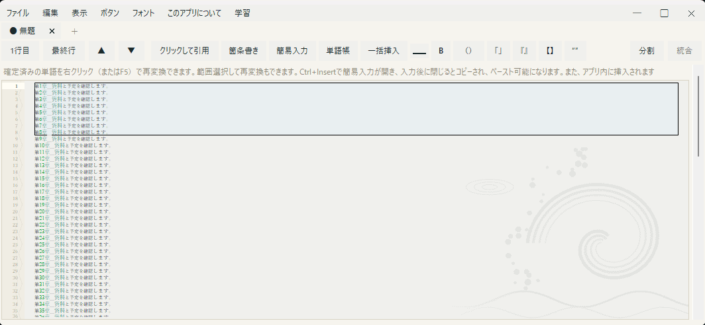</a><figcaption>縮小中は、多くの行を一度に見渡せます。</figcaption></figure></li>
<li><h4>上下に動かして移動先を探します</h4><p>右ボタンを押したまま、マウスを上下に動かします。目的の行が枠に入る位置まで移動します。</p>
<figure class="guide-shot"><a href="assets/readme_manual/manual-032.png">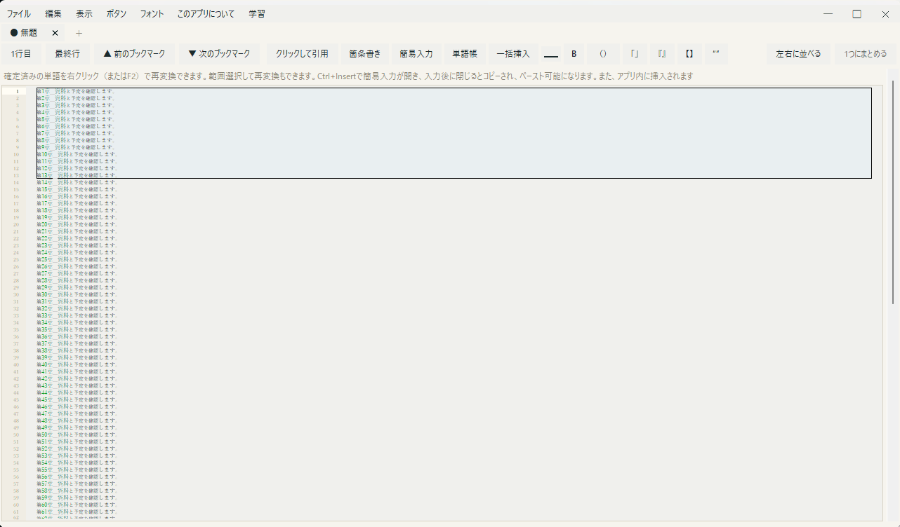</a><figcaption>縮小したまま、文章の後ろの方へ移動した画面です。</figcaption></figure></li>
<li><h4>右ボタンを離します</h4><p>文字が元の大きさへ戻り、縮小中に見ていた位置から読めます。</p>
<figure class="guide-shot"><a href="assets/readme_manual/manual-033.png"></a><figcaption>移動先で通常の大きさに戻りました。</figcaption></figure></li>
</ol>
<p class="guide-note">右クリック1回だけでは縮小しません。「2回目を押したまま」にするのがポイントです。</p>
<p class="guide-back"><a href="#picture-index">目次に戻る</a></p></article>
</section>

<a name="edit"></a>
<section>
<hr class="section-rule">
<h2>編集の基本機能</h2>

<h3><span class="dot"></span>タブで複数のメモを開く</h3>
<p>
＋ボタンで新しいタブを開き、複数のメモを並行して扱えます。
タブは<b>ドラッグして並べ替え</b>られます。
</p>
<p>タブの移動には、次のキーが使えます。上下の段はそれぞれ同じ動きなので、打ちやすいほうを使ってください。</p>
<table class="keys">
<tr><th>キー</th><th>動作</th></tr>
<tr><td class="k"><span class="combo"><span class="kbd">Ctrl</span>+<span class="kbd">Tab</span></span> /
<span class="combo"><span class="kbd">Ctrl</span>+<span class="kbd">PageDown</span></span></td><td>次のタブへ</td></tr>
<tr><td class="k"><span class="combo"><span class="kbd">Ctrl</span>+<span class="kbd">Shift</span>+<span class="kbd">Tab</span></span> /
<span class="combo"><span class="kbd">Ctrl</span>+<span class="kbd">PageUp</span></span></td><td>前のタブへ</td></tr>
<tr><td class="k"><span class="combo"><span class="kbd">Ctrl</span>+<span class="kbd">T</span></span></td><td>新しいタブを開く</td></tr>
<tr><td class="k"><span class="combo"><span class="kbd">Ctrl</span>+<span class="kbd">W</span></span></td><td>いまのタブを閉じる</td></tr>
</table>
<p>
最後のタブで <span class="kbd">Ctrl</span>+<span class="kbd">Tab</span> を押すと先頭のタブへ戻ります
（逆向きも同じように回ります）。
</p>
<p>タブを右クリックすると出る一覧の<b>先頭のタブに移動</b>で、いちばん左のタブに切り替えます。タブがたくさんあって左端が隠れているときも、タブの並びを左端まで送って見せます。タブの並び順は変わりません。先頭のタブを開いているときは選べません。</p>
<figure class="guide-shot"><a href="assets/readme_manual/manual-034.png">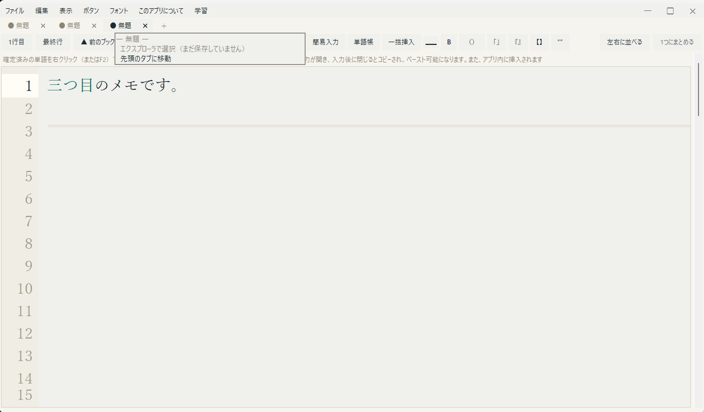</a><figcaption>タブの右クリックの一覧から「先頭のタブに移動」を選びます。</figcaption></figure>

<h3><span class="dot"></span>自動保存と続きから再開</h3>
<p>
書いた内容はタブごとに自動的に控えられます。保存せずにそのままアプリを閉じても、次に開いたときにタブごと復元され、続きから再開できます。
ファイルとして保存した場合は、そのファイルとの結び付きも記憶されます。
</p>

<h3><span class="dot"></span>文字コードと改行</h3>
<p>
開いたファイルのUTF-8・Shift_JIS（CP932）・BOM付きUTF-16と、改行形式を保持して保存します。
混在する改行や読み込んだ末尾の改行も保持し、編集欄の表示用空行は書き出しません。
「ファイル → このタブの文字コード」で次回保存の文字コードを変更できます。
その文字コードで表せない文字がある場合は理由を表示し、元のファイルを保ちます。
</p>


<a name="guide-autosave"></a>
<article class="picture-guide">
<h3>保存せずに閉じても次回続きを開く</h3>
<p>名前を付けて保存していないメモも、次にCorrectNoteを開いたときに続きから使えます。</p>
<p class="guide-back"><a href="#picture-index">目次に戻る</a></p></article>
</section>
<a name="wheel-tabs"></a>
<section>
<hr class="section-rule">
<h2>ホイールでタブを往復する</h2>
<p>
タブの上でホイールを回すと、下回転で右のタブへ、上回転で左のタブへ移動します。端まで来ると反対端へ戻ります。
<b>右ボタンを押したままホイールを回す</b>と、本文や行番号欄にポインターがあるときも同じ操作ができます。
</p>
<p>
右ボタンを離さなくても、<b>最後のタブ移動から0.3秒以上間を空けて逆に回す</b>と、逆方向へ移動できます。
切り替わった直後のごく短い逆回転は、意図しない跳ね戻りを防ぐため無視します。
ホイールでタブ移動した後に右ボタンを離しても、候補一覧やタブメニューは開きません。
</p>


<a name="guide-tabs"></a>
<article class="picture-guide">
<h3>ホイールで別のタブへ切り替える</h3>
<p>タブの見出しの上でマウスホイールを回し、別のメモへ切り替えます。</p>
<figure class="guide-shot"><a href="assets/readme_manual/manual-035.gif">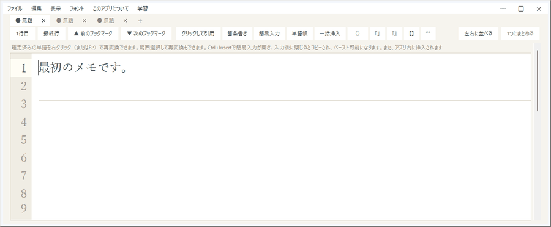</a><figcaption>下へ回すと次のタブへ、上へ回すと前のタブへ移ります。</figcaption></figure><ol class="steps picture-steps">
<li><h4>タブの上にマウスを置きます</h4><p>画面上部の「無題」やファイル名が並ぶ帯にマウスを移します。本文の上では通常のスクロールになります。</p>
<figure class="guide-shot"><a href="assets/readme_manual/manual-036.png">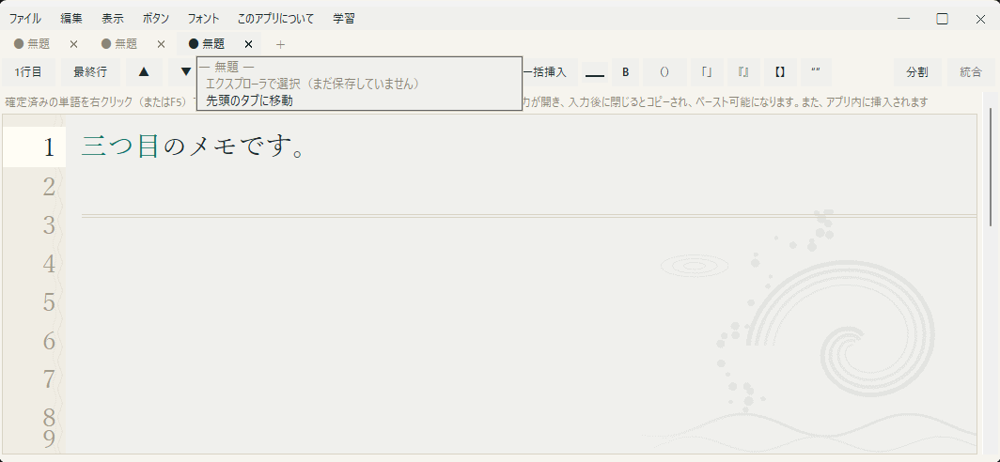</a><figcaption>左端のタブにある、最初のメモを表示しています。</figcaption></figure></li>
<li><h4>下へ回すと右のタブへ移ります</h4><p>ホイールを下向きに1段回すと、次のタブを表示します。</p>
<figure class="guide-shot"><a href="assets/readme_manual/manual-037.png"></a><figcaption>中央のタブと、二つ目のメモへ切り替わりました。</figcaption></figure></li>
<li><h4>上へ回すと左のタブへ戻ります</h4><p>ホイールを上向きに回すと、前のタブへ移ります。端まで来ると反対の端へ回ります。</p>
<figure class="guide-shot"><a href="assets/readme_manual/manual-036.png"></a><figcaption>最初のメモに戻りました。</figcaption></figure></li>
</ol>
<p class="guide-note">本文や行番号の上でも、右ボタンを押したままホイールを回すとタブ移動になります。</p>
<p class="guide-back"><a href="#picture-index">目次に戻る</a></p></article>
</section>
<a name="search-replace"></a>
<section>
<hr class="section-rule">
<h2>検索と置換</h2>
<p>
<span class="kbd">Ctrl+F</span> で検索、<span class="kbd">Ctrl+H</span> で置換のダイアログを開きます。
大文字・小文字の区別、単語単位の一致、正規表現、末尾まで来たら先頭に戻る折り返し検索に対応しています。
チェックした条件は次回の検索でも、次回アプリを起動したときも記憶されています。
<code>|</code> だけを検索するときは、その文字自体を探します。正規表現が有効な場合も同じです。
<code>A|B</code> のような正規表現では、従来どおり「AまたはB」を検索します。
</p>

<p>
検索・置換ダイアログの「タブを挿入」「改行を挿入」ボタンは、直前に編集していた検索欄または置換欄にタブや改行を入れます。
タブは薄い四角、改行は↵で表示します。改行を含む検索・置換は、最初と最後に文字がある行の間だけを対象にします。
</p>
<p>
「全タブ検索」で、未保存の内容を含む各タブの入力文（補正前）を一覧にできます。
タブ名・行と桁・前後の文章を確認し、ダブルクリックまたはEnterで該当箇所へ移動します。
編集後の古い結果は再検索して更新します。
</p>

<a name="guide-search-return"></a>
<article class="picture-guide">
<h3>Ctrl＋Fで検索し、検索前の位置へ戻る</h3>
<p>検索で別の場所へ移動しても、検索を始める前のカーソル位置へ戻れます。</p>
<ol class="steps picture-steps">
<li><h4>続きを書きたい場所にカーソルを置きます</h4><p>ここでは1行目の末尾から検索を始めます。Ctrl+Fを押して検索ウインドウを開きます。</p>
<figure class="guide-shot"><a href="assets/readme_manual/manual-038.png"></a><figcaption>戻り先となる、検索前のカーソル位置です。</figcaption></figure></li>
<li><h4>探す文字を入力します</h4><p>「検索する文字列」に文字を入れ、「次を検索」を押します。例では「会議」を探します。</p>
<figure class="guide-shot"><a href="assets/readme_manual/manual-039.png">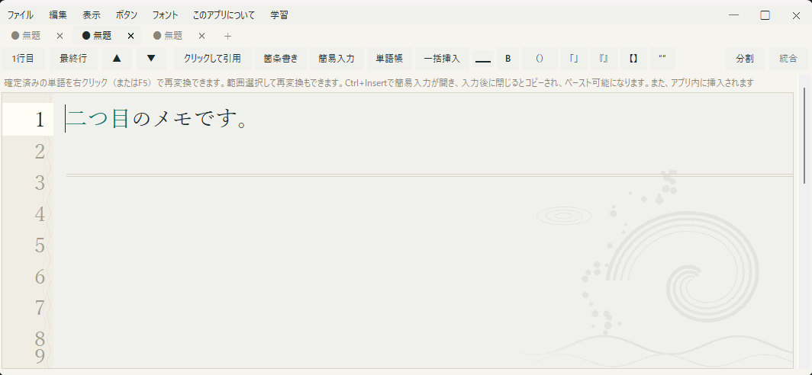</a><figcaption>検索する文字列を入力した画面です。</figcaption></figure></li>
<li><h4>見つかった場所を確認します</h4><p>本文が検索結果のある行へ移動します。検索を続けても、同じ検索文字列であれば最初の戻り先を覚えています。</p>
<figure class="guide-shot"><a href="assets/readme_manual/manual-040.png">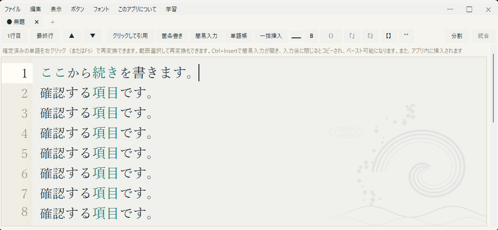</a><figcaption>本文の「会議」が見つかり、その位置へ移りました。</figcaption></figure>
<figure class="guide-shot"><a href="assets/readme_manual/manual-041.png">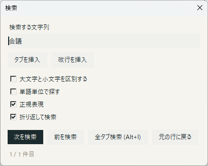</a><figcaption>検索ウインドウの右側に「元の行に戻る」があります。</figcaption></figure></li>
<li><h4>「元の行に戻る」を押します</h4><p>検索前のタブ・カーソル位置に戻ります。検索ウインドウを閉じれば、そのまま続きを書けます。</p>
<figure class="guide-shot"><a href="assets/readme_manual/manual-042.png"></a><figcaption>最初の1行目の末尾へ戻りました。</figcaption></figure>
<figure class="guide-shot"><a href="assets/readme_manual/manual-043.png">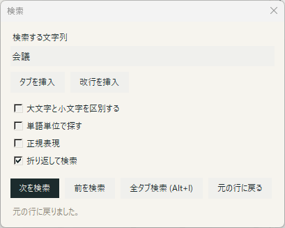</a><figcaption>検索ウインドウにも、元の行に戻ったことが表示されます。</figcaption></figure></li>
</ol>
<p class="guide-note">検索する文字列を変えると、戻り先も新しい検索の開始位置に切り替わります。戻り先のタブを閉じた場合は戻れません。</p>
<p class="guide-back"><a href="#picture-index">目次に戻る</a></p></article>
</section>
<a name="goto"></a>
<section>
<hr class="section-rule">
<h2>Ctrl＋G ― 行へ移る・文字を探す</h2>
<p class="sec-intro">行番号か文字を入れて Enter を押すだけで、その場所へカーソルを移します。表計算ソフトの「ジャンプ」に近い使い方です。</p>
<ol class="steps">
<li><b>Ctrl＋G を押します。</b><p>CorrectNote の窓が前に出ているときに押すと、窓の中に1行の入力欄が出ます。別のアプリを使っているときは反応しません。</p>
<figure class="guide-shot"><a href="assets/readme_manual/manual-044.png">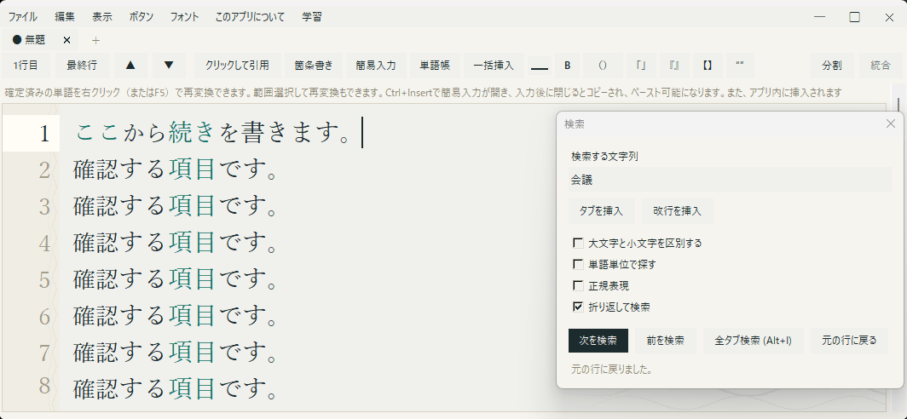</a><figcaption>入力欄に行番号か、探したい文字を入れます。</figcaption></figure></li>
<li><b>行番号か文字を入れ、Enter を押します。</b><p><b>数字</b>なら、その行へ移ります（全角の数字も使えます）。最終行より大きい数字は最終行へ、0 は1行目へ移ります。</p><p><b>文字</b>なら、同じタブの中でカーソルの位置から下へ探し、見つかった文字の末尾にカーソルを置きます。最終行まで見つからないときは、1行目からカーソルの位置までも探します。英字の大文字と小文字は区別しません。</p>
<figure class="guide-shot"><a href="assets/readme_manual/manual-045.png">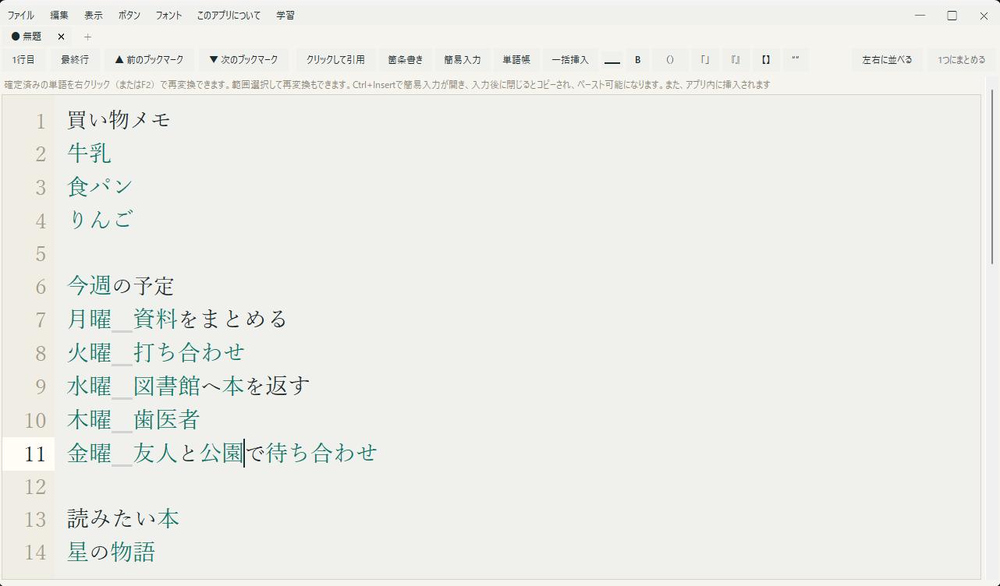</a><figcaption>「公園」の末尾にカーソルが移りました。</figcaption></figure></li>
</ol>
<p>見つからないときは、確認の窓は出さずに、窓の下の欄に「見つかりません」と表示するだけです。入力が空欄のまま Enter を押したときは何もしません。<span class="kbd">Esc</span> を押すか、入力欄の外をクリックすると閉じます。</p>
<p class="guide-note">次に Ctrl＋G を押すと、前に入れた文字が選ばれた状態で出ます。そのまま Enter を押すと、次に見つかる場所へ移ります。カーソルを動かすだけなので、本文は変わりません。</p>
<p class="guide-back"><a href="#picture-index">目次に戻る</a></p>
</section>
<a name="bookmarks"></a>
<section>
<hr class="section-rule">
<h2>ブックマーク</h2>
<p>
行番号をダブルクリックすると、その行にブックマークを付けられます。
ツールバーの <span class="kbd">▲前のブックマーク</span> <span class="kbd">▼次のブックマーク</span> で、
付けた場所を順番にたどり、移動先を中央に表示します。その後のホイールやスクロールバー操作では通常の表示に戻り、1行目まで戻せます。長い文章の目印として使えます。
</p>

    
<a name="guide-bookmarks"></a>
<article class="picture-guide">
<h3>行番号のダブルクリックで登録し、ボタン／Alt＋上下で移動</h3>
<p>後で戻りたい行に目印を付け、ボタンやキーで順にたどります。</p>
<figure class="guide-shot"><a href="assets/readme_manual/manual-046.gif">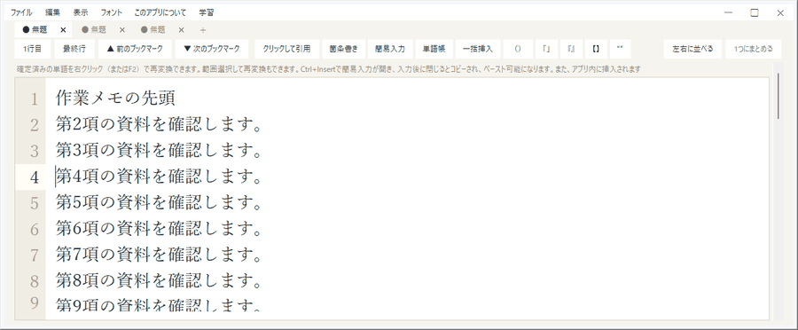</a><figcaption>目印を登録した後、次・前のブックマークへ移動します。</figcaption></figure><ol class="steps picture-steps">
<li><h4>目印を付けたい行へ移動します</h4><p>本文をクリックして、その行にカーソルを置きます。例では4行目に付けます。</p>
<figure class="guide-shot"><a href="assets/readme_manual/manual-047.png">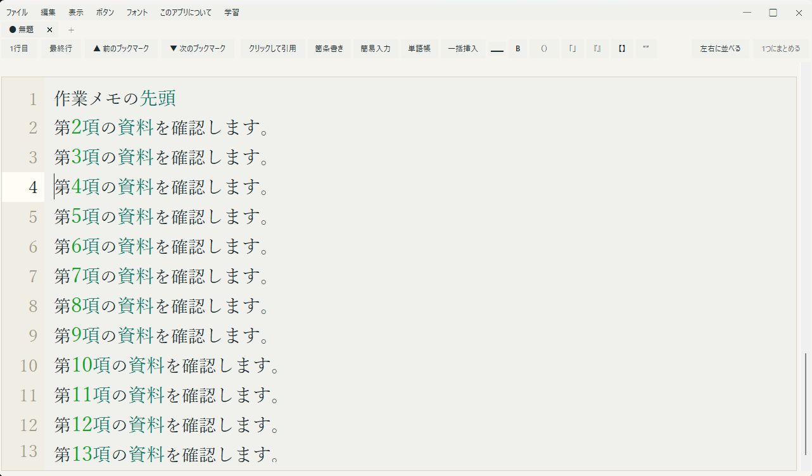</a><figcaption>4行目を選んだ状態です。</figcaption></figure></li>
<li><h4>Breakキーで追加します</h4><p>Breakキーを押すと、行番号の左に青い目印が付きます。行番号のダブルクリックやCtrl+Spaceでも切り替えられます。</p>
<figure class="guide-shot"><a href="assets/readme_manual/manual-048.png"></a><figcaption>4行目の行番号の左にブックマークが付きました。</figcaption></figure></li>
<li><h4>次のブックマークへ進みます</h4><p>別の行にも同じように追加します。「▼次のブックマーク」またはAlt+↓で、次の目印へ移動します。</p>
<figure class="guide-shot"><a href="assets/readme_manual/manual-049.png">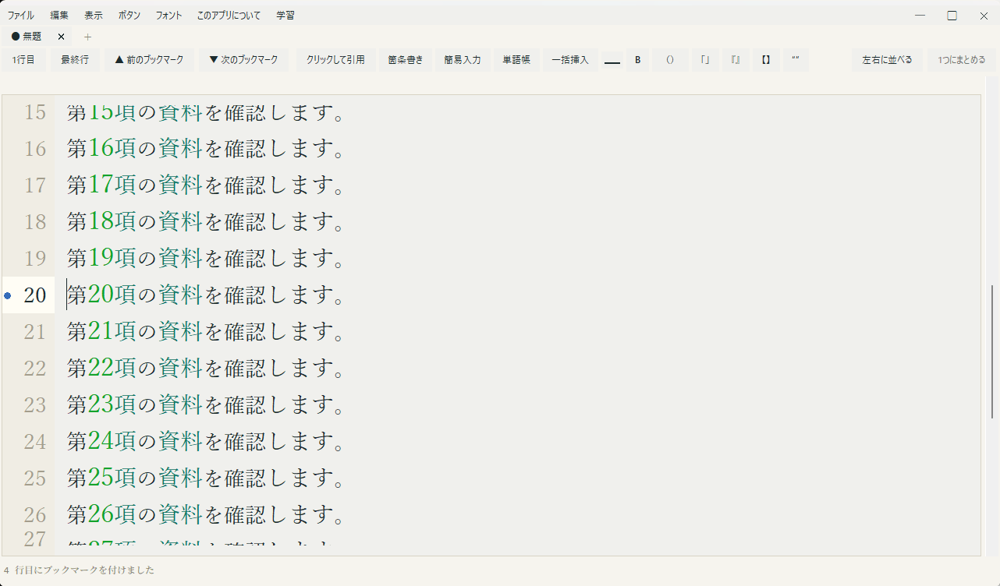</a><figcaption>次の目印がある20行目を中央付近に表示しています。</figcaption></figure></li>
<li><h4>前のブックマークへ戻ります</h4><p>「▲前のブックマーク」またはAlt+↑で前の目印へ戻ります。消すときは、その行でもう一度Breakキーを押します。</p>
<figure class="guide-shot"><a href="assets/readme_manual/manual-050.png">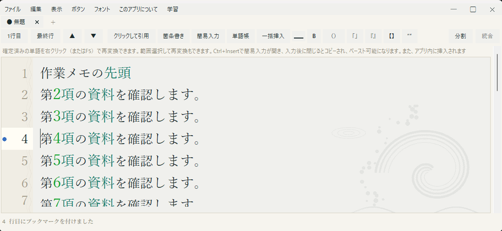</a><figcaption>前の目印がある4行目へ戻りました。</figcaption></figure></li>
</ol>
<p class="guide-note">移動後にホイールやスクロールバーを動かすと、通常どおりスクロールできます。</p>
<p class="guide-back"><a href="#picture-index">目次に戻る</a></p></article>
</section>
<a name="keyboard-layout"></a>
<section>
<hr class="section-rule">
<h2>キーボードの配列と形</h2>
<p class="sec-intro">お使いのキーボードの配列と形を選べます。<a href="#autofix">自動補正</a>がキーの押し間違いを探すときに、どのキーが隣り合っているかの判断に使います。表示メニューの <b>キーボードの配列と形</b> から選びます。</p>
<figure class="guide-shot"><a href="assets/readme_manual/manual-051.png">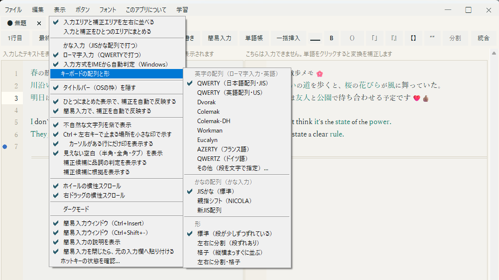</a><figcaption>表示メニューの「キーボードの配列と形」。英字の配列・かなの配列・形を1つずつ選びます。</figcaption></figure>
<table class="keys">
<tr><th>組</th><th>選べるもの</th><th>効く入力</th></tr>
<tr><td>英字の配列</td><td>QWERTY（日本語配列・JIS）・QWERTY（英語配列・US）・Dvorak・Colemak・Colemak-DH・Workman・Eucalyn・AZERTY（フランス語）・QWERTZ（ドイツ語）・その他（段を文字で指定）</td><td>ローマ字入力・英語</td></tr>
<tr><td>かなの配列</td><td>JISかな（標準）・親指シフト（NICOLA）・新JIS配列</td><td>かな入力</td></tr>
<tr><td>形</td><td>標準（段が少しずつずれている）・左右に分割（段ずれあり）・格子（縦横まっすぐに並ぶ）・左右に分割・格子</td><td>ローマ字入力・かな入力・英語</td></tr>
</table>
<p>初期状態は QWERTY（日本語配列・JIS）・JISかな（標準）・標準です。普段のキーボードであれば変える必要はありません。</p>
<p>形の「左右に分割」は、左右の手の間で離れているキーを隣として扱いません。「格子」は、段のずれがないキーボードの縦横の並びで隣を決めます。</p>
<p>「その他（段を文字で指定）…」を選ぶと、キーの並びを1段ずつ入力する欄が開きます。段ごとの文字を左から順に書き、段の間を <code class="inline">|</code> で区切ります（例：<code class="inline">qwertyuiop|asdfghjkl|zxcvbnm</code>）。読めない並びのときは、元の配列に戻ります。</p>
<p>配列や形を変えると、開いているメモの補正をやり直します。設定は次回の起動にも引き継がれます。</p>
<p class="guide-note">かなの配列は、表示メニューで「かな入力」を選んでいるときに使われます。ローマ字入力のときは、英字の配列と形で隣を決めます。</p>
<p class="guide-back"><a href="#picture-index">目次に戻る</a></p>
</section>

<a name="undo-redo"></a>
<section>
<hr class="section-rule">
<h2>Undo／Redoの表示</h2>
<p>元に戻した後や、やり直した後の文字を、色で確かめられます。</p>
<h3><span class="dot"></span>Undo後の下線</h3>
<p><span class="kbd">Ctrl+Z</span> で戻した後は、次にもう一度Undoすると消える文字列に、色付きの下線を付けます。削除を戻すだけなど、次に消える文字がない場合は下線を付けません。</p>
<figure class="guide-shot"><a href="assets/readme_manual/manual-052.png">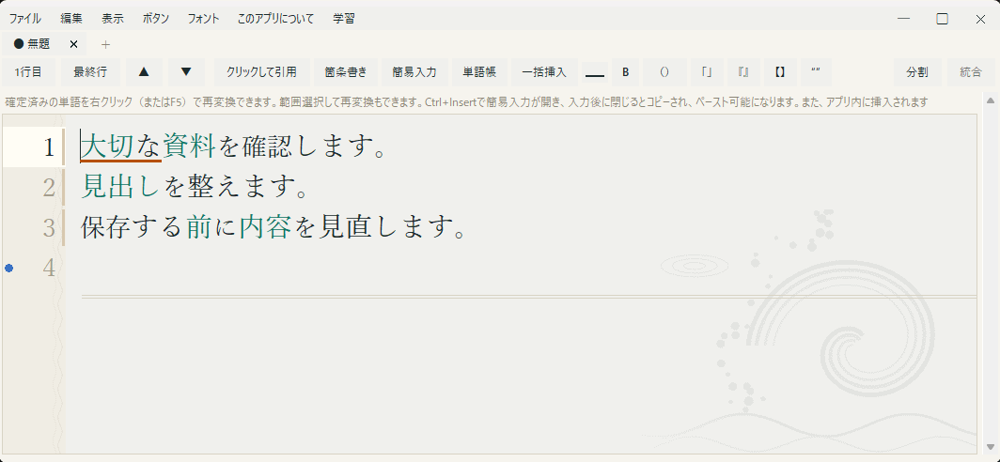</a><figcaption>次に取り消すと消える「大切な」を、オレンジ色の下線で示します。</figcaption></figure>
<h3><span class="dot"></span>Redo後の下線</h3>
<p>Redoで復元した文字列には色付きの下線を付けます。次に編集すると下線は消えます。</p>
<figure class="guide-shot"><a href="assets/readme_manual/manual-053.png">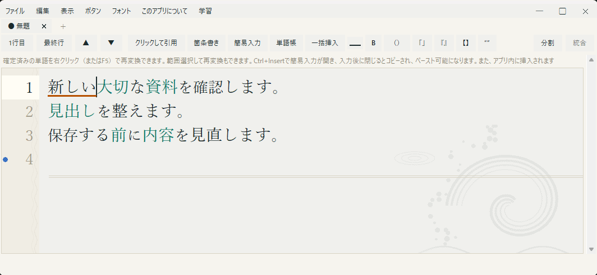</a><figcaption>やり直しで戻った入力「新しい」を、オレンジ色の下線で示します。</figcaption></figure>
<p class="guide-back"><a href="#picture-index">目次に戻る</a></p>
</section>

<a name="ruler-rows"></a>
<section>
<hr class="section-rule">
<h2>ルーラーで行に目印を置く</h2>
<p>上部の横線ボタン（─）を押すと、カーソルのある行に横線を置けます。長い文章を読むときや、離れた行を見比べるときの目印になります。</p>
<ol class="steps"><li><b>目印を置く行へカーソルを移し、横線ボタンを押します。</b><p>別の行へ移動して押すと、その行にも追加できます。</p></li><li><b>解除するときは、その行で同じボタンを押します。</b><p>ほかの行に置いた横線は残ります。</p></li></ol>
<figure class="guide-shot"><a href="assets/readme_manual/manual-054.png"></a><figcaption>2行目と4行目にルーラーを置いた例。別の行へ追加しても、先に置いた横線は残ります。</figcaption></figure>
<p>カーソルを別の行へ動かしても、横線は置いた行に残ります。折り返された長い行では、その行の最後の表示行の下に引きます。横線はタブごとに保存され、再起動後も残ります。</p>
<figure class="guide-shot"><a href="assets/readme_manual/manual-055.png">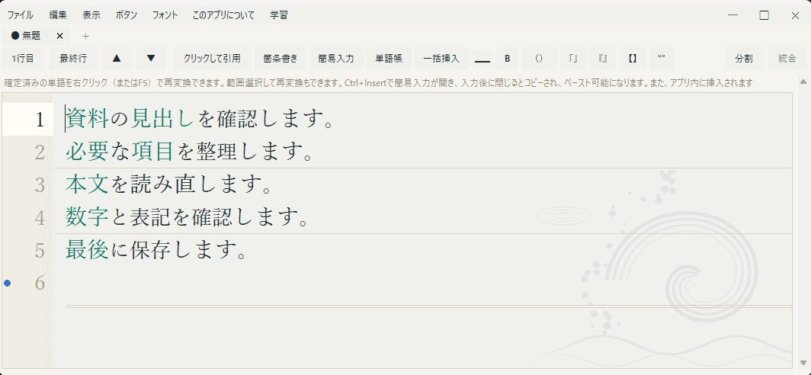</a><figcaption>カーソルを1行目へ動かしても、ルーラーは2行目と4行目に固定されたままです。</figcaption></figure>
<p class="guide-note">最終行の二重線は、ルーラーとは別の目印です。キーでカーソルを動かした直後は、入力位置の縦線が一瞬オレンジ色になります。</p>
<p class="guide-back"><a href="#picture-index">目次に戻る</a></p>
</section>

<a name="toolbar-settings"></a>
<section>
<hr class="section-rule">
<h2>ボタンの表示と並べ替え</h2>
<p>上部メニューの <b>ボタン → 表示と並べ替え…</b> から、使うボタンと並び順を選べます。</p> <h3><span class="dot"></span>書式ボタン（B・I・U・S）</h3> <p>ルーラーボタンの右に、メモ帳と同じ1文字の書式ボタンがあります。左からボールド（B）、斜体（I）、下線（U）、取り消し線（S）です。初期状態で表示されるのはボールドだけで、ほかの3つはボタンメニューで表示できます。文字を選択して押すとその範囲の書式をオン・オフし、選択せずに押すとこれから入力する文字に使います。ショートカットキーはボールドが<span class="kbd">Ctrl</span>+<span class="kbd">B</span>と<span class="kbd">Ctrl</span>+<span class="kbd">2</span>、斜体が<span class="kbd">Ctrl</span>+<span class="kbd">I</span>と<span class="kbd">Ctrl</span>+<span class="kbd">3</span>、下線が<span class="kbd">Ctrl</span>+<span class="kbd">U</span>と<span class="kbd">Ctrl</span>+<span class="kbd">4</span>、取り消し線が<span class="kbd">Ctrl</span>+<span class="kbd">5</span>です。書式は表示だけに使い、補正欄（左右に並べた右側）の同じ文字にも付きます。補正で書き換わった語は、その語全体に付きます。書式はタブごとに控えられて次回起動後も残ります。保存するテキストファイルには書式は入りません。</p>
<h3><span class="dot"></span>使うボタンを表示する</h3>
<p>一覧の左端のチェックをクリックして、表示・非表示を切り替えます。項目を選んで右側のチェックを使うこともできます。「左右に並べる／1つにまとめる」は、1つのチェックで両方のボタンをまとめて切り替えます。</p>
<figure class="guide-shot"><a href="assets/readme_manual/manual-056.png">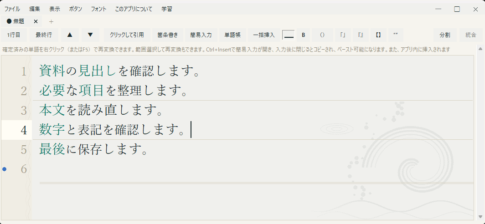</a><figcaption>現在の項目一覧から「単語帳」の表示をオフにした例です。</figcaption></figure>
<h3><span class="dot"></span>順番を変える</h3>
<p>動かしたい項目を選び、<b>上へ</b>・<b>下へ</b> を押します。表示と順番の設定は、次回の起動にも引き継がれます。</p>
<figure class="guide-shot"><a href="assets/readme_manual/manual-057.png">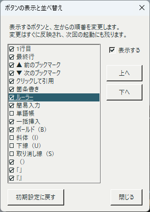</a><figcaption>「ルーラー」を選び、「上へ」を数回押して「簡易入力」の前へ移動した例です。</figcaption></figure>
<p class="guide-note">ウィンドウを小さく使うときは、使うボタンだけを表示し、「1つにまとめる」レイアウトにすると本文を広く使えます。</p>
<p class="guide-back"><a href="#picture-index">目次に戻る</a></p>
</section>


<a name="display"></a>
<section>
<hr class="section-rule">
<h2>表示の設定</h2>
<h3><span class="dot"></span>フォント</h3>
<p>
「フォント → 種類・サイズを選択」で本文・補正欄・簡易入力の字を変更できます。
サイズはメニューから直接選ぶこともできます。「初期設定に戻す」でYu Mincho・10ポイントに戻ります。
サイズだけを変更して「適用」「OK」を押すこともできます。ダイアログの「初期設定」はその場で反映します。設定は次回起動にも引き継がれ、俯瞰表示を終えると選んだ大きさへ戻ります。
</p>
<p>
「フォント → 品詞ごとのサイズ倍率と文字色」で、品詞別に本文と補正欄の文字サイズと文字色を設定できます。
</p>
<p>
倍率の初期値は名詞・動詞・形容詞・副詞・助動詞が1.1倍、数詞が1.2倍で、名詞（サ変）などその他の品詞は1.0倍です。「倍率を初期値」でこの設定に戻り、「すべて1倍」で全品詞を同じ大きさにできます。基準サイズに倍率を掛けた結果に小数点以下がある場合は切り上げます。
</p>
<figure class="guide-shot">
        
<a href="assets/readme_manual/manual-058.svg">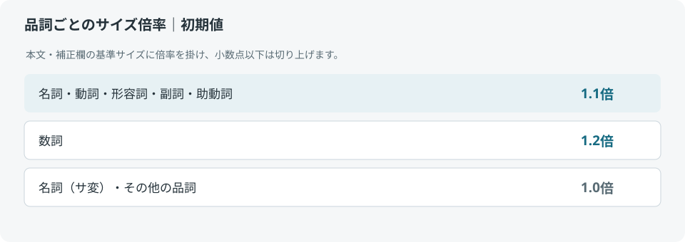</a>
        
<figcaption>品詞ごとのサイズ倍率（初期値）</figcaption>
</figure>
<p>
文字色の初期値は、ライトモードでは名詞が青緑（濃い）、数詞が緑（やや濃い）、英字と記号がグレー（やや濃い）です。ダークモードでは名詞が緑（ごく明るい）、数詞が緑（とても明るい）、英字と記号がグレー（明るい）で、名詞（サ変）などその他は色を変えません。「色を初期値」でこの設定に戻り、「色をすべて変えない」で全品詞を欄の文字色のままにできます。
</p>
<figure class="guide-shot">
        
<a href="assets/readme_manual/manual-059.svg">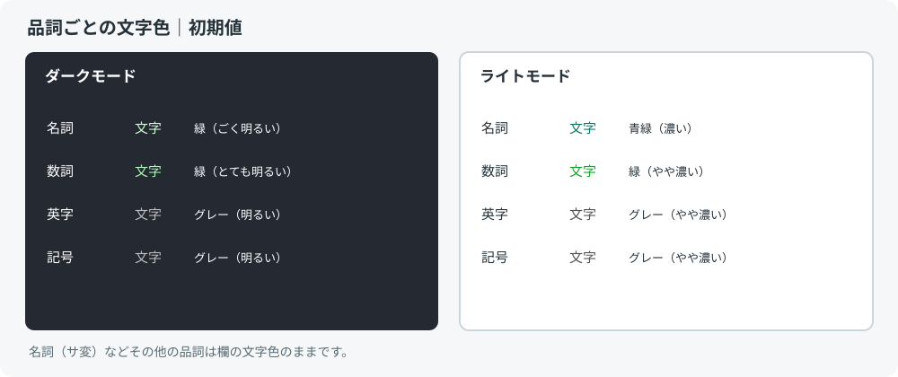</a>
        
<figcaption>品詞ごとの文字色（ライト／ダークモードの初期値）</figcaption>
</figure>
<p>
「OK」「×」「Esc」はそのまま閉じ、「キャンセル」は画面を開いた時の倍率と色に戻して閉じます。
</p>
<h3><span class="dot"></span>ダークモード</h3>
<p>
表示メニューの <span class="kbd">ダークモード</span> で切り替えられます。
ほかの配色や絵の装飾は<a href="#appearance">外見</a>で選べます。
設定は自動的に保存され、次にアプリを開いたときも同じ状態で始まります。
</p>
<a name="memory-usage"></a>
<h3><span class="dot"></span>メモリ使用量</h3>
<p>「このアプリについて → メモリ使用量」で、低・高を選べます。既定は高で、普段はそのまま使えます。低は待機中のメモリを減らしますが、次の補正や、まだ補正していないタブを開くときの待ち時間が長くなります。補正の内容は同じです。設定は次回起動にも引き継がれます。</p>
<h3><span class="dot"></span>ホットキーの個別設定</h3>
<p>
簡易入力ウィンドウを呼び出す2つのホットキー（<span class="kbd">Ctrl+Insert</span> /
<span class="kbd">Ctrl+Shift+-</span>）は、表示メニューからそれぞれ個別にオン・オフを切り替えられます。
反応しないときは、同じメニューの <span class="kbd">ホットキーの状態を確認…</span> で、
実際に登録できているかを確かめられます。
</p>
<a name="guide-whitespace"></a>
<article class="picture-guide">
<h3>表示メニューで空白の目印を表示する</h3>
<p>半角スペース・全角スペース・タブを、目印で区別できます。</p>
<ol class="steps picture-steps">
<li><h4>空白を含む文章を用意します</h4><p>通常の表示では、空いている場所がスペースなのかタブなのか分かりにくいことがあります。</p>
<figure class="guide-shot"><a href="assets/readme_manual/manual-060.png"></a><figcaption>半角空白、全角空白、タブが入った例です。</figcaption></figure></li>
<li><h4>「表示」メニューで空白の表示をオンにします</h4><p>「見えない空白（半角・全角・タブ）を表示」を選びます。本文中の空白に印が付き、タブは幅のある背景で分かります。同じ項目をもう一度選ぶと印が消えます。</p>
<figure class="guide-shot"><a href="assets/readme_manual/manual-061.png"></a><figcaption>空白に目印が付きました。本文の文字そのものは変わりません。</figcaption></figure></li>
</ol>
<p class="guide-note">目印は画面表示だけです。コピーした文章や保存するファイルに印の文字を付け足すことはありません。</p>
<p class="guide-back"><a href="#picture-index">目次に戻る</a></p></article>
<a name="guide-typing-pointer"></a>
<article class="picture-guide">
<h3>本文に入力するとポインターが隠れる</h3>
<p>文字を入力するとマウスポインターが非表示になります。</p>
<ol class="steps picture-steps">
<li><h4>本文の入力位置を決める</h4><p>本文をクリックして、文字を入れたい位置に縦線を置きます。マウスポインターは本文の上に置いたままにします。</p>
<figure class="guide-shot"><a href="assets/readme_manual/manual-062.png"></a><figcaption>2行目の末尾を入力位置にした画面です。</figcaption></figure></li>
<li><h4>文字を入力する</h4><p>そのまま文字を入力します。本文の上のマウスポインターが隠れ、文字と入力位置の縦線が見やすくなります。日本語の変換中も、入力が進むとポインターを隠します。</p>
<figure class="guide-shot"><a href="assets/readme_manual/manual-063.png"></a><figcaption>末尾に「あ」を入力した画面です。入力位置の縦線はそのまま表示されます。</figcaption></figure></li>
<li><h4>マウスを少し動かす</h4><p>マウスを動かすとポインターが戻ります。クリックやホイール操作、別のウインドウへの切り替えでも戻るため、そのまま次の操作ができます。</p>
<figure class="guide-shot"><a href="assets/readme_manual/manual-063.png"></a><figcaption>文字はそのままに、マウス操作へ戻った画面です。</figcaption></figure></li>
</ol>
<p class="guide-note">マウスがメニューや別アプリの上にあるときは、そちらのポインターを隠しません。</p><p class="guide-back"><a href="#picture-index">目次に戻る</a></p></article>
</section>


<a name="appearance"></a>
<section>
<hr class="section-rule">
<h2>外見 ― 配色と装飾</h2>
<p class="sec-intro">アプリ全体の色合いと、本文の裏に敷く薄い絵を選べます。上部メニューの <b>このアプリについて → 外見</b> から切り替えます。メニューの項目にマウスを乗せると、その配色や装飾が一時的に画面へ反映されるので、選ぶ前に見た目を確かめられます。クリックすると確定し、選ばずにメニューを閉じると元に戻ります。</p>
<figure class="guide-shot"><a href="assets/readme_manual/manual-064.png"></a><figcaption>このアプリについて → 外見 から、配色・装飾・装飾の濃さを選びます。</figcaption></figure>
<table class="keys">
<tr><th>項目</th><th>選べるもの</th></tr>
<tr><td>配色</td><td>標準（ライト）・抹茶・空 ／ 標準（ダーク）・夜・炭</td></tr>
<tr><td>装飾</td><td>なし ／ 和文様・原稿・星空・桜・草木・墨と和紙・扇と帯・いきもの・波</td></tr>
<tr><td>装飾の濃さ</td><td>薄い・普通・濃い</td></tr>
</table>
<h3><span class="dot"></span>配色</h3>
<p>画面全体（ボタン・メニュー・本文と補正欄・行番号）の色を切り替えます。メニューの区切り線より上がライト系、下がダーク系です。初期状態は「標準（ライト）」です。</p>
<h3><span class="dot"></span>装飾</h3>
<p>装飾を選ぶと、メモ欄と補正欄の文字の裏に絵を薄く敷きます。絵は欄の右下に寄せて置き、文字は絵の上に重なります。スクロールしても絵は欄に対して動かず、便箋のように見えます。行番号の欄にも、同じ装飾の模様が薄く入ります。絵の濃さは「装飾の濃さ」（薄い・普通・濃い）で変えられます。絵は欄の枠のところでちょうど切れます。初期状態は装飾「波」・濃さ「薄い」です。絵を消したいときは装飾で「なし」を選びます。</p>
<figure class="guide-shot"><a href="assets/readme_manual/manual-065.png"></a><figcaption>配色「抹茶」＋装飾「桜」（濃さ：普通）</figcaption></figure>
<figure class="guide-shot"><a href="assets/readme_manual/manual-066.png"></a><figcaption>配色「夜」＋装飾「星空」（濃さ：普通）</figcaption></figure>
<figure class="guide-shot"><a href="assets/readme_manual/manual-067.png"></a><figcaption>配色「空」＋装飾「波」（濃さ：普通）</figcaption></figure>
<p>表示メニューの <span class="kbd">ダークモード</span> は、ライト系とダーク系で最後に選んだ配色どうしを切り替えます。配色・装飾・濃さの設定は次回の起動にも引き継がれます。</p>
<p class="guide-note">絵は表示だけです。本文や保存するファイルには何も加わりません。窓の大きさを変えている間は絵が前の位置に残り、止めると右下へ戻ります。</p>
<p class="guide-back"><a href="#picture-index">目次に戻る</a></p>
</section>

<a name="ctrl-navigation"></a>
<section>
<hr class="section-rule">
<h2>Ctrlキーによるカーソル移動</h2>
<a name="guide-cursor"></a>
<article class="picture-guide">
<h3>Ctrl＋左右キーで日本語向けにカーソル移動</h3>
<p>1文字ずつではなく、日本語の区切りを使ってカーソルを動かします。</p>
<figure class="guide-shot"><a href="assets/readme_manual/manual-068.gif"></a><figcaption>Ctrlを押している間は、止まる場所に灰色の下線が出ます。</figcaption></figure>
<ol class="steps picture-steps">
<li><h4>本文にカーソルを置きます</h4><p>例では「私は、資料を確認します。」の先頭に置いています。</p>
<figure class="guide-shot"><a href="assets/readme_manual/manual-069.png"></a><figcaption>先頭から移動を始めます。</figcaption></figure></li>
<li><h4>Ctrlを押しながら→を押します</h4><p>助詞や句読点などの区切りへ進みます。この例では「私は、」の後ろへ移ります。</p>
<figure class="guide-shot"><a href="assets/readme_manual/manual-070.png"></a><figcaption>「私は、｜資料を確認します。」の位置です。縦棒は説明上の目印です。</figcaption></figure></li>
<li><h4>もう一度→で次の区切りへ進みます</h4><p>Ctrlを押したまま→を押すと、次は「資料を」の後ろへ進みます。</p>
<figure class="guide-shot"><a href="assets/readme_manual/manual-071.png"></a><figcaption>「私は、資料を｜確認します。」の位置です。</figcaption></figure></li>
<li><h4>Ctrl＋←で前の区切りへ戻ります</h4><p>反対向きも同じように使えます。Shiftも一緒に押すと、移動した範囲を選択できます。</p>
<figure class="guide-shot"><a href="assets/readme_manual/manual-070.png"></a><figcaption>「私は、」の後ろへ戻りました。</figcaption></figure></li>
</ol>
<p class="guide-note">区切りは文章によって変わります。空白・タブや括弧の前後も移動先になります。</p>
<p>Ctrlキーを押している間、Ctrl＋左右キーで止まる場所には、カーソルのある行だけ文字の下に灰色の下線が出ます（Ctrlを離すと消え、行の終わりには出ません。色はライトモードとダークモードで変わります）。文字色は変わりません。「にも」「では」のように助詞が続くところは、続きの終わりで1回だけ止まります。入力欄・補正結果・簡易入力で使えます。補正結果では、入力欄でカーソルのある行に印が出ます。「表示」メニューの「Ctrl＋左右キーで止まる場所を小さな印で示す」でオン・オフを、「カーソルがある行にだけ印を表示する」をオフにすると、すべての行に印が出ます。初期状態はどちらもオン（カーソルのある行だけに印）です。設定は次回の起動にも引き継がれます。</p>
<p class="guide-back"><a href="#picture-index">目次に戻る</a></p>
</article>
<a name="guide-cursor-vertical"></a>
<article class="picture-guide">
<h3>Ctrl＋上下キーで本文のまとまりを移動</h3>
<p>入力欄・補正結果・簡易入力で、Ctrl＋↓は空白行で区切られた本文のまとまりの末尾へ、Ctrl＋↑は先頭へ移動します。まとまりの端から押すと、次／前のまとまりの端へ移ります。カーソルが空白だけの行にある場合は、次／前の本文行へ移動します。Ctrl＋Shift＋↓／↑では同じ移動先まで範囲を選択できます。</p>
<figure class="guide-shot"><a href="assets/readme_manual/manual-072.svg"></a><figcaption>Ctrl＋↑／↓は空白行で区切られた本文のまとまりの先頭／末尾へ移動します。</figcaption></figure><p class="guide-back"><a href="#picture-index">目次に戻る</a></p></article>
</section>

<a name="edit-shortcuts"></a>
<section>
<hr class="section-rule">
<h2>編集のショートカット</h2>
<a name="guide-capslock"></a>
<article class="picture-guide">
<h3>CapsLockで文字を削除</h3>
<p>CapsLockをBackSpaceと同じように使い、カーソルの手前を消せます。</p>
<ol class="steps picture-steps">
<li><h4>消す文字の後ろにカーソルを置きます</h4><p>例では「資料です。」の句点の直後に置きます。</p>
<figure class="guide-shot"><a href="assets/readme_manual/manual-073.png"></a><figcaption>カーソルのすぐ手前の「。」を消します。</figcaption></figure></li>
<li><h4>CapsLockを押します</h4><p>カーソルの手前の1文字が消えます。範囲を選択している場合は、その範囲を削除します。</p>
<figure class="guide-shot"><a href="assets/readme_manual/manual-074.png"></a><figcaption>句点が消え、「資料です」になりました。</figcaption></figure></li>
</ol>
<p class="guide-note">「編集」メニューのCapsLockをBackSpaceとして使う設定がオンのときに使えます。オフにすると通常のCapsLockの動作に戻ります。</p>
<p class="guide-back"><a href="#picture-index">目次に戻る</a></p></article>
<a name="guide-copy"></a>
<article class="picture-guide">
<h3>F1でコピー</h3>
<p>選んだ文字をF1でコピーできます。元の文字は残ります。</p>
<ol class="steps picture-steps">
<li><h4>コピーする文字を選択します</h4><p>左ドラッグなどで、コピーしたい部分を選びます。</p>
<figure class="guide-shot"><a href="assets/readme_manual/manual-075.png"></a><figcaption>「会議の資料」を選択しています。</figcaption></figure></li>
<li><h4>F1を押します</h4><p>選択した文字がクリップボードへコピーされます。本文の表示は変わりません。</p>
<figure class="guide-shot"><a href="assets/readme_manual/manual-076.png"></a><figcaption>F1を押しても、元の文字と選択範囲は残ります。</figcaption></figure></li>
<li><h4>別の位置へ貼り付けます</h4><p>貼り付け先にカーソルを移し、F4またはCtrl+Vを押します。</p>
<figure class="guide-shot"><a href="assets/readme_manual/manual-077.png"></a><figcaption>コピーした文字を2行目へ貼り付けました。</figcaption></figure></li>
</ol>
<p class="guide-note">選択がない状態のF1は引用モードになります。通常のコピーをしたい場合は、先に文字を選択してください。</p>
<p class="guide-back"><a href="#picture-index">目次に戻る</a></p></article>
<a name="guide-enter"></a>
<article class="picture-guide">
<h3>F3でエンター</h3>
<p>本文でF3を押すと、Enterと同じように改行できます。</p>
<figure class="guide-shot"><a href="assets/readme_manual/manual-078.gif"></a><figcaption>F3を押すと、カーソルの位置で改行します。</figcaption></figure>
<ol class="steps picture-steps">
<li><h4>改行したい位置にカーソルを置きます</h4><p>ここでは「会議の資料」と「を確認します。」の間です。</p>
</li>
<li><h4>F3を押します</h4><p>カーソル位置に改行が入り、後ろの文字が次の行へ移ります。</p>
</li>
</ol>
<p class="guide-note">IMEで変換している間は、まず変換の確定操作が優先されます。</p>
<p class="guide-back"><a href="#picture-index">目次に戻る</a></p></article>
<a name="guide-paste"></a>
<article class="picture-guide">
<h3>F4でペースト</h3>
<p>クリップボードにコピーした文字を、カーソル位置へ貼り付けます。</p>
<ol class="steps picture-steps">
<li><h4>文字をコピーし、貼り付け先へ移ります</h4><p>F1やCtrl+Cでコピーした後、貼り付け先をクリックします。例では「貼り付け先：」の直後です。</p>
<figure class="guide-shot"><a href="assets/readme_manual/manual-079.png"></a><figcaption>コピー済みの文字を入れる位置にカーソルを置きました。</figcaption></figure></li>
<li><h4>F4を押します</h4><p>Ctrl+Vと同じように、コピーした文字が入ります。選択範囲がある場合は、その範囲を置き換えます。</p>
<figure class="guide-shot"><a href="assets/readme_manual/manual-080.png"></a><figcaption>「会議の資料」がカーソル位置へ入りました。</figcaption></figure></li>
</ol>
<p class="guide-back"><a href="#picture-index">目次に戻る</a></p></article>
</section>

<a name="faq"></a>
<section>
<hr class="section-rule">
<h2>よくある質問</h2>

<h3><span class="dot"></span>正しく書いた語が直されてしまいます</h3>
<p>正しく書いた語が別の表記に変わってしまったときは、その語をクリックするか <span class="kbd">F2</span> を押し、候補一覧から使いたい表記を選び直してください（再変換）。</p>

<h3><span class="dot"></span>同音異義語がうまく直りません</h3>
<p>
同音異義語は、意図した漢字に変換されないことがあります。
意図した表記と違うときは、入力済みの単語をクリックするか <span class="kbd">F2</span> を押し、候補一覧から選んでください（<a href="#choose">再変換</a>）。
</p>

<h3><span class="dot"></span>入力した内容は外部に送信されますか</h3>
<p>
いいえ。CorrectNote は通信を行いません。判断に使う辞書・語彙・学習内容は、すべてお使いの端末の中だけに保存されます。
</p>

<h3><span class="dot"></span>簡易入力のショートカットキーが反応しません</h3>
<p>
表示メニューの<span class="kbd">ホットキーの状態を確認…</span>で、登録できているかを確認してください。
他のアプリが同じキーの組み合わせを既に使っている場合は登録が失敗します。
CorrectNote起動時に登録を試みます。
</p>
</section>

<a name="shortcuts"></a>
<section>
<hr class="section-rule">
<h2>ショートカット一覧</h2>
<table class="keys">
<tr><th>キー</th><th>動作</th></tr>
<tr><td class="k"><span class="kbd">Ctrl</span>+<span class="kbd">N</span></td><td>新規</td></tr>
<tr><td class="k"><span class="kbd">Ctrl</span>+<span class="kbd">O</span></td><td>開く</td></tr>
<tr><td class="k"><span class="kbd">Ctrl</span>+<span class="kbd">S</span></td><td>保存</td></tr>
<tr><td class="k"><span class="kbd">Ctrl</span>+<span class="kbd">F</span></td><td>検索</td></tr>
<tr><td class="k"><span class="kbd">Ctrl</span>+<span class="kbd">H</span></td><td>置換</td></tr>
<tr><td class="k"><span class="kbd">Ctrl</span>+<span class="kbd">G</span></td><td>行番号の行へ移る／文字を探してその末尾へ移る（<a href="#goto">詳しく</a>）</td></tr>
<tr><td class="k"><span class="kbd">F3</span></td><td>Enterと同じ動作</td></tr>
<tr><td class="k"><span class="kbd">F4</span></td><td>貼り付け</td></tr>
<tr><td class="k"><span class="kbd">F5</span></td><td>括弧を挿入。続けて押すと（）→「」→『』→【】→“”→（）と切り替え</td></tr>
<tr><td class="k"><span class="kbd">F6</span> / <span class="kbd">F7</span></td><td>選択範囲を平仮名 / カタカナへ変換</td></tr>
<tr><td class="k"><span class="kbd">F8</span> / <span class="kbd">F9</span></td><td>選択範囲を半角 / JISかな配列の英数字キー列へ変換</td></tr>
<tr><td class="k"><span class="kbd">Ctrl</span>+<span class="kbd">F5</span></td><td>（）を挿入</td></tr>
<tr><td class="k"><span class="kbd">Shift</span>+<span class="kbd">F5</span></td><td>『』を挿入</td></tr>
<tr><td class="k"><span class="kbd">Alt</span>+<span class="kbd">F5</span></td><td>【】を挿入</td></tr>
<tr><td class="k"><span class="kbd">Ctrl</span>+<span class="kbd">Shift</span>+<span class="kbd">F5</span></td><td>“”を挿入</td></tr>
<tr><td class="k"><span class="kbd">Shift</span>+<span class="kbd">F3</span></td><td>前を検索</td></tr>
<tr><td class="k"><span class="kbd">F2</span></td><td>再変換 ― カーソル直前の語の候補を開く（押すたびに左の語へ遡る）</td></tr>
<tr><td class="k"><span class="kbd">←</span> / <span class="kbd">→</span>（候補一覧が開いているとき）</td><td>再変換の対象の語を前後に移す</td></tr>
<tr><td class="k"><span class="combo"><span class="kbd">Ctrl</span>+<span class="kbd">Tab</span></span> / <span class="combo"><span class="kbd">Ctrl</span>+<span class="kbd">PageDown</span></span></td><td>次のタブへ</td></tr>
<tr><td class="k"><span class="combo"><span class="kbd">Ctrl</span>+<span class="kbd">Shift</span>+<span class="kbd">Tab</span></span> / <span class="combo"><span class="kbd">Ctrl</span>+<span class="kbd">PageUp</span></span></td><td>前のタブへ</td></tr>
<tr><td class="k"><span class="combo"><span class="kbd">Ctrl</span>+<span class="kbd">T</span></span> / <span class="combo"><span class="kbd">Ctrl</span>+<span class="kbd">W</span></span></td><td>新しいタブを開く / いまのタブを閉じる</td></tr>
<tr><td class="k"><span class="kbd">F1</span></td><td>選択中はコピー、無選択では引用モードの切り替え</td></tr>
<tr><td class="k"><span class="kbd">CapsLock</span></td><td>BackSpaceと同じ動作。編集メニューで切替可能（初期値オン）</td></tr>
<tr><td class="k"><span class="kbd">Insert</span></td><td>引用モードの切り替え。編集メニューで切替可能（初期値オン）</td></tr>
<tr><td class="k"><span class="kbd">Break</span> / <span class="kbd">Ctrl</span>+<span class="kbd">Space</span></td><td>ブックマークの作成／解除</td></tr> <tr><td class="k"><span class="kbd">Ctrl</span>+<span class="kbd">B</span> / <span class="kbd">Ctrl</span>+<span class="kbd">2</span></td><td>ボールドのオン・オフ</td></tr> <tr><td class="k"><span class="kbd">Ctrl</span>+<span class="kbd">I</span> / <span class="kbd">Ctrl</span>+<span class="kbd">3</span></td><td>斜体のオン・オフ</td></tr> <tr><td class="k"><span class="kbd">Ctrl</span>+<span class="kbd">U</span> / <span class="kbd">Ctrl</span>+<span class="kbd">4</span></td><td>下線のオン・オフ</td></tr> <tr><td class="k"><span class="kbd">Ctrl</span>+<span class="kbd">5</span></td><td>取り消し線のオン・オフ</td></tr>
<tr><td class="k"><span class="kbd">=</span>（全角時 <span class="kbd">Shift</span>+<span class="kbd">-</span>）</td><td>引用モードの切り替え（メモ欄限定）</td></tr>
<tr><td class="k"><span class="kbd">Ctrl</span>+<span class="kbd">C</span>（選択なし）</td><td>引用モードに入る（選択があるときは通常のコピー）</td></tr>
<tr><td class="k"><span class="kbd">Esc</span></td><td>引用モードの中止</td></tr>
<tr><td class="k"><span class="combo"><span class="kbd">Ctrl</span>+<span class="kbd">Insert</span></span> / <span class="combo"><span class="kbd">Ctrl</span>+<span class="kbd">Shift</span>+<span class="kbd">-</span></span></td><td>簡易入力ウィンドウを開く</td></tr>
<tr><td class="k"><span class="kbd">Ctrl</span>+<span class="kbd">←</span> / <span class="kbd">→</span></td><td>接続詞・助詞の後（直後の句読点・！・？・…はつなげて連続の最後）、開き括弧の前・閉じ括弧の後、空白やタブの前後へ移動。空の括弧の前は通過。Shiftも押すと同じ位置まで選択</td></tr>
<tr><td class="k"><span class="kbd">Ctrl</span>+<span class="kbd">↑</span> / <span class="kbd">↓</span></td><td>空白行で区切られた本文のまとまりの先頭／末尾へ移動。Ctrl＋Shift＋↑／↓では同じ位置まで選択</td></tr>
<tr><td class="k">タブ上の右クリック / ホイール</td><td>タブメニュー / 隣のタブへ移動。右ボタンを押しながらなら本文上でも移動でき、0.3秒以上間を空けると押したまま逆方向へ戻れます（<a href="#guide-tabs">ホイールでタブ移動する</a>）</td></tr>
<tr><td class="k">行番号ダブルクリック</td><td>ブックマークの作成／解除</td></tr>
<tr><td class="k">右ダブルクリック（押したまま）</td><td>俯瞰 ― 字を小さくして見渡す（離すと元に戻る）</td></tr>
<tr><td class="k">余白を右ドラッグ</td><td>画面のスクロール</td></tr>
</table>
</section>

<footer>CorrectNote 説明書</footer>

## 使い方

### exe をそのまま使う

[Releases](../../releases) から `CorrectNote.exe` をダウンロードして、好きなフォルダに置いて実行するだけです。Python のインストールは不要です。語彙などのデータファイルは exe と同じフォルダに自動で作られます。

### ソースから実行する

Python 3.9 以降と tkinter(通常は Python に同梱)が必要です。

```
pip install janome
py app.py
```

janome は必須です(無いと補正の主力の守りが働かず、精度が大きく落ちます)。`py check_janome.py` で確認できます。

### 自分でビルドする

```
build_exe.bat
```

をダブルクリックすると、現在のソースから `dist\CorrectNote.exe` を作ります。ローカルのPython 3.9を優先し、別のPythonを使うときは `CORRECTNOTE_PYTHON` に `python.exe` のパスを指定します。PyInstallerとjanomeは事前にそのPythonへ入れてください。ビルド後はEXE内の版・補正コード・同梱語彙を現行ソースと照合し、不一致なら失敗を表示します。GitHub Actionsにもタグからの自動ビルド・公開があります。公開時は操作・起動・保存・単語帳の検査とEXEのソース・同梱物照合を公開条件とし、補正精度の不一致は別の診断として報告します。補正全体の合格を示すものではありません。

## テスト

```
py tests_mock.py
```

janomeの無い環境用のモックテストです。janomeがある環境では未測定として終了します。実辞書・Windows画面の検査は `python ci_smoke_test.py` で実行します。モックの合格と補正全体の合格は別で、未解決の不一致が残っています。Windowsの公開条件は `python release_checks.py` で確認できます。GitHub Actionsの補正モック結果は専用ログと要約に残ります。実辞書の全体診断はActionsの手動実行で追加できます。

## ライセンス

GNU General Public License v3.0([LICENSE](LICENSE))で公開しています。

このソフトウェアを改変・組み込みして配布する場合、GPL の定めにより、その配布物のソースコードも同じライセンスで公開する必要があります。

Copyright (C) 2026 Takahashi Yuu
